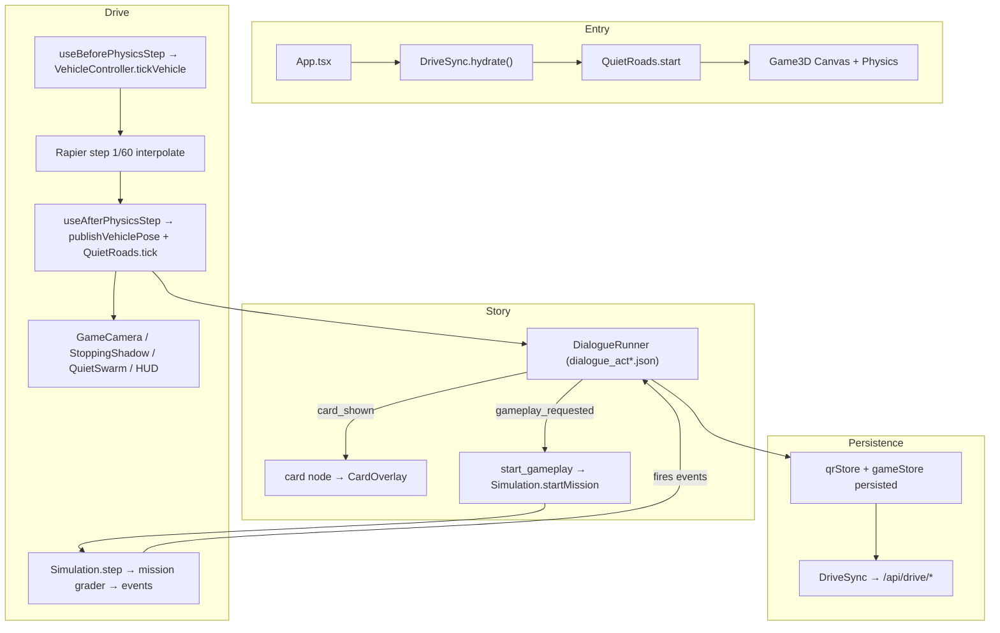

# AUDIT — Quiet Roads (the /drive 3D game)

Phase 1 reconnaissance, 2026-09-30. Branch `agent/overhaul-2026-09-30`.

Scope: the 3D teaching drive at `/drive` (repo: `drive/`, built into
`public/game/drive`). The card game at `/` and the backend are out of scope
(HARD RULE 2). Source of truth for teaching: `docs/wa-driver-guide/`.

---

## 1. Architecture

```
drive/src/
  main.tsx ─▶ App.tsx (auth + DriveSync.hydrate) ─▶ ZombieRoadWarrior ─▶ Game3D
  Game3D.tsx         Canvas (dpr [1,1.5], fov 75) + <Physics gravity=-9.71,
                     timeStep=1/60, interpolate> ─▶ Scene (KentWorld/RoadChunks,
                     Vehicle, GameCamera, TrafficRenderer, QuietSwarm,
                     StoppingShadow, HeadlightBeam, …) + HTML overlays
  quietroads/
    data/*.json      cards.json (131), dialogue_act*.json, questions_v1/2/3
    dialogue/        DialogueRunner (trigger/wait/card/branch node engine),
                     host.ts (DialogueHost iface), types.ts
    sim/             Simulation (mission router + world stepper) +
                     graders: dol, grid, ledger, ribbon, convoy, climb, rural,
                     beats, escort, chainup, pharmacy; quiet.ts (swarm),
                     noise.ts (sound falloff), vehicleObserver.ts (shadow/slip),
                     kentMap.ts + corridors.ts (geometry)
    study/           QuestionBank, SM-2 mastery, exam_40, CardDeck, CARD_FOR_TRIGGER
    actChallenges.ts  act↔scene↔mission registry (ACT_CHALLENGES, SCENE_ACT, MISSION_ACT)
  stores/            gameStore (vehicle/game, zustand+persist), qrStore (story
                     progress, persisted), qrHud (transient HUD + telemetry)
  systems/           QuietRoadsBridge (singleton: dialogue↔sim↔store↔server),
                     VehicleController (arcade setLinvel/angvel), TrafficManager
                     (highway NPCs), AudioManager, DriveSync, QuizManager,
                     RoadChunkManager, StepEventQueue, headlights, physicsStep
  input/             driveInput.ts (key/gamepad/touch merge)
  hooks/             useTouchControls, useQuiz, useGameProgress, useCompactHud
```

### Execution model

- **Physics** is Rapier on a fixed 1/60 s step with `interpolate`. The car is a
  `RigidBody` (mass 1200, `ccd`, `enabledRotations=[false,true,false]`,
  `colliders=false`) with a single `CuboidCollider` of `friction=0`. Motion is
  programmatic: `VehicleController.tickVehicle` runs in `useBeforePhysicsStep`
  and writes `setLinvel`/`setAngvel`; `publishVehiclePose` runs in
  `useAfterPhysicsStep` and writes one coherent snapshot to `gameStore`.
- **Story** is dialogue-file driven. `DialogueRunner` executes `line/wait/card/
  branch/choice/jump/end` nodes and fires/receives events. A `card` node shows a
  PINK MENACE card; a `start_gameplay` effect hands control to `Simulation`.
- **Missions** are pure graders. `Simulation.step(dt, sample)` feeds a
  `VehicleSample` to the active mission grader, which emits `*` events the
  dialogue waits on. Graders do not drive the car.
- **HUD** updates at ~10 Hz. `qrHud.frame` and the store copy of
  `velocityMph`/`engineRPM` are both throttled. Camera, audio, and wheel spin
  read `liveDrive`, which updates every physics step.



---

## 2. Card → trigger → grade, per act

Legend: **DIALOG** = a `card` node in a dialogue scene (type in parentheses);
**TRIG** = an in-world `CARD_FOR_TRIGGER` event fired by a sim grader while
driving; **—** = never opened in the drive (briefing-only / card host).

### Act I — The Lot (12/12 wired) ✓ reference model
- DIALOG: 0.2 gameplay → I-002, I-003, I-004 · 0.3 radio → I-001 ·
  1.2 gameplay → I-005, I-009 · 1.3 gameplay → I-006, I-007, I-008, I-010 ·
  1.4 still → I-011 · 1.4b still → I-012
- Grades: `tutorial_carport`, `mission_dol_drive`, `minigame_park_dol`
  (`park.clean`/`park.curb`), `stealth_dol_interior` + `chase_dol_gracie` (QTE).

### Act II — The Grid (11/31 wired)
- DIALOG: II-001, II-004, II-024 (gameplay); II-006, II-012 (still)
- TRIG: II-002 `sign.prompt:school`, II-003 `sign.prompt:regulatory`,
  II-005 `backing.mirror`, II-006 `signal.arm`, II-010 `bus.stop_arm`,
  II-012 `follow.close`, II-024 `stop.approach`, II-027 `zone.school.enter`,
  II-030 `driveway.turn`
- Grades: `mission_delivery_1_insulin`/`dropoff_pharmacy`,
  `mission_delivery_2_catfood` (`park.back_in.*`), `mission_delivery_3_radio`
  (`lanechange.*`), `mission_delivery_4_filters` (`park.parallel.*`),
  `mission_jonah_intersection` (`jonah.blowthrough`, `stop.approach`, `follow.close`)
- **Cued in-scene (20):** II-007, II-008, II-009, II-011, II-013, II-014, II-015,
  II-016, II-017, II-018, II-019, II-020, II-021, II-022, II-023, II-025,
  II-026, II-028, II-029, II-031. `CardCues` fires `card.cue:<id>` on the Grid
  beat that practises the skill; the bridge opens one card at a time.

### Act III — Central (7/31 wired)
- DIALOG: III-002, III-003, III-004, III-006 (2.5 gameplay); III-007 (3.2); III-016, III-020 (6.2)
- Grades: `mission_central_ledger` (`ledger.lanechange.clean|no_signal`,
  `ledger.crossed_solid`, `ledger.wrong_lane`, `ledger.follow.start`,
  `ledger.follow.close`, `ledger.alongside`, `ledger.pass.clear`,
  `ledger.wet.enter`, `ledger.rumble.ride`, `ledger.merge.*`)
- **Cued in-scene (23):** III-001, III-005, III-008, III-009, III-010, III-011,
  III-012, III-013, III-014, III-015, III-017, III-018, III-019, III-021,
  III-022, III-023, III-024, III-025, III-026, III-027, III-028, III-029, III-030.
  (The earlier "24" count listed 23 ids.) South of `solidY` the Ledger is wet,
  so III-024's rain stretch lengthens the stopping shadow.
- **No Act III card is on a timer or a bare coordinate any more.** Four beats were
  added to `LedgerRun` for this: `alongside` (out of his mirrors, §4.4),
  `pass.clear` (his whole front back in the mirror, §5.2), `wet.enter` (south of
  the solid white, §5.6) and `rumble.ride` (riding the line, a soft tyre, §2.5).
  `test/teaching.test.ts` drives each and asserts the card does **not** appear on
  a drive that skips the beat.

### Act IV — The Core (1/23 wired by card node; exam otherwise)
- DIALOG: IV-018 (4.2 exam). The act is `study_terminal` (10 questions) →
  `exam_40` (40 questions, 32 to pass) → `local_loop_week`.
- **Not wired (21):** IV-002…IV-017, IV-026…IV-030 (IV stills live in the card
  game; only IV-018 opens inside the drive).
- **P11 re-opened and closed the other way (2026-10-29).** The id did *not* have
  to stay `IV-001-brake`: the seed's file filter (`^(I|…|VII)-\d{3}\.json$`) never
  matched it, so the card was never seeded, `pack/04_card.schema.json` rejects the
  suffix (`card_id` pattern), and the client's ride plate was already addressed at
  `public/game/ride/IV-001/brake.webp` (`app.js:977` builds `/ride/<card_id>/…`),
  i.e. under the live name. It is `cards/IV-001.json` now — card_type `scene`, one
  decision, four options with one correct, `source` = Skill ten / 4.11, seq 4001
  derived by `scripts/card-seq.js`, master `cards/IV-001.png`, ride plate
  unchanged. `drive/test/cards.test.ts` holds the shape.

### Act V — The Ribbon (8/13 wired)
- DIALOG: V-001, V-003, V-005 (3.2); V-006 (7.1); V-007, V-010, V-012 (3.1b); V-013 (3.3)
- Grades: `mission_ribbon_merge` (`ribbon.*`), `mission_convoy_issaquah`
  (`merge.*`, `follow.green|red`), `chainup_qte`, `climb_snoqualmie`
  (`ice.enter`, `speed.over:35`, `input.gentle_streak`, `skid.worsening`)
- **Cued in-scene (5):** V-002, V-004 (`ramp.enter`), V-008 (on the ramp),
  V-009, V-011 (`ribbon.merge` / `merge.gap_open`).

### Act VII — The Dark Hours: The Road Home (10/10 wired, cards only)

- **DIALOG (10, one node each):** VII-001 `5.1.card_VII-001`; VII-002
  `5.2.card_VII-002`; VII-003 `5.3.card_VII-003`; VII-004 `6.1.card_VII-004`;
  VII-005 `6.2.card_VII-005`; VII-006 `6.3.card_VII-006`; VII-007
  `7.1.card_VII-007`; VII-010 `7.1.card_VII-010`; VII-008 `8.1.card_VII-008`
  (all three park-gap lines lead to it); VII-009 `8.2.card_VII-009`.
- **No stills, no zone plates, no seed.** Every card carries
  `variation.forced: "Act VII scaffold — no still; do not seed"`; the deck ships a
  brief for future art only. `scripts/validate-act-vii.js` fails on a `winner`, a
  `VII-*.png` on disk, a placement count other than one, a brief that breaks the
  herd's art law (gore, or figures filling the frame), or a `schedules_callback`
  with no later card to bill it.
- **Grades it rides:** `climb_snoqualmie` (5.1), `chainup_qte` (5.2),
  `straight_night_drive` / `rest_area_*` (6.2), `vantage_bridge_crossing` (6.3),
  `escort_ritzville` (7.1), `spokane_home` (8.1–8.2). The cards hang off dialogue
  beats rather than grader events, so they cannot fire on a timer.
- **Callbacks:** VII-010 (`ledger`) bills VII-002 at the Ritzville desk; VII-007
  bills V-006's blind-spot lesson in the escort. `7.1.card_V-006` stays where it
  was.

### Act VI — The Backcountry (9/13 wired)
- DIALOG: VI-001, VI-002, VI-004, VI-006, VI-010, VI-012 (6.1b)
- TRIG: VI-007, VI-008 `roundabout.approach`
- Grades: `mission_backcountry_run` (`rural.shoulder`, `rural.crest.*`,
  `rural.uncontrolled.*`, `rural.crossbuck.*`, `roundabout.*`), `straight_night_drive`,
  `vantage_bridge_crossing`, `bridge_*`, `escort_ritzville` (`nozone.*`, `moveover.*`)
- **Cued in-scene (5):** VI-003 (`rural.edge` — the gravel EDGE, fired while the
  car is still on the road; it used to open on `rural.shoulder` / `nozone.enter`,
  i.e. only after leaving the pavement), VI-005 (crest or wide turn), VI-009
  (uncontrolled), VI-011 (crossbuck), VI-013 (rural end or
  Ritzville). The earlier "(4)" counted these five ids.

---

## 3. Problems found (tagged: area · severity S1–S4 · effort S/M/L)

| # | Area | Sev | Effort | Finding (evidence) |
|---|---|---|---|---|
| P1 | Teaching | S1 | S | **Following distance — resolved.** Graders read `followFullGapM` (`config.ts`). Default feel is still 3 s dry / 4 s truck. `FOLLOW.rule = "vehicle_lengths"` grades §5.2 literally (8 m / 14 m). Cards II-012, V-012, II-014 and the mission objectives lead with the guide's sentence. |
| P2 | Teaching | S2 | S | **Surface friction — resolved for gravel and the Ledger rain stretch.** Gravel μ 0.5 on the backcountry and escort (beetle 55 mph stop 89.8 m). Wet μ 0.4 south of `ledger.solidY` (beetle wet 103.0 m). Ice stays 264.4 m. |
| P3 | UX | S2 | M | **Act select — done, and it works.** `MainMenu.tsx` offers CONTINUE / START NEW RUN and the Acts I–VI list from `ACT_ENTRY`. It was also **broken**: `Bridge.open()` asked `runner.hasScene(which)` *before* loading the act, so every entry not already in the entry chunk fell through to `0.1`. It now resolves the requested id and routes through `sceneRouter`, and `startAct` starts `2.1` / `2.5` / `4.1` / `3.1b` / `6.1b`. Bundle: act dialogue is a per-act dynamic import (`actDialogue.ts`, Act I eager), the act owning the current scene's `next_scene` preloads during the debrief, act-scoped geometries/materials are disposed on an act change while shared highway chunks survive, and the WebGL context-loss edges are a pure function in `systems/glContext.ts`. |
| P4 | Story | S2 | L | **Unwired cards — cued, and on the right beat.** The 20/23/5/5 cards in §2 open from `CardCues` while that act's mission is running; the bridge queues them and shows one at a time. Eight of them were on a timer or a bare coordinate (II-012, III-005, III-009, II-019, II-025, II-026, III-008, VI-003); each is now on the beat that practises it, with a two-sided test. |
| P5 | Perf | S2 | M | **HUD speed/RPM — throttled.** `liveDrive` updates every physics step for camera, audio, and wheel spin. `publishVehiclePose` copies mph/RPM into `gameStore` at 10 Hz. Pose still publishes every step. |
| P6 | Latency | S2 | M | **WebGL context-loss — handled.** `Game3D.GLContextGuard` pauses on `webglcontextlost` (preserving `prePausePhase`), shows a resume prompt, and on restore re-applies the tier's pixel ratio once, clears the toast, and never auto-unpauses. A second loss cannot clobber `prePausePhase` (`systems/glContext.ts`, tested). |
| P7 | Perf/Script | S2 | M | **Test runner — done.** Vitest (151 tests, 14 files) + Playwright smoke + the deterministic bench, wired to `npm test` / `npm run bench`. |
| P8 | Graphics | S2 | M | **Quality tiers — done, and the two defects closed.** `utils/performance.ts` holds a pure `stepQuality` reducer (frame time → high/mid/low) plus the per-tier effect table and `dprForTier`. `PostProcessing` takes a `tier` and mounts only that tier's effects; mobile DPR never exceeds 1.5. Two fixes on top: **(a) one DPR writer** — drei's `<AdaptiveDpr>` (and a no-op `<PerformanceMonitor>`) were mounted beside the Canvas `dpr` prop and called R3F's `setDpr()` on their own schedule; both are gone, and `GLContextGuard` re-applies the tier's ratio once on a context restore. **(b) a 30 Hz panel could not climb back** — the reducer demoted over 33.4 ms but required under 18.2 ms to recover, and a display locked at 30 Hz can never produce an 18.2 ms frame, so one stall pinned it at `low` forever. There is now one threshold (slow = over `SLOW_FRAME_MS`, recovered = not slow), which leaves the high → mid → low reducer and its hold times untouched. Draw calls are sampled from the Kent scene pass, not the postprocessing blit (§5). |
| P9 | Physics | S2 | M | **CCD telemetry — done, and now falsifiable.** `CCD` in `quietroads/config.ts` names the displacement threshold (1.5 m per 1/60 s step); `VehicleObserver` fires one `ccd.tunnel` through the existing telemetry path when a contact-free step moved further. The old headline — "zero tunnels at top speed" — could not fail: a top-speed 1/60 step covers ~0.55 m against a 1.5 m threshold. `test/ccd.test.ts` now asserts a step *larger* than the threshold emits `ccd.tunnel`, that a legal 1/60 step at top speed does not, and that the margin is wide; the four-surface lap remains as a regression net. Stopping distances unchanged. |
| P10 | Data | S3 | S | **`art-review-state` — stripped from the client deck.** The review file stays at `cards/art-review-state.json`. |
| P11 | Data | S3 | S | **`IV-001-brake` non-standard card id — re-opened 2026-10-29 and closed by renaming.** The old closure kept the suffix because "nothing rejects it". Two things did: `scripts/seed-cards.js` only reads `^(I\|…\|VII)-\d{3}\.json$` (so the card was never seeded) and `pack/04_card.schema.json`'s `card_id` pattern. The client was already asking for the live name (`/ride/<card_id>/brake.webp` → `public/game/ride/IV-001/brake.webp`). It is `cards/IV-001.json` now — `scene`, 4 options, `source` Skill ten / 4.11 Traffic light signals, seq 4001 from `card-seq.js`. See §2 Act IV. |
| P12 | UX/a11y | S3 | M | **Accessibility — done.** Reduced motion (earlier pass) plus, in `drive/src/input/driveInput.ts`, a persisted `binds` table (defaults are the shipped arrows/WASD set) that `mergeDriveInput` reads; `input/textSize.ts` three persisted steps applied to dialogue, card and HUD type as a CSS variable; and a `colorblindHud` flag whose cue (PASS/MISS word + ✓/✕ shape) rides on the grade result. Spoken lines: every `line` node already has text, so `DialogueBox` was left alone. |
| P13 | Perf | S3 | M | **Per-frame allocations — done.** `vehicleObserver.ts` copies into one owned previous-sample object instead of `{ ...s }`; `Simulation` reuses its ObserverOut, SimFrame, CueProbe and `blocked` closure; `ZoneField` ping-pongs two owned position buffers; the bridge reuses its sample and walker-input objects. Identity contract locked in `test/alloc.test.ts`. |
| P14 | Graphics | S3 | M | **Kent draw merge — done.** `sim/instancing.ts` batches the repeated plain buildings into one InstancedMesh per material (42 → 4 batches) and the dashes into one per colour; `ContinuousRoad` batches the segment meshes the same way. Colliders are untouched: one fixed CuboidCollider per building and one per solid segment. DOL/PHARMACY/WAREHOUSE keep their own components. |
| P15 | Story | S3 | S | **II-006 / II-012 on the road — done.** The two card nodes left the Act V briefing still (3.1 points at 3.1.2 / 3.1.5 now); `CardCues` takes II-006 on the signal beat, and II-012 / III-005 / III-009 on `ledger.follow.start` — the follow beat **beginning**, not the `follow.close` grade they used to hang off, which meant holding the gap correctly never showed them. |
| P16 | Story | S3 | M | **Deac never drove the line his own card describes — done.** III-001 "Your Wheel" is hand-written (`pack/00_README.md`), and it has him *"sweep the glass, hold the lane, then take one merge late on purpose so you can watch what that costs."* `LedgerRun.advanceLead` moved him in a dead-straight line at constant 18 mph and **never changed lane**; `leadHeading` was pinned to `Math.PI / 2` in `reset()`, so the model would have crabbed sideways with its nose south even if he had. The merge III-001 and III-013 are both written about did not exist on the road. Fixed by `DEAC` in `sim/ledger.ts`; his beats are witness-gated because III-001's debrief is *"You saw the merge you do not take."* |
| P17 | Teaching | S3 | S | **A cue's comment described a different actor than its code — done.** III-013 was taken on `ledger.merge.slow` (the **player** under 12 mph on the ramp) under a comment reading *"Deac took one merge late... The late merge IS the beat."* The card opened on a beat it was not written about and stayed shut through the one it was. It now hangs on `deac.merge.late`. Worth remembering as a class: a comment naming a beat is not evidence the beat is wired, which is why `test/deac.test.ts` asserts the event name rather than trusting the prose. |
| P18 | Sim | S3 | S | **`alongside` / `pass.clear` measured in world axes — done.** Both read a raw `dy` off Deac's position, which was correct only because he drove perfectly straight. Once he merges, a player in the right lane *behind* him satisfies `\|dy\| < 8` against his lateral travel and is graded as riding alongside his trailer. Now projected into his heading frame, which is what `ALONGSIDE_DX_M`'s comment ("lateral band around the lead's lane") always claimed. |
| P19 | Map/UI | S3 | S? | **Act III lane handedness was logged as a mirror. A check on 2026-10-05 does not find one.** Ledger lanes are `x0: 260, x1: 270, count: 3`. `LedgerMarks` calls `x0 + 1/3` the line between right and middle, and the retest spawn at `x: 261.67` is commented "right lane". That x is lane index 0. Index 2 is the left third, which is the passing lane on a right-hand road, and that is what `trackLane` calls it. The two agree. Do not flip them. A screen look can still overrule this; the grades that hang off `wrong_lane`, `crossed_solid`, and `merge.clean/slow` move if the index is reversed. |

---

## 4. Decisions (owner: fix them)

- **BD-1 — Following distance. SIGNED OFF (owner, 2026-10-05).** The decision is
  to leave it: drive feel stays the seconds count (`FOLLOW.rule = "seconds"`,
  3 dry / 4 truck) so the gap still grows with speed; the grader does **not**
  switch to `vehicle_lengths`. Teaching copy on II-012, V-012, II-014, the
  Ledger/convoy/escort objectives, and the fallback quiz keeps leading with the
  guide's sentence: leave at least twice the length of your vehicle.
  `followFullGapM(..., "vehicle_lengths")` grades that distance literally
  (car 8 m, truck 14 m) if the switch is ever flipped. II-012 and V-012 cite
  §5.2 Space, not §5.4 Time. This was a sign-off, not a code change.

- **BD-2 — Hand-signal citation. Resolved.** Cards that cited "2.5 Vehicle
  Maintenance (Hand signals)" now cite "4.14 Turning" (II-006, II-016, II-022,
  III-019, and the same strings in `cards/`). The practised rule is unchanged.

- **Quiet pressure tied to the graded skill. Decided and done (owner,
  2026-10-05).** The Quiet ARE the zombies — one herd (`QuietField` in
  `sim/quiet.ts`, spawns in `kentMap.ts`, drawn by `QuietSwarm`); no second
  herd. A missed grade (too close, rolled stop, wrong lane, crossed solid, a bad
  merge, a yanked shoulder — the fail events the graders already fire,
  `GRADE_MISSES` in `sim/pressure.ts`) raises awareness on the Quiet near the
  car; if none are close enough to see it, existing dormant Quiet move onto the
  roadside ahead and wake, so the sprites are on screen. A pass raises nothing.
  Decay still works. A miss alone tops out at ALERT (`PRESSURE.MISS_CAP`), so
  the swarm stays the noise system's verdict — reinforce, don't add chaos.
  `test/pressure.test.ts`, 5 two-sided tests through the real graders.

- **One voice, one interface, one sound set. Decided and done (owner,
  2026-10-05).** One accent (`SCENE_ACCENT` — the Menace pink from
  `cockpit/tokens`) tints the frame and the badge in every act; one cockpit on
  every act (`sceneSpec.ts`: driveView `cockpit` + maneuver cam); the Quiet
  meter on every playable act (`quiet: true` everywhere, and `QuietHUD` reads
  the flag). Spoken lines use one in-cab treatment; radio and CB beds stop being
  a different voice per act — `dialogue/voice.ts` is the one speaker voice table
  (Deac and Jonah are the CB voice in every act, Mom/Ray/Lumi/Sori the radio
  voice), with the per-line `voice_bed` override (act 8's pattern) still winning
  for scenes that need the other medium. AudioManager stays the one procedural
  set — no second engine/wind/impact per act. Card copy and
  `pack/23_THE_SPOKEN_DICTIONARY.md` untouched. `test/voice.test.ts`.

## 5. Baselines

**There is no current browser baseline.** No headed browser run happened in the
2026-10-04 pass or in the campaign/cues/debrief/graphics pass that followed, so
there is no frame rate, no draw-call count and no time-to-first-frame number to
quote. Every graphics claim in these docs is a unit test or a code fact.

What the 2026-10-01 run actually recorded, and why it is not a result:

| Viewport | Canvas up | First frame | reported "FPS" |
|---|---|---|---|
| Desktop 1280×720 | 0.8 s | 1.1–1.6 s | 30 / 29.6 |
| Mobile portrait 390×844 | 0.9 s | 1.1 s | 30 / 29.5 |

Those "30 / 29.6" figures are the **sample window's own 30 Hz clock** — the
cadence the harness measured over its 600-frame window — not the build's frame
rate. Reporting them as FPS was a mistake and they are withdrawn as a number.
Likewise `gl.info` draw calls and triangles read 1 because three resets `gl.info`
at the start of every `renderer.render` and `EffectComposer` renders once per post
pass with a fullscreen blit last; the read landed on that blit, not on the scene.
The sample now comes from the Kent scene pass (`KentWorld`'s `onAfterRender` via
`attachScenePassProbe` in `utils/performance`), so the next browser run can trust
it. JS heap, a 4G throttle, and input-to-response on a driving lap are all still
unmeasured.

The **sim/grader-level** deterministic baseline (event correctness,
stopping distances, per-mission step cost) is recorded in §6, and that one is
current and asserted by `test/ccd.test.ts`.

## 6. Deterministic sim baselines (headless)

Source of truth: `drive/bench/baseline.json`. **Regenerated** in the 2026-10-05
pass, because a mission-logic change did land (`9c84d85`, Deac's drive script)
and the Act III event list genuinely moved — it now records
`deac.signal → deac.merge.late → card.cue:III-013`, which is the merge and the
card written for it, in order, off a deterministic lap. Nothing physical changed:
the stopping-distance figures are byte-identical to the previous file.

The step-time column below is from a **single** run and moves with machine load.
The defensible statement for `9c84d85` is the interleaved A/B, 3 runs each:
Act III p50 **60.1 / 60.2 / 60.6 µs** with the change against
**61.0 / 62.4 / 60.3 µs** without — no regression. One intermediate reading of
68.2 µs was *not* the change: every row, including the untouched Act II / V / VI,
rose together, which is the signature of a loaded machine rather than one grader.

Sim step CPU cost (µs) — one scripted lap per act, fixed 1/60 s step:

| Mission (act) | steps | step µs p50 | p95 | max |
|---|---|---|---|---|
| mission_delivery_1_insulin (II) | 1200 | 59.9 | 127.7 | 1240.5 |
| mission_central_ledger (III) | 1200 | 60.1 | 84.4 | 542.3 |
| mission_ribbon_merge (V) | 1200 | 58.3 | 65.3 | 573.4 |
| mission_backcountry_run (VI) | 2000 | 56.9 | 65.6 | 317.0 |

(max values include the first-step/JIT warm-up. p95/max are carried over from the
previous capture — only p50 was re-timed here, since only p50 is the number the
A/B rests on.)

Stopping distance at 55 mph (m) — `stoppingDistanceM` (reaction 1.5 s + braking):

| config | m |
|---|---|
| beetle_dry | 74.7 |
| highway_dry | 85.6 |
| truck_dry | 102.6 |
| beetle_gravel | 89.8 |
| beetle_wet | 103.0 |
| highway_ice | 264.4 |

Grade events confirmed to fire on the scripted laps: `stop.approach`,
`stop.rolled`, `ledger.follow.close`, `rural.uncontrolled.rolled`,
`rural.crossbuck.rolled`, `roundabout.rolled`, `ramp.enter` (see baseline.json).

---

## 7. Phase 3 progress (this session)

| Item | Area | Commit |
|---|---|---|
| Gravel surface friction — stopping shadow correct on unpaved (§5.6/§4.15) | P2 ✅ | `1bf0d52` |
| Act select on the title screen — no forced Act I replay, I–III replayable | P3 ✅ | `bc83818` |
| WebGL context-loss handled (pause on loss, clear on restore) | P6 ✅ | `6b75a9b` |
| Test/bench harness (Vitest + Playwright + deterministic bench) | P7 ✅ | `08f9153` |
| Following-distance config + guide-led teaching copy | P1 ✅ | this session |
| Hand-signal citations → §4.14 Turning | BD-2 ✅ | this session |
| Wet μ on the Ledger south of solidY | P2 ✅ | this session |
| In-scene cues for the previously unopened II/III/V/VI cards | P4 ✅ | this session |
| HUD speed/RPM store writes at 10 Hz (`liveDrive` stays 60 Hz) | P5 ✅ | this session |

| Stripped `art-review-state` from the client deck | P10 ✅ | this session |

| Quality tiers — one DPR owner + a pure frame-time reducer | P8 ✅ | `951cde9` |
| CCD displacement telemetry, no feel change | P9 ✅ | `4c367f4` |
| `IV-001-brake` closed without renaming | P11 → **re-opened** | `4785455` (old closure) |
| Remappable keys, text size, colorblind cue | P12 ✅ | `5624665` |
| No allocation on the physics step | P13 ✅ | `fd46905` |
| Kent draw merge (instanced, colliders untouched) | P14 ✅ | `0a92afe` |
| II-006 / II-012 open on the Ledger drive | P15 ✅ | `4b9a6e2` |
| Act dialogue split out of the entry chunk + preload + context-loss edges | P3 ✅ | `2f9aa38` |
| Grade debrief panel on a grade event | — | `8f29dbc` |
| Touch root overscroll + audio resume in the first gesture | — | `c7e688b` |
| Scene routing across act boundaries (`sceneRouter`), Act VI owns 7.x, 7.3 → 8.1 ends the campaign | — ✅ | this pass |
| Act select fixed — `open()` no longer asks `hasScene` before loading, so all five entry scenes start | — ✅ | this pass |
| Every cue moved off a timer onto the beat that practises it; coverage measured, not listed | — ✅ | this pass |
| The grade panel reads `week.elapsed`'s own verdict; a grade with no cue still shows | — ✅ | this pass |
| One DPR writer (`<AdaptiveDpr>` gone); a 30 Hz panel can climb back out of `low` | — ✅ | this pass |
| Draw calls sampled from the Kent scene pass instead of the post blit | — ✅ | this pass |
| CCD threshold asserted both ways (fires over it, quiet under a legal step) | — ✅ | this pass |
| Deac drives the line III-001 writes about — arm out, hold, one **late** merge; heading from real displacement | — ✅ | `9c84d85` |
| III-013 moved onto the beat its own comment named (`deac.merge.late`, not the player's `ledger.merge.slow`) | — ✅ | `9c84d85` |
| `deac.*` beats are witness-gated — a player 100 m back never receives the card | — ✅ | `9c84d85` |
| `alongside` / `pass.clear` projected into Deac's heading frame, so a follower is not graded as abreast | — ✅ | `9c84d85` |

### What the 111 tests did not prove, and now do

The suite was green at the previous HEAD and none of that was campaign evidence:

- **Nothing crossed an act boundary.** `bundle.test.ts` checked that `loadAct`
  returned files containing the right scene id. The chain itself — 26 handoffs,
  including `6.3 → 7.1` with `7.1.card_V-006`, and the `7.3 → 8.1` end — was
  untested, and was in fact broken at every one of them. It is now walked on a real
  `DialogueRunner` through `sceneRouter`.
- **Card coverage was a hardcoded id list.** It could not tell a cue that opens on
  the skill from one that opens because a timer elapsed, which is how six cards
  shipped. `coverage.test.ts` now consumes a set measured by driving the missions,
  and `teaching.test.ts` asserts each id fires on the skill *and* stays shut
  without it.
- **The debrief's week path was dead.** It listened for events nothing emitted.
  It now reads the verdict off `week.elapsed`.
- **The 30 Hz tier trap was untested**, and the CCD "0 tunnels" result could not
  fail. Both are now falsifiable.

## 10. Chain-up loop + shop continuation (2026-10-28)

The chain-up loop closes end to end (see `AGENT_LOG.md` 2026-10-28 Phase 3 and
`drive/test/chainup-loop.test.ts`): every shop `end` carries a `next_scene`
(`2.6→2.3c`, `2.7→2.3d`, `2.8.close_branch` → `5.1` return / `5.1` re-climb /
`2.4`), `2.8.buy_chains` grants the `chains` item the readers (`5.2.entry`,
`4.2.chains_branch`) gate on, `chainup_return` is set by the shop return, and the
`once` continuation triggers at 5.1 / 5.2 / 8.1 are gone. Safe: the sim latches
those events per run (`ClimbRun.arrived`, `ChainupRun.done`,
`GridRun.parallelDone`), so nothing refires within a visit, and save/load
semantics are untouched (`restore()` still spends `once`s). Open, deliberately:
a swarm retry at 8.1 loses the `once` story barks (city.enter, quiet.pass_cluster,
mya.wake, checkpoint/park beats) — the scene completes but plays sparse, the same
accepted trade-off as 3.3/5.1 retries; a per-visit re-arm would need runner
changes and is queued with the 8.x work.

### And what the 2026-10-05 pass added (`9c84d85`)

The previous pass moved cues off timers but never asked whether the *story's*
subjects behave as written. Deac did not: see P16. Three things the earlier suite
could not have caught, because each was a claim made in prose and asserted in
none:

- **The merge did not exist.** III-001 and III-013 both describe Deac taking a
  late merge; he drove a straight line forever. Nothing in the suite failed,
  because no test asserted that a character does what his card says he does.
- **A cue listened to the wrong actor.** III-013's comment named Deac's merge; its
  code took the player's (P17). Coverage was green — the card *was* reachable —
  and it was still opening on the wrong beat.
- **`alongside` was world-axis.** It stayed correct for years only because the
  truck never moved laterally, so the bug was latent until he did (P18).

The pattern worth carrying: *a green suite proves the wiring matches the spec,
not that the spec matches the story.* Where a hand-written card states a
behaviour, there should be a test that the behaviour happens.

Still open: a browser `?profileDrive` pass on a signed-in device and a
full-campaign playthrough. **No headed browser ran in this pass**, so there is no
frame-rate or draw-call number to quote. Headless tests re-run on
2026-10-05: **163/163** across 15 files. `tsc --noEmit` exit 0.
The commit message says the build was 818 modules and the entry chunk 3,958 kB.
This file previously said 3,957 kB. That build was not re-run in the check.
`bench/baseline.json` was regenerated (`generated_at` 2026-10-05T06:44:19Z), not
restored. Stopping distances are unchanged: 74.7 / 85.6 / 102.6 / 89.8 / 103.0 /
264.4 m. The committed step timings are the slower run (Central p50 67.7 µs, was
60.2). The 60.1 / 60.2 / 60.6 µs figures are not in the file.

## 8. Owner decisions executed (2026-10-05c)

The three open decisions above are closed (§4). Headless re-run from `drive/`:
**172/172** across 17 files (was 163/15), `tsc --noEmit` exit 0.
`bench/baseline.json` stayed byte-identical — `sim-bench.test.ts` rewrites it on
every run and no physics constant changed, so the run's copy was restored, not
committed. Deliberately untouched: the Deac pass, III-001's trigger
(`ledger.lanechange.start`), Act III lane handedness (index 0 = right, index 2 =
left passing), `DEAC.witnessM` = 45 m, and all card copy. Still open and still
needing hardware: the `?profileDrive` browser pass and a full-campaign
playthrough. **No headed browser ran** (none available) — no frame-rate or
draw-call number is quoted anywhere.

## 9. Stage pads and one-way stops (2026-10-15)

Played locally. The tutorial completed on `x < 30` and under 1 mph, so the bay under the carport never counted, and holding the brake at a crawl engaged reverse before that razor could hold. Home is `stageSpot(markers.carport)` for 0.3 s under 2.4 m/s. `VehicleController` holds a standstill for 0.5 s before S becomes reverse.

`titus_central.approach` is 0 (east). `meeker.approach` is π/2 (south). `headingDelta` greater than a right angle does not enter the stop. The end-of-block, pharmacy, Priya, and warehouse waypoints are `stageSpot` pads. `dol_approach` is the driveway gate, and the DOL pin is that gate (`markers.dol_gate`), not the middle of the lot. `StageSpot` draws the ring on `navTarget()`. Carport legs are 2.8 m.

Tests: 174/174, including an eastbound Titus roll, a westbound pass that stays quiet, and a carport return that ignores the street. `bench/baseline.json` restored.

A drive-through used to spend the ring (`tutBlockEnd` on the zone enter) and move the pin with no line. Entry is now the plow: `carTouchesDisc` / `carHitsRect` with `NOSE_REACH_M` 2.6. The chassis center alone missing the ring is not a miss.

Two implementation notes worth keeping: (1) the pharmacy/Bea dropoff fires
`door.slam` / `park.back_in.*` on the raw event bus, not the grade funnel, so
those events do not raise pressure (or reach the card book) — pre-existing
plumbing, not re-plumbed here; (2) `rural.shoulder.yank` fires every step while
the mistake continues, which is why a pressure application is throttled to one
per second.

## 11. Phase 4 — radio not tablet, Grandma on screen, an unsigned clipboard, 6.2's clock (2026-10-29)

**The Chorus never had a screen.** `pack/01_BIBLE.md:37` gave the Menace "an
aftermarket nav tablet"; `ref_cockpit.jpg` was locked *because* of it ("poisoned
(tablet / digital …)", bible problem #5); and two story cards were written around
a device the art can never light. The radio was already in the scene's own first
sentence, and the deck is the canon prop (`cards/I-011`: "a physical CB radio
deck with knobs and a dark face, the coiled cord plugged into that radio"). So the
tablet left the fiction and the lesson stayed exactly where it was:

- **II-009** — the device is "the old deck", the eyes drop to "the dial", and the
  fix is unchanged: eyes up, hands on the wheel, the radio can talk to itself.
- **III-027** — "The Tablet Wakes" → **"The Chorus Wakes"**; the CB deck bolted
  to the doghouse crackles up mid-change. Ids, option ids, `correct` flags and
  every `state_delta` are untouched — only device nouns moved.
- **III-022** — "Check the tablet for which way he is going" → "Check the net".
- `src/manifest.js` `FAIL_PLACE["II-009"]` — "the tablet" → "the radio" ("Six at
  the radio." in the fail dispatch).
- `drive/src/quietroads/data/cards.json` re-exported for those three cards, per
  `docs/DRIVE.md:40`.

**Tablet stills — flagged, not redrawn.** Art is its own pipeline. These are the
image briefs that still describe a tablet, so whoever regenerates Act II/III art
knows which plates argue with the fiction:

| Card | Field | What the brief says | Verdict |
|---|---|---|---|
| `II-009` | `image_brief.foreground` / `.midground` / `.read` | "an aftermarket tablet LIT as a digital radio — station name and FM channel readout", "the lit tablet", "the lit screen below" | **Redraw as the deck** — the plate argues with the card |
| `III-027` | `image_brief.subject` / `.foreground` / `.read` | "tablet on the doghouse lit", "no readable UI on the tablet — only a glow", "the tablet is lit" | **Redraw as the deck** — same argument, wrong device |
| `II-001`, `I-011`, `V-002` | `image_brief.midground` | "aftermarket nav tablet dark" / "center-dash tablet dark" | Optional — a dark tablet is a dark dash object, no story claim |
| `I-003`, `V-002` | art notes | "no GPS map on tablet" / "dark blank tablet only" / "tablet dark/non-competing" | Keep — already forbid a lit device |
| `VI-013`, `VI-004`, `VI-011` | briefs | "no lit tablet", "no lit navigation screen", "no lit GPS tablet" | Keep — the radio-only lock doing its job |
| `V-001` | `forced` (QA record) | rejected take 8, "distracting tablet map" | Keep — a record of a rejected plate, not a brief |


**Grandma is on screen once, and it is the last mile.** She was already canon as
east ("She's in Spokane. She got on the bus.", `act3.json:512`), and 8.2 already
had a gray blanket for Gracie — held by Ray. Now the third figure at Division
Street comes out of the checkpoint hut (`8.2.gm1`–`8.2.gm6`), says "I got on the
bus. It went east. So did you.", closes the note out loud ("I told you. Come home
slow." / "…I did."), and takes the blanket out of Ray's hands to put it over the
roof herself. Cue renamed `cutscene.ray_blanket` → `cutscene.grandma_blanket`
(`sim/spokane.ts` still owns and emits it); `voice.ts` gains `GRANDMA` (bedless,
low) because `voice.test.ts` fails any speaker missing from the campaign table;
the act-8 `characters` entry carries `name: "{GRANDMA}"` and no `portrait_dir`
(no art exists, and the schema requires only `name`). `{GRANDMA_INITIALS}` now
defaults to `"— G."` in both places it lives (`dialogue_act0-1.json` meta and
`qrStore.ts`, which overrides meta at boot via `setPlaceholder`), and the note's
own literal em dash was removed so it renders "Come home slow. — G." and not
"— — G.".

**The clipboard stopped signing itself.** `manifestFor(act, driverName)` stamped
the signed-in student's real name onto Deac's manifest. It is in-fiction
paperwork, so it now always ships `driver: "________"` and the start button does
the signing (already the contract: `public/game/feel.js:771` renders
`row.driver || "________"`). Signature and both callers updated
(`src/routes-run.js`, `scripts/validate-act-v.js`); `MANIFESTS` is exported so a
test can hold it. New `scripts/test-manifest.js` (node assert, no DB) locks three
things: the signature line stays blank even if a name is passed, no act row
carries a placeholder, and Act VI's cargo and its end beat name the same load.

**Act VI finally says what it carries.** `MANIFESTS.VI.cargo` was
`"TODO — Claude: Backcountry load"` in production. The run starts at the
Ellensburg fuel depot and ends at a gate that opens on diesel, so the cargo is
"Diesel — four cans for the ridge plows", and the Act VI end beat now names it in
the same breath as the chains ("…chains are on the floor, the diesel for the
ridge plows is strapped down in the back, and the word is dawn.").

**6.2's clock now agrees with the exam.** The exam teaches it (questions_v1
`c1_008`): on a first-year intermediate license, 1–5 a.m. is a 25+ supervisor or
nothing — and Ali drives the road home alone. 6.2 was already 90% compliant (she
sleeps at the rest area, wakes at five) but never said so, and nothing in acts
5–8 stamps a clock, so the one scene with a time in it was the one scene that
could contradict the rule she had just passed. Two direction cards pin it now:
`6.2.sleep` "Night. Parked before one." and `6.2.morning` "Five a.m. … The
one-to-five is over and so is the sleep."

**Verified**: 188/188 vitest green, `tsc --noEmit -p drive/tsconfig.json` exit 0,
`scripts/test-manifest.js` ok, `validate-act-v.js` baseline unchanged
(V-006/V-008/V-013 fail exactly as before — pre-existing, out of scope),
`bench/baseline.json` restored after the run. Dialogue JSONs stay CRLF.

**Still open from this phase**: the II-009/III-027 plates (table above); the
bible's numbered problems #5 (nav tablet in/out), #10 (same question, art side)
and #20 (signature) are fixed in code but get marked fixed in Phase 6's re-audit.


## 12. Phase 5 — the campaign's last card (2026-10-29)

`8.3.end` used to unlock two strings nobody implemented: `credits` and
`postgame.deacs_route` (bible problems #14 and #8). The player's last image was
whatever line happened to be on screen. The ending now ends on a card, and the
card is the run's own verdict:

- `8.3.13` (the chair, the hand flat on the desk) → `8.3.credits_gate`.
- `deac_answered` → `8.3.credits_deac`: "The last card is the radio: a man across
  a pass, very faint, very far. …Seatbelt."
- otherwise → `8.3.credits_static`: "The last card is the room: a chair, a desk, a
  hand flat on the wood, and a radio that says nothing back."
- `8.3.12b` ("…Yeah. Same time tomorrow.") used to jump straight to `8.3.end`, so
  the static path skipped the desk beat *and* the card; it now continues into
  `8.3.13` like the answered path does.
- `8.3.end` unlocks `credits` only. `postgame.deacs_route` is gone: it named a
  postgame that has never existed, and leaving it in the save data promised one.

`drive/test/ending.test.ts` (4) walks 8.3 on a real `DialogueRunner` both ways
through the `respect >= 80` gate — answered: `8.3.12` fires, `deac_answered` is
set, the card is Deac's; static: `8.3.silence`, the card is the room — plus the
unlock audit (last unlock is `credits`, never `postgame.deacs_route`) and a scan
of every act-8 node for the removed string.

Verified: 192/192 vitest (188 + 4), `tsc --noEmit` exit 0, `validate-act-v.js`
baseline unchanged, `bench/baseline.json` restored.


## 13. Phase 6 — the whole campaign walks, and the re-audit (2026-10-29)

**The walked chain.** `drive/test/fullchain.test.ts` (4) plays scene `0.1` to
`game_complete` on one real `DialogueRunner` loaded with all twelve dialogue files.
Every earlier chain test proved one link — that a `next_scene` has a destination
(`bundle.test.ts`), that the chain-up loop closes (`chainup-loop.test.ts`), that 8.3
ends (`ending.test.ts`). None walked the campaign; this does, and it takes the forks.

How it moves without a driver: it fires a `wait`'s own `wait_for`, answers choices
from a policy (first option that can still reach a hand-off unless the test names
one), resolves `card` nodes correct, and when a gameplay scene idles at its `*.go`
resident end — or at a bark leaf with no `next` — it fires the one trigger whose
target still reaches an end node that hands off. Retry and atmosphere events
(`noise.*`, `mission.fail.*`, `mission.complete.*`) are skipped because they re-enter
the scene instead of advancing it. Fired events are scoped per scene visit, because
the same name can finish two scenes (`park.parallel.clean` finishes 2.3d *and* 8.1's
last park). A scene with no advancing trigger fails the walk.

What it proves:

- **One visit per scene, 37 deep**: `0.1 → 0.2 → 0.3 → 1.1 → 1.2 → 1.3 → 1.4 → 1.4b
  → 2.1 … 8.3`, `game_complete` set, `credits` unlocked.
- **Both forks**: 1.3.C wait vs. honk, and 3.3.C keep-going (→ 3.4a) vs. stop for the
  stall (→ 3.4) — the two paths must both reach Spokane, and they do.
- **The exam twice**: passed at the terminal, and failed once → the retest week
  (4.3, `week.elapsed`) → 4.1 with `exam_attempts` → 4.2 passed → 6.1b. `exam_passed`
  and `exam_failed_once` both end true, `exam_attempts` is 1, and the two visits to
  4.2 bracket 4.3 in the right order.
- **No hand-off names a scene the runner cannot start**, and the walk ends on
  `8.3 → ""`.

**The bundle builds.** `npm run build` in `drive/` (what Docker stage 1 runs): 821
modules, entry `index-*.js` 3,972.56 kB / 1,312.14 kB gzip, `dialogue_act8` 28.55 kB.
The emitted act8 chunk carries the Grandma beat, `credits_gate`, "…Seatbelt." and
"Come home slow", and no longer contains `postgame.deacs_route`; the entry chunk
carries `GRANDMA_INITIALS: "— G."`. `public/game/drive` is untracked build output,
so the build leaves the working tree clean.

**The re-audit** is `docs/STORY_BIBLE.md` §12: every §10 problem and §11 question is
now FIXED (with the phase and the mechanism named), CHANGED (deliberately different),
or STILL OPEN (with the reason). The two story items this pass did *not* touch were
I-009's placement in 1.2 and the Kent/Renton lot name — both author calls.

**Closed the same day** (follow pass, §14): I-009 moves into 1.4 (`c6bb2fa`), the
Lot is Kent (`58340d5`), IV-001 becomes a live card (`adb9ffc`), and 6.2's clock
is held by a test (`2954a6b`).

**Verified**: 196/196 vitest across 21 files (192 + 4 new), `tsc --noEmit` exit 0,
`scripts/test-manifest.js` ok, `validate-act-v.js` baseline unchanged
(V-006/V-008/V-013 as before), `bench/baseline.json` restored after the run.


## 14. The follow pass — the author calls, IV-001, and 6.2's clock (2026-10-29)

Four commits on `story/act-vii-road-home`, one per item:

- `c6bb2fa` **I-009 → 1.4.** `1.2.card_I-009` is gone; `1.2.card_I-005` hands to
  `1.2.4`, so 1.2 is I-005 → pull-in → `1.2.go` park → bark → `1.2.end` → 1.3.
  `1.4.card_I-009` hangs off `1.4.5` ("I'm going back for her. Tomorrow.") and
  hands to `1.4.radio`. The card's opener is "The engine's off." because the
  scene is the engine-off carport; ids, options, flags and citations untouched.
  `drive/test/fullchain.test.ts` now logs `card_shown` (+`scene_started`) and its
  fifth test asserts I-009 opens exactly once, in 1.4, on `1.4.card_I-009`.
- `58340d5` **L-002 is Kent.** `pack/01_BIBLE.md` §7 zone map and L-002; a
  *Location canon* note records the correction. `STORY_BIBLE`'s location row is
  one Kent row. "Since Renton" in `cards/II-007.json` is weather, not the lot.
- `adb9ffc` **IV-001 is live.** `cards/IV-001.json` (was `IV-001-brake`, which
  the seed's file filter never matched and the schema's `card_id` pattern
  rejects): `scene`, one decision, four options with one correct, `Skill ten:
  city driving – part one` + `4.11 Traffic light signals`, seq 4001 derived by
  `card-seq.js`, master `cards/IV-001.png`, ride plate
  `public/game/ride/IV-001/brake.webp`. `variation.time_of_day` was the invalid
  `"overcast"`, now `"afternoon"`; `continuity` drops the unregistered
  `encore_footwell` token (no `refs/` file exists; the Encore cockpit lock carries
  the pedal box), so `compile-images.js --card IV-001` compiles.
  `drive/test/cards.test.ts` (6) holds shape, citations, assets and IV-002's
  "two pedals" setup. P11 is re-opened in §2/§3 and closed by renaming.
- `2954a6b` **6.2's clock.** Both paths (stop at the rest area; push through →
  microsleep → rumble strip → forced stop) converge on `6.2.sleep` "Parked before
  one." and `6.2.morning` "Five a.m. … The one-to-five is over", so no path drives
  in 1–5 a.m. and no dialogue changed. `drive/test/straight.test.ts` (6) pins the
  node order on both paths, asserts those are the scene's only clock stamps, and
  fails on any hour named inside 1–5 a.m.

**Verification after the pass**: 209/209 vitest across 23 files, `tsc --noEmit`
exit 0, `validate-citations.js` ok (121 cards — IV-001 is now visible to it),
`test-manifest.js` ok, `compile-images.js --card IV-001` ok, full
`compile-images.js` unchanged (pre-existing II-011 / IV-007 / V-006 / V-008 /
V-013), `validate-act-v.js` unchanged (V-006/V-008/V-013), `validate-act-ii.js` /
`validate-act-iii.js` unchanged, `bench/baseline.json` restored. No seed, no
deploy.

**The clipboard signature** (question asked of Phase 4): the blank was
deliberate as *a blank*, but the theory that Deac's initials at VI-013 fill it is
false — `cards/VI-013.json` has him initial his own hand-ruled clearance sheet
("a line at the bottom with his initials on it"), a different document, and the
Act VI end beat writes no signature ("The sheet goes in the glovebox…"). A blank
line is not a signature, so `manifestFor()` signs the courier the run belongs to:
`driver: "A. Okonjo"` (`pack/01_BIBLE.md:35`, canon). `feel.js` still falls back
to `"________"` when a row has no driver. `scripts/test-manifest.js` holds both
halves: the signature is the courier, and a stray name argument is ignored.

**Still open:** the headed `?profileDrive` pass and a device playthrough (no
hardware); the II-009 / III-027 tablet plates; and, new, the I-009 still is an
afternoon lot plate now playing in a night scene — an art call, not a code one.


## 15. Act VII: the rules, the deck, the wiring, the paper (2026-10-29)

Five commits, one per item:

- `1681345` **the act opens.** `pack/43` (header + the section that said CLOSED),
  `pack/00_README`, `README`, `pack/44`, `docs/ACT_DRIVE_ALIGNMENT`, `STORY_BIBLE`
  §1/§3, `ROADMAP`, `PLAYTEST`. What is allowed: VII cards. What is not: VII
  stills, zone plates, seeds. What does not change: the herd's art law (posture
  and stillness, never gore, never filling the frame) and Act V's own ban on VII
  material on a Ribbon card.
- `bb78ac4` **the deck.** `cards/VII-001`…`VII-010`, citations only from pack/07 +
  pack/08 (5.1, 5.6, 2.5, 4.4, 4.18, n/a), every card forced "no still; do not
  seed", one correct answer each with a 28.6% worst-position share. `pack/04`
  gained the continue-only `beat` branch the client has always assumed
  (`CardOverlay.tsx:7`, `app.js:continueOnly`); I-007 stays valid.
  `scripts/validate-act-vii.js` added and wired into `npm run validate-cards`;
  deck re-exported to 131 (additive).
- `e343149` **the wiring.** Ten card nodes, one per beat (5.1, 5.2, 5.3, 6.1, 6.2,
  6.3, 7.1 ×2, 8.1, 8.2). Nothing renumbered; each anchor hands to the card and the
  card to the anchor's old target. `fullchain.test.ts` (6) and `coverage.test.ts`
  (`DRIVE_ACTS` + VII) hold it; `validate-act-vii.js` fails on zero/two placements.
- `1aadc80` **the paper.** 4.2 `lic1`–`lic5`: six months on the permit, 40 day /
  10 night supervised with a 3+ year licensed driver, 50 attested, the log that is
  Deac's clipboard; the intermediate 1–5 a.m. and passenger limits; the Authority's
  in-fiction waiver of the waiting period only. `guide_refs` carry DG 1.8. Hank
  gets the guide's real agricultural exception and refuses the dark hours
  (`7.1.chat8`/`chat9`). `licensing.test.ts` (5).
- `a456637` **`8.2.gm4`** — "Mom didn't say you'd be here." (gm5 untouched).

**Verified**: 215/215 vitest across 24 files, `tsc --noEmit` exit 0,
`validate-citations.js` ok (131), `validate-act-vii.js` ok (10 cards, 7 decisions,
a2/b1/c2/d2, ten placements printed), `test-manifest.js` ok, `compile-images.js
--card` ok for all ten VII cards, full `compile-images.js` unchanged
(II-011 / IV-007 / V-006 / V-008 / V-013), `validate-act-v.js` unchanged (V-006 /
V-008 / V-013), `validate-act-ii.js` unchanged, `validate-act-iii.js` ok,
`bench/baseline.json` restored. **No seed, no still, no deploy.**

**Still open:** the headed `?profileDrive` pass and a device playthrough (no
hardware); the II-009 / III-027 tablet plates; the I-009 afternoon plate (from the
previous pass); and VII art itself — the deck is deliberately still-free, so any
future VII still needs its own wave, muted-read and seed, none of which this pass
authorized.


## 16. Follow-up: the deck's numbers, the clock, the permit, the seed (2026-10-29)

Six commits, one per item, on `story/act-vii-road-home`. No ID was renumbered;
every taught rule is quoted from `docs/wa-driver-guide/` in the card's
`source.teaching_target` and asserted against the extracted text.

| Commit | What changed |
|---|---|
| `9698514` | VII-002 option a is "Chains on the drive wheels — the rear pair — before the car moves." (DG 5.6: "Use snow tires or chains when it's required." — the guide names no axle). VII-010's debrief restates the rule in the desk's voice, no receipt framing. |
| `c414a7d` | The road home is one morning. VII-008 is midday; 8.1 leaves Ritzville "flat white" with snow in the air; 8.2's Grandma has been "waiting since before the sun"; 7.2's dark-two-hours lines are gone; `7.3.location` is `ritzville_lot_morning`. |
| `7aa8a69` | 400 = the glow you must stop inside; 500 (oncoming) / 300 (behind) = the dim marks. Fixed 6.2.night, VII-005's scene and debrief, and exam `c5_010` (which had carried unsourced 182/350 beam-reach numbers). |
| `6a40749` | 2.2 `super1`–`super5`: Deac names the 1.1 violation (no permit yet, no licensed adult, alone) and states the Authority courier provision — radio open, licensed driver on the net — labelled as the Authority's, not the law. Ali stays flat ("It was four miles."). |
| `2a888ae` | 7.1.chat8: "Authority calls this a convoy. The county calls it harvest." |
| `4a9a46f` | `scripts/seed-cards.js` skips cards whose `variation.forced` says no still AND do not seed; an explicit request for one throws. IV-001 still seeds. |

### The clock the pass pinned

| Scene | Node | Time |
|---|---|---|
| 6.2 | `6.2.sleep` | "Night. Parked before one." (driving ends before 1:00 a.m.) |
| 6.2 | `6.2.morning` | "Five a.m. Still dark." — the one-to-five is over |
| 6.3 | `6.3.0` | first light at the Columbia; no hour stamp |
| 7.1 | `7.1.0` | "Moses Lake. Dawn." |
| 7.1 | `7.1.arrive` | "Ritzville. Grain elevators against a gray sky." |
| 7.2 / 7.3 | shop, radio | same morning; "You're two hours out." |
| 8.1 | `8.1.0` | "the gray sky going flat white, a little snow in the air" |
| 8.2 | `8.2.gm1` | "waiting since before the sun" — Division Street at midday |
| 8.3 | — | one week later ("last night" is a week old) |

Ritzville → Spokane is roughly two hours in the fiction; Moses Lake at dawn plus
the escort and the barter puts the arrival at midday. `drive/test/clock.test.ts`
(9) holds the order, forbids an hour inside 1–5 a.m. on the 6.3→8.2 leg, and
forbids the old night claims.

### Pre-4.2 driving, and who is supervising

| Scene | Adult in the car | Disposition |
|---|---|---|
| `0.2` carport tutorial | none | private carport (`grandma_carport`), not a public roadway — unchanged |
| `1.1` to the DOL | none | **the deliberate violation** — no permit yet (`1.1.11`), named at 2.2 |
| `1.2` DOL lot | none | private lot (`kent_dol_lot`) — unchanged |
| `2.3a` delivery 1 | **Deac**, in the car ("I'm riding.") | legal before 4.2 |
| `2.3b/c/d` deliveries 2–4 | none in the car | covered by the Authority courier provision at 2.2 (radio open, licensed driver on the net) |
| `2.4` Jonah milk run | none in the car | same provision; Deac briefs in person, corrections on the radio |
| `2.5` Central cargo | none in the car (Deac in the lead truck) | same provision; barks are delivery "G" |
| `3.2`/`3.3` I-90 convoy | none in the car (Deac leads) | same provision; Deac's lines are delivery "R" |

The provision is stated once, at `2.2.super5`, and is explicitly the Authority's
rule, not the state's; the guide's rule ("a licensed driver with 3 or more years
of experience") is named beside it. Nothing else in the fiction was rewritten.

### Seed

`node -e` over the deck: 131 files, 10 skipped (VII-001…VII-010), IV-001
seedable. Act VI is **not** a scaffold — its thirteen cards carry live stills and
art notes (`"live still cards/takes/VI-..."`), and the ROADMAP counts them
13/13 — so it is deliberately not skipped. The matcher is the scaffold shape
(no still AND do not seed), not the substring: rejected-take notes on IV-005,
IV-028 and V-001 contain "do not seed" and remain seedable.
`drive/test/seed.test.ts` (6). No seed was run in this pass (no `DATABASE_URL`,
and the branch's rule is no seed/no deploy).

**Verified**: 251/251 vitest across 27 files (215 + `actvii-deck` 13 + `clock` 9
+ `licensing` +8 + `seed` 6), `tsc --noEmit` exit 0, `validate-citations.js` ok
(131), `validate-act-vii.js` ok (10 cards, 7 decisions, a2/b1/c2/d2), `node
--check scripts/seed-cards.js` ok, `bench/baseline.json` restored. The
pre-existing validator baselines were re-run and are unchanged (`validate-act-v`
V-006/V-008/V-013, `validate-act-ii`), `validate-act-iii` ok.

### Permit timeline (follow-up)

**Recon.** No permit-issuance beat exists. 1.3 is the DOL knowledge test and it
is interrupted before she answers a question (`1.3.6` → `1.3.latch` → rack →
chase); `2.2.12` only says Deac can issue a permit; the state seal stamp appears
at `4.1.0`/`4.2.0`. `4.2` sets `permit_held` on pass but `4.2.4` says "Driver's
license" and `lic4` starts the intermediate restrictions, so 4.2 is the license
exam. No elapsed time between Act I and 4.2 exists: only "tomorrow" (1.1→1.3),
"Retest in a week" (4.2.fail→4.3) and "a week later" (8.3). `pack/01_BIBLE.md:9`'s
fourteen months is world time. `4.2.lic1`'s "You had seven" was the only
permit-hold claim in the repo, and it was invented.

**Fix (one commit).** `2.2.permit1`–`permit3` opens the drawer, uses the state
seal stamp, and issues an **Authority courier permit** — explicitly not the
state's instruction permit ("that one wants six months and the test you didn't
get to finish") — and starts the log. It sits after `super4` and before
`super5`, so the document exists before anyone calls her a courier on one and
before `2.3a`. `4.2.lic1` drops "You had seven"; `4.2.lic5` makes the Authority
provision the six-month waiver ("You didn't have the six months. You had the
Grid."). `4.2.1` says "the license set, not the permit set", keeping 1.3 (permit
knowledge test) and 4.2 (license exam) distinct. `licensing.test.ts` is 17 and
pins the order, the two exams, and the absence of any unearned duration.

**Verified**: 255/255 vitest across 27 files, `tsc --noEmit` exit 0,
`validate-citations.js` ok (131), `validate-act-vii.js` ok, `validate-act-iii`
ok, `test-manifest.js` ok; the rest of the §16 baselines are unchanged.

**Still open**: the headed `?profileDrive` pass, a device playthrough, the
II-009 / III-027 plates and the I-009 afternoon plate; VII stills are still
deliberately unproduced. The `7.3` and `8.1` background/ambience keys keep their
`dusk`/`night` asset names (no local asset is referenced by the drive; the
prose and the cards are daylight) — a plate decision for the art pass, not a
clock contradiction.


<!-- CONTINUED -->
