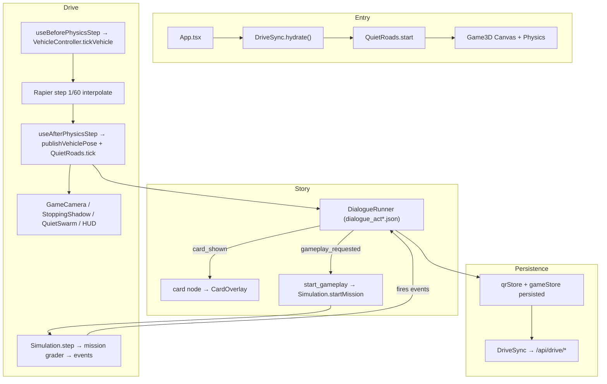

# AUDIT — Quiet Roads (the /drive 3D game)

Phase 1 reconnaissance, 2026-09-30. Branch `agent/overhaul-2026-09-30`.

Scope: the 3D teaching drive at `/drive` (repo: `drive/`, built into
`public/game/drive`). The card game at `/` and the backend are out of scope
(HARD RULE 2). Source of truth for teaching: `docs/wa-driver-guide/`.

---

## 1. Architecture

```
drive/src/
  main.tsx ─▶ App.tsx (auth + DriveSync.hydrate) ─▶ ZombieRoadWarrior ─▶ Game3D
  Game3D.tsx         Canvas (dpr [1,1.5], fov 75) + <Physics gravity=-9.71,
                     timeStep=1/60, interpolate> ─▶ Scene (KentWorld/RoadChunks,
                     Vehicle, GameCamera, TrafficRenderer, QuietSwarm,
                     StoppingShadow, HeadlightBeam, …) + HTML overlays
  quietroads/
    data/*.json      cards.json (131), dialogue_act*.json, questions_v1/2/3
    dialogue/        DialogueRunner (trigger/wait/card/branch node engine),
                     host.ts (DialogueHost iface), types.ts
    sim/             Simulation (mission router + world stepper) +
                     graders: dol, grid, ledger, ribbon, convoy, climb, rural,
                     beats, escort, chainup, pharmacy; quiet.ts (swarm),
                     noise.ts (sound falloff), vehicleObserver.ts (shadow/slip),
                     kentMap.ts + corridors.ts (geometry)
    study/           QuestionBank, SM-2 mastery, exam_40, CardDeck, CARD_FOR_TRIGGER
    actChallenges.ts  act↔scene↔mission registry (ACT_CHALLENGES, SCENE_ACT, MISSION_ACT)
  stores/            gameStore (vehicle/game, zustand+persist), qrStore (story
                     progress, persisted), qrHud (transient HUD + telemetry)
  systems/           QuietRoadsBridge (singleton: dialogue↔sim↔store↔server),
                     VehicleController (arcade setLinvel/angvel), TrafficManager
                     (highway NPCs), AudioManager, DriveSync, QuizManager,
                     RoadChunkManager, StepEventQueue, headlights, physicsStep
  input/             driveInput.ts (key/gamepad/touch merge)
  hooks/             useTouchControls, useQuiz, useGameProgress, useCompactHud
```

### Execution model

- **Physics** is Rapier on a fixed 1/60 s step with `interpolate`. The car is a
  `RigidBody` (mass 1200, `ccd`, `enabledRotations=[false,true,false]`,
  `colliders=false`) with a single `CuboidCollider` of `friction=0`. Motion is
  programmatic: `VehicleController.tickVehicle` runs in `useBeforePhysicsStep`
  and writes `setLinvel`/`setAngvel`; `publishVehiclePose` runs in
  `useAfterPhysicsStep` and writes one coherent snapshot to `gameStore`.
- **Story** is dialogue-file driven. `DialogueRunner` executes `line/wait/card/
  branch/choice/jump/end` nodes and fires/receives events. A `card` node shows a
  PINK MENACE card; a `start_gameplay` effect hands control to `Simulation`.
- **Missions** are pure graders. `Simulation.step(dt, sample)` feeds a
  `VehicleSample` to the active mission grader, which emits `*` events the
  dialogue waits on. Graders do not drive the car.
- **HUD** updates at ~10 Hz. `qrHud.frame` and the store copy of
  `velocityMph`/`engineRPM` are both throttled. Camera, audio, and wheel spin
  read `liveDrive`, which updates every physics step.



---

## 2. Card → trigger → grade, per act

Legend: **DIALOG** = a `card` node in a dialogue scene (type in parentheses);
**TRIG** = an in-world `CARD_FOR_TRIGGER` event fired by a sim grader while
driving; **—** = never opened in the drive (briefing-only / card host).

### Act I — The Lot (12/12 wired) ✓ reference model
- DIALOG: 0.2 gameplay → I-002, I-003, I-004 · 0.3 radio → I-001 ·
  1.2 gameplay → I-005, I-009 · 1.3 gameplay → I-006, I-007, I-008, I-010 ·
  1.4 still → I-011 · 1.4b still → I-012
- Grades: `tutorial_carport`, `mission_dol_drive`, `minigame_park_dol`
  (`park.clean`/`park.curb`), `stealth_dol_interior` + `chase_dol_gracie` (QTE).

### Act II — The Grid (11/31 wired)
- DIALOG: II-001, II-004, II-024 (gameplay); II-006, II-012 (still)
- TRIG: II-002 `sign.prompt:school`, II-003 `sign.prompt:regulatory`,
  II-005 `backing.mirror`, II-006 `signal.arm`, II-010 `bus.stop_arm`,
  II-012 `follow.close`, II-024 `stop.approach`, II-027 `zone.school.enter`,
  II-030 `driveway.turn`
- Grades: `mission_delivery_1_insulin`/`dropoff_pharmacy`,
  `mission_delivery_2_catfood` (`park.back_in.*`), `mission_delivery_3_radio`
  (`lanechange.*`), `mission_delivery_4_filters` (`park.parallel.*`),
  `mission_jonah_intersection` (`jonah.blowthrough`, `stop.approach`, `follow.close`)
- **Cued in-scene (20):** II-007, II-008, II-009, II-011, II-013, II-014, II-015,
  II-016, II-017, II-018, II-019, II-020, II-021, II-022, II-023, II-025,
  II-026, II-028, II-029, II-031. `CardCues` fires `card.cue:<id>` on the Grid
  beat that practises the skill; the bridge opens one card at a time.

### Act III — Central (7/31 wired)
- DIALOG: III-002, III-003, III-004, III-006 (2.5 gameplay); III-007 (3.2); III-016, III-020 (6.2)
- Grades: `mission_central_ledger` (`ledger.lanechange.clean|no_signal`,
  `ledger.crossed_solid`, `ledger.wrong_lane`, `ledger.follow.start`,
  `ledger.follow.close`, `ledger.alongside`, `ledger.pass.clear`,
  `ledger.wet.enter`, `ledger.rumble.ride`, `ledger.merge.*`)
- **Cued in-scene (23):** III-001, III-005, III-008, III-009, III-010, III-011,
  III-012, III-013, III-014, III-015, III-017, III-018, III-019, III-021,
  III-022, III-023, III-024, III-025, III-026, III-027, III-028, III-029, III-030.
  (The earlier "24" count listed 23 ids.) South of `solidY` the Ledger is wet,
  so III-024's rain stretch lengthens the stopping shadow.
- **No Act III card is on a timer or a bare coordinate any more.** Four beats were
  added to `LedgerRun` for this: `alongside` (out of his mirrors, §4.4),
  `pass.clear` (his whole front back in the mirror, §5.2), `wet.enter` (south of
  the solid white, §5.6) and `rumble.ride` (riding the line, a soft tyre, §2.5).
  `test/teaching.test.ts` drives each and asserts the card does **not** appear on
  a drive that skips the beat.

### Act IV — The Core (1/23 wired by card node; exam otherwise)
- DIALOG: IV-018 (4.2 exam). The act is `study_terminal` (10 questions) →
  `exam_40` (40 questions, 32 to pass) → `local_loop_week`.
- **Not wired (21):** IV-002…IV-017, IV-026…IV-030 (IV stills live in the card
  game; only IV-018 opens inside the drive).
- **P11 re-opened and closed the other way (2026-10-29).** The id did *not* have
  to stay `IV-001-brake`: the seed's file filter (`^(I|…|VII)-\d{3}\.json$`) never
  matched it, so the card was never seeded, `pack/04_card.schema.json` rejects the
  suffix (`card_id` pattern), and the client's ride plate was already addressed at
  `public/game/ride/IV-001/brake.webp` (`app.js:977` builds `/ride/<card_id>/…`),
  i.e. under the live name. It is `cards/IV-001.json` now — card_type `scene`, one
  decision, four options with one correct, `source` = Skill ten / 4.11, seq 4001
  derived by `scripts/card-seq.js`, master `cards/IV-001.png`, ride plate
  unchanged. `drive/test/cards.test.ts` holds the shape.

### Act V — The Ribbon (8/13 wired)
- DIALOG: V-001, V-003, V-005 (3.2); V-006 (7.1); V-007, V-010, V-012 (3.1b); V-013 (3.3)
- Grades: `mission_ribbon_merge` (`ribbon.*`), `mission_convoy_issaquah`
  (`merge.*`, `follow.green|red`), `chainup_qte`, `climb_snoqualmie`
  (`ice.enter`, `speed.over:35`, `input.gentle_streak`, `skid.worsening`)
- **Cued in-scene (5):** V-002, V-004 (`ramp.enter`), V-008 (on the ramp),
  V-009, V-011 (`ribbon.merge` / `merge.gap_open`).

### Act VII — The Dark Hours: The Road Home (10/10 wired, cards only)

- **DIALOG (10, one node each):** VII-001 `5.1.card_VII-001`; VII-002
  `5.2.card_VII-002`; VII-003 `5.3.card_VII-003`; VII-004 `6.1.card_VII-004`;
  VII-005 `6.2.card_VII-005`; VII-006 `6.3.card_VII-006`; VII-007
  `7.1.card_VII-007`; VII-010 `7.1.card_VII-010`; VII-008 `8.1.card_VII-008`
  (all three park-gap lines lead to it); VII-009 `8.2.card_VII-009`.
- **No stills, no zone plates, no seed.** Every card carries
  `variation.forced: "Act VII scaffold — no still; do not seed"`; the deck ships a
  brief for future art only. `scripts/validate-act-vii.js` fails on a `winner`, a
  `VII-*.png` on disk, a placement count other than one, a brief that breaks the
  herd's art law (gore, or figures filling the frame), or a `schedules_callback`
  with no later card to bill it.
- **Grades it rides:** `climb_snoqualmie` (5.1), `chainup_qte` (5.2),
  `straight_night_drive` / `rest_area_*` (6.2), `vantage_bridge_crossing` (6.3),
  `escort_ritzville` (7.1), `spokane_home` (8.1–8.2). The cards hang off dialogue
  beats rather than grader events, so they cannot fire on a timer.
- **Callbacks:** VII-010 (`ledger`) bills VII-002 at the Ritzville desk; VII-007
  bills V-006's blind-spot lesson in the escort. `7.1.card_V-006` stays where it
  was.

### Act VI — The Backcountry (9/13 wired)
- DIALOG: VI-001, VI-002, VI-004, VI-006, VI-010, VI-012 (6.1b)
- TRIG: VI-007, VI-008 `roundabout.approach`
- Grades: `mission_backcountry_run` (`rural.shoulder`, `rural.crest.*`,
  `rural.uncontrolled.*`, `rural.crossbuck.*`, `roundabout.*`), `straight_night_drive`,
  `vantage_bridge_crossing`, `bridge_*`, `escort_ritzville` (`nozone.*`, `moveover.*`)
- **Cued in-scene (5):** VI-003 (`rural.edge` — the gravel EDGE, fired while the
  car is still on the road; it used to open on `rural.shoulder` / `nozone.enter`,
  i.e. only after leaving the pavement), VI-005 (crest or wide turn), VI-009
  (uncontrolled), VI-011 (crossbuck), VI-013 (rural end or
  Ritzville). The earlier "(4)" counted these five ids.

---

## 3. Problems found (tagged: area · severity S1–S4 · effort S/M/L)

| # | Area | Sev | Effort | Finding (evidence) |
|---|---|---|---|---|
| P1 | Teaching | S1 | S | **Following distance — resolved.** Graders read `followFullGapM` (`config.ts`). Default feel is still 3 s dry / 4 s truck. `FOLLOW.rule = "vehicle_lengths"` grades §5.2 literally (8 m / 14 m). Cards II-012, V-012, II-014 and the mission objectives lead with the guide's sentence. |
| P2 | Teaching | S2 | S | **Surface friction — resolved for gravel and the Ledger rain stretch.** Gravel μ 0.5 on the backcountry and escort (beetle 55 mph stop 89.8 m). Wet μ 0.4 south of `ledger.solidY` (beetle wet 103.0 m). Ice stays 264.4 m. |
| P3 | UX | S2 | M | **Act select — done, and it works.** `MainMenu.tsx` offers CONTINUE / START NEW RUN and the Acts I–VI list from `ACT_ENTRY`. It was also **broken**: `Bridge.open()` asked `runner.hasScene(which)` *before* loading the act, so every entry not already in the entry chunk fell through to `0.1`. It now resolves the requested id and routes through `sceneRouter`, and `startAct` starts `2.1` / `2.5` / `4.1` / `3.1b` / `6.1b`. Bundle: act dialogue is a per-act dynamic import (`actDialogue.ts`, Act I eager), the act owning the current scene's `next_scene` preloads during the debrief, act-scoped geometries/materials are disposed on an act change while shared highway chunks survive, and the WebGL context-loss edges are a pure function in `systems/glContext.ts`. |
| P4 | Story | S2 | L | **Unwired cards — cued, and on the right beat.** The 20/23/5/5 cards in §2 open from `CardCues` while that act's mission is running; the bridge queues them and shows one at a time. Eight of them were on a timer or a bare coordinate (II-012, III-005, III-009, II-019, II-025, II-026, III-008, VI-003); each is now on the beat that practises it, with a two-sided test. |
| P5 | Perf | S2 | M | **HUD speed/RPM — throttled.** `liveDrive` updates every physics step for camera, audio, and wheel spin. `publishVehiclePose` copies mph/RPM into `gameStore` at 10 Hz. Pose still publishes every step. |
| P6 | Latency | S2 | M | **WebGL context-loss — handled.** `Game3D.GLContextGuard` pauses on `webglcontextlost` (preserving `prePausePhase`), shows a resume prompt, and on restore re-applies the tier's pixel ratio once, clears the toast, and never auto-unpauses. A second loss cannot clobber `prePausePhase` (`systems/glContext.ts`, tested). |
| P7 | Perf/Script | S2 | M | **Test runner — done.** Vitest (151 tests, 14 files) + Playwright smoke + the deterministic bench, wired to `npm test` / `npm run bench`. |
| P8 | Graphics | S2 | M | **Quality tiers — done, and the two defects closed.** `utils/performance.ts` holds a pure `stepQuality` reducer (frame time → high/mid/low) plus the per-tier effect table and `dprForTier`. `PostProcessing` takes a `tier` and mounts only that tier's effects; mobile DPR never exceeds 1.5. Two fixes on top: **(a) one DPR writer** — drei's `<AdaptiveDpr>` (and a no-op `<PerformanceMonitor>`) were mounted beside the Canvas `dpr` prop and called R3F's `setDpr()` on their own schedule; both are gone, and `GLContextGuard` re-applies the tier's ratio once on a context restore. **(b) a 30 Hz panel could not climb back** — the reducer demoted over 33.4 ms but required under 18.2 ms to recover, and a display locked at 30 Hz can never produce an 18.2 ms frame, so one stall pinned it at `low` forever. There is now one threshold (slow = over `SLOW_FRAME_MS`, recovered = not slow), which leaves the high → mid → low reducer and its hold times untouched. Draw calls are sampled from the Kent scene pass, not the postprocessing blit (§5). |
| P9 | Physics | S2 | M | **CCD telemetry — done, and now falsifiable.** `CCD` in `quietroads/config.ts` names the displacement threshold (1.5 m per 1/60 s step); `VehicleObserver` fires one `ccd.tunnel` through the existing telemetry path when a contact-free step moved further. The old headline — "zero tunnels at top speed" — could not fail: a top-speed 1/60 step covers ~0.55 m against a 1.5 m threshold. `test/ccd.test.ts` now asserts a step *larger* than the threshold emits `ccd.tunnel`, that a legal 1/60 step at top speed does not, and that the margin is wide; the four-surface lap remains as a regression net. Stopping distances unchanged. |
| P10 | Data | S3 | S | **`art-review-state` — stripped from the client deck.** The review file stays at `cards/art-review-state.json`. |
| P11 | Data | S3 | S | **`IV-001-brake` non-standard card id — re-opened 2026-10-29 and closed by renaming.** The old closure kept the suffix because "nothing rejects it". Two things did: `scripts/seed-cards.js` only reads `^(I\|…\|VII)-\d{3}\.json$` (so the card was never seeded) and `pack/04_card.schema.json`'s `card_id` pattern. The client was already asking for the live name (`/ride/<card_id>/brake.webp` → `public/game/ride/IV-001/brake.webp`). It is `cards/IV-001.json` now — `scene`, 4 options, `source` Skill ten / 4.11 Traffic light signals, seq 4001 from `card-seq.js`. See §2 Act IV. |
| P12 | UX/a11y | S3 | M | **Accessibility — done.** Reduced motion (earlier pass) plus, in `drive/src/input/driveInput.ts`, a persisted `binds` table (defaults are the shipped arrows/WASD set) that `mergeDriveInput` reads; `input/textSize.ts` three persisted steps applied to dialogue, card and HUD type as a CSS variable; and a `colorblindHud` flag whose cue (PASS/MISS word + ✓/✕ shape) rides on the grade result. Spoken lines: every `line` node already has text, so `DialogueBox` was left alone. |
| P13 | Perf | S3 | M | **Per-frame allocations — done.** `vehicleObserver.ts` copies into one owned previous-sample object instead of `{ ...s }`; `Simulation` reuses its ObserverOut, SimFrame, CueProbe and `blocked` closure; `ZoneField` ping-pongs two owned position buffers; the bridge reuses its sample and walker-input objects. Identity contract locked in `test/alloc.test.ts`. |
| P14 | Graphics | S3 | M | **Kent draw merge — done.** `sim/instancing.ts` batches the repeated plain buildings into one InstancedMesh per material (42 → 4 batches) and the dashes into one per colour; `ContinuousRoad` batches the segment meshes the same way. Colliders are untouched: one fixed CuboidCollider per building and one per solid segment. DOL/PHARMACY/WAREHOUSE keep their own components. |
| P15 | Story | S3 | S | **II-006 / II-012 on the road — done.** The two card nodes left the Act V briefing still (3.1 points at 3.1.2 / 3.1.5 now); `CardCues` takes II-006 on the signal beat, and II-012 / III-005 / III-009 on `ledger.follow.start` — the follow beat **beginning**, not the `follow.close` grade they used to hang off, which meant holding the gap correctly never showed them. |
| P16 | Story | S3 | M | **Deac never drove the line his own card describes — done.** III-001 "Your Wheel" is hand-written (`pack/00_README.md`), and it has him *"sweep the glass, hold the lane, then take one merge late on purpose so you can watch what that costs."* `LedgerRun.advanceLead` moved him in a dead-straight line at constant 18 mph and **never changed lane**; `leadHeading` was pinned to `Math.PI / 2` in `reset()`, so the model would have crabbed sideways with its nose south even if he had. The merge III-001 and III-013 are both written about did not exist on the road. Fixed by `DEAC` in `sim/ledger.ts`; his beats are witness-gated because III-001's debrief is *"You saw the merge you do not take."* |
| P17 | Teaching | S3 | S | **A cue's comment described a different actor than its code — done.** III-013 was taken on `ledger.merge.slow` (the **player** under 12 mph on the ramp) under a comment reading *"Deac took one merge late... The late merge IS the beat."* The card opened on a beat it was not written about and stayed shut through the one it was. It now hangs on `deac.merge.late`. Worth remembering as a class: a comment naming a beat is not evidence the beat is wired, which is why `test/deac.test.ts` asserts the event name rather than trusting the prose. |
| P18 | Sim | S3 | S | **`alongside` / `pass.clear` measured in world axes — done.** Both read a raw `dy` off Deac's position, which was correct only because he drove perfectly straight. Once he merges, a player in the right lane *behind* him satisfies `\|dy\| < 8` against his lateral travel and is graded as riding alongside his trailer. Now projected into his heading frame, which is what `ALONGSIDE_DX_M`'s comment ("lateral band around the lead's lane") always claimed. |
| P19 | Map/UI | S3 | S? | **Act III lane handedness was logged as a mirror. A check on 2026-10-05 does not find one.** Ledger lanes are `x0: 260, x1: 270, count: 3`. `LedgerMarks` calls `x0 + 1/3` the line between right and middle, and the retest spawn at `x: 261.67` is commented "right lane". That x is lane index 0. Index 2 is the left third, which is the passing lane on a right-hand road, and that is what `trackLane` calls it. The two agree. Do not flip them. A screen look can still overrule this; the grades that hang off `wrong_lane`, `crossed_solid`, and `merge.clean/slow` move if the index is reversed. |

---

## 4. Decisions (owner: fix them)

- **BD-1 — Following distance. SIGNED OFF (owner, 2026-10-05).** The decision is
  to leave it: drive feel stays the seconds count (`FOLLOW.rule = "seconds"`,
  3 dry / 4 truck) so the gap still grows with speed; the grader does **not**
  switch to `vehicle_lengths`. Teaching copy on II-012, V-012, II-014, the
  Ledger/convoy/escort objectives, and the fallback quiz keeps leading with the
  guide's sentence: leave at least twice the length of your vehicle.
  `followFullGapM(..., "vehicle_lengths")` grades that distance literally
  (car 8 m, truck 14 m) if the switch is ever flipped. II-012 and V-012 cite
  §5.2 Space, not §5.4 Time. This was a sign-off, not a code change.

- **BD-2 — Hand-signal citation. Resolved.** Cards that cited "2.5 Vehicle
  Maintenance (Hand signals)" now cite "4.14 Turning" (II-006, II-016, II-022,
  III-019, and the same strings in `cards/`). The practised rule is unchanged.

- **Quiet pressure tied to the graded skill. Decided and done (owner,
  2026-10-05).** The Quiet ARE the zombies — one herd (`QuietField` in
  `sim/quiet.ts`, spawns in `kentMap.ts`, drawn by `QuietSwarm`); no second
  herd. A missed grade (too close, rolled stop, wrong lane, crossed solid, a bad
  merge, a yanked shoulder — the fail events the graders already fire,
  `GRADE_MISSES` in `sim/pressure.ts`) raises awareness on the Quiet near the
  car; if none are close enough to see it, existing dormant Quiet move onto the
  roadside ahead and wake, so the sprites are on screen. A pass raises nothing.
  Decay still works. A miss alone tops out at ALERT (`PRESSURE.MISS_CAP`), so
  the swarm stays the noise system's verdict — reinforce, don't add chaos.
  `test/pressure.test.ts`, 5 two-sided tests through the real graders.

- **One voice, one interface, one sound set. Decided and done (owner,
  2026-10-05).** One accent (`SCENE_ACCENT` — the Menace pink from
  `cockpit/tokens`) tints the frame and the badge in every act; one cockpit on
  every act (`sceneSpec.ts`: driveView `cockpit` + maneuver cam); the Quiet
  meter on every playable act (`quiet: true` everywhere, and `QuietHUD` reads
  the flag). Spoken lines use one in-cab treatment; radio and CB beds stop being
  a different voice per act — `dialogue/voice.ts` is the one speaker voice table
  (Deac and Jonah are the CB voice in every act, Mom/Ray/Lumi/Sori the radio
  voice), with the per-line `voice_bed` override (act 8's pattern) still winning
  for scenes that need the other medium. AudioManager stays the one procedural
  set — no second engine/wind/impact per act. Card copy and
  `pack/23_THE_SPOKEN_DICTIONARY.md` untouched. `test/voice.test.ts`.

## 5. Baselines

**There is no current browser baseline.** No headed browser run happened in the
2026-10-04 pass or in the campaign/cues/debrief/graphics pass that followed, so
there is no frame rate, no draw-call count and no time-to-first-frame number to
quote. Every graphics claim in these docs is a unit test or a code fact.

What the 2026-10-01 run actually recorded, and why it is not a result:

| Viewport | Canvas up | First frame | reported "FPS" |
|---|---|---|---|
| Desktop 1280×720 | 0.8 s | 1.1–1.6 s | 30 / 29.6 |
| Mobile portrait 390×844 | 0.9 s | 1.1 s | 30 / 29.5 |

Those "30 / 29.6" figures are the **sample window's own 30 Hz clock** — the
cadence the harness measured over its 600-frame window — not the build's frame
rate. Reporting them as FPS was a mistake and they are withdrawn as a number.
Likewise `gl.info` draw calls and triangles read 1 because three resets `gl.info`
at the start of every `renderer.render` and `EffectComposer` renders once per post
pass with a fullscreen blit last; the read landed on that blit, not on the scene.
The sample now comes from the Kent scene pass (`KentWorld`'s `onAfterRender` via
`attachScenePassProbe` in `utils/performance`), so the next browser run can trust
it. JS heap, a 4G throttle, and input-to-response on a driving lap are all still
unmeasured.

The **sim/grader-level** deterministic baseline (event correctness,
stopping distances, per-mission step cost) is recorded in §6, and that one is
current and asserted by `test/ccd.test.ts`.

## 6. Deterministic sim baselines (headless)

Source of truth: `drive/bench/baseline.json`. **Regenerated** in the 2026-10-05
pass, because a mission-logic change did land (`9c84d85`, Deac's drive script)
and the Act III event list genuinely moved — it now records
`deac.signal → deac.merge.late → card.cue:III-013`, which is the merge and the
card written for it, in order, off a deterministic lap. Nothing physical changed:
the stopping-distance figures are byte-identical to the previous file.

The step-time column below is from a **single** run and moves with machine load.
The defensible statement for `9c84d85` is the interleaved A/B, 3 runs each:
Act III p50 **60.1 / 60.2 / 60.6 µs** with the change against
**61.0 / 62.4 / 60.3 µs** without — no regression. One intermediate reading of
68.2 µs was *not* the change: every row, including the untouched Act II / V / VI,
rose together, which is the signature of a loaded machine rather than one grader.

Sim step CPU cost (µs) — one scripted lap per act, fixed 1/60 s step:

| Mission (act) | steps | step µs p50 | p95 | max |
|---|---|---|---|---|
| mission_delivery_1_insulin (II) | 1200 | 59.9 | 127.7 | 1240.5 |
| mission_central_ledger (III) | 1200 | 60.1 | 84.4 | 542.3 |
| mission_ribbon_merge (V) | 1200 | 58.3 | 65.3 | 573.4 |
| mission_backcountry_run (VI) | 2000 | 56.9 | 65.6 | 317.0 |

(max values include the first-step/JIT warm-up. p95/max are carried over from the
previous capture — only p50 was re-timed here, since only p50 is the number the
A/B rests on.)

Stopping distance at 55 mph (m) — `stoppingDistanceM` (reaction 1.5 s + braking):

| config | m |
|---|---|
| beetle_dry | 74.7 |
| highway_dry | 85.6 |
| truck_dry | 102.6 |
| beetle_gravel | 89.8 |
| beetle_wet | 103.0 |
| highway_ice | 264.4 |

Grade events confirmed to fire on the scripted laps: `stop.approach`,
`stop.rolled`, `ledger.follow.close`, `rural.uncontrolled.rolled`,
`rural.crossbuck.rolled`, `roundabout.rolled`, `ramp.enter` (see baseline.json).

---

## 7. Phase 3 progress (this session)

| Item | Area | Commit |
|---|---|---|
| Gravel surface friction — stopping shadow correct on unpaved (§5.6/§4.15) | P2 ✅ | `1bf0d52` |
| Act select on the title screen — no forced Act I replay, I–III replayable | P3 ✅ | `bc83818` |
| WebGL context-loss handled (pause on loss, clear on restore) | P6 ✅ | `6b75a9b` |
| Test/bench harness (Vitest + Playwright + deterministic bench) | P7 ✅ | `08f9153` |
| Following-distance config + guide-led teaching copy | P1 ✅ | this session |
| Hand-signal citations → §4.14 Turning | BD-2 ✅ | this session |
| Wet μ on the Ledger south of solidY | P2 ✅ | this session |
| In-scene cues for the previously unopened II/III/V/VI cards | P4 ✅ | this session |
| HUD speed/RPM store writes at 10 Hz (`liveDrive` stays 60 Hz) | P5 ✅ | this session |

| Stripped `art-review-state` from the client deck | P10 ✅ | this session |

| Quality tiers — one DPR owner + a pure frame-time reducer | P8 ✅ | `951cde9` |
| CCD displacement telemetry, no feel change | P9 ✅ | `4c367f4` |
| `IV-001-brake` closed without renaming | P11 → **re-opened** | `4785455` (old closure) |
| Remappable keys, text size, colorblind cue | P12 ✅ | `5624665` |
| No allocation on the physics step | P13 ✅ | `fd46905` |
| Kent draw merge (instanced, colliders untouched) | P14 ✅ | `0a92afe` |
| II-006 / II-012 open on the Ledger drive | P15 ✅ | `4b9a6e2` |
| Act dialogue split out of the entry chunk + preload + context-loss edges | P3 ✅ | `2f9aa38` |
| Grade debrief panel on a grade event | — | `8f29dbc` |
| Touch root overscroll + audio resume in the first gesture | — | `c7e688b` |
| Scene routing across act boundaries (`sceneRouter`), Act VI owns 7.x, 7.3 → 8.1 ends the campaign | — ✅ | this pass |
| Act select fixed — `open()` no longer asks `hasScene` before loading, so all five entry scenes start | — ✅ | this pass |
| Every cue moved off a timer onto the beat that practises it; coverage measured, not listed | — ✅ | this pass |
| The grade panel reads `week.elapsed`'s own verdict; a grade with no cue still shows | — ✅ | this pass |
| One DPR writer (`<AdaptiveDpr>` gone); a 30 Hz panel can climb back out of `low` | — ✅ | this pass |
| Draw calls sampled from the Kent scene pass instead of the post blit | — ✅ | this pass |
| CCD threshold asserted both ways (fires over it, quiet under a legal step) | — ✅ | this pass |
| Deac drives the line III-001 writes about — arm out, hold, one **late** merge; heading from real displacement | — ✅ | `9c84d85` |
| III-013 moved onto the beat its own comment named (`deac.merge.late`, not the player's `ledger.merge.slow`) | — ✅ | `9c84d85` |
| `deac.*` beats are witness-gated — a player 100 m back never receives the card | — ✅ | `9c84d85` |
| `alongside` / `pass.clear` projected into Deac's heading frame, so a follower is not graded as abreast | — ✅ | `9c84d85` |

### What the 111 tests did not prove, and now do

The suite was green at the previous HEAD and none of that was campaign evidence:

- **Nothing crossed an act boundary.** `bundle.test.ts` checked that `loadAct`
  returned files containing the right scene id. The chain itself — 26 handoffs,
  including `6.3 → 7.1` with `7.1.card_V-006`, and the `7.3 → 8.1` end — was
  untested, and was in fact broken at every one of them. It is now walked on a real
  `DialogueRunner` through `sceneRouter`.
- **Card coverage was a hardcoded id list.** It could not tell a cue that opens on
  the skill from one that opens because a timer elapsed, which is how six cards
  shipped. `coverage.test.ts` now consumes a set measured by driving the missions,
  and `teaching.test.ts` asserts each id fires on the skill *and* stays shut
  without it.
- **The debrief's week path was dead.** It listened for events nothing emitted.
  It now reads the verdict off `week.elapsed`.
- **The 30 Hz tier trap was untested**, and the CCD "0 tunnels" result could not
  fail. Both are now falsifiable.

## 10. Chain-up loop + shop continuation (2026-10-28)

The chain-up loop closes end to end (see `AGENT_LOG.md` 2026-10-28 Phase 3 and
`drive/test/chainup-loop.test.ts`): every shop `end` carries a `next_scene`
(`2.6→2.3c`, `2.7→2.3d`, `2.8.close_branch` → `5.1` return / `5.1` re-climb /
`2.4`), `2.8.buy_chains` grants the `chains` item the readers (`5.2.entry`,
`4.2.chains_branch`) gate on, `chainup_return` is set by the shop return, and the
`once` continuation triggers at 5.1 / 5.2 / 8.1 are gone. Safe: the sim latches
those events per run (`ClimbRun.arrived`, `ChainupRun.done`,
`GridRun.parallelDone`), so nothing refires within a visit, and save/load
semantics are untouched (`restore()` still spends `once`s). Open, deliberately:
a swarm retry at 8.1 loses the `once` story barks (city.enter, quiet.pass_cluster,
mya.wake, checkpoint/park beats) — the scene completes but plays sparse, the same
accepted trade-off as 3.3/5.1 retries; a per-visit re-arm would need runner
changes and is queued with the 8.x work.

### And what the 2026-10-05 pass added (`9c84d85`)

The previous pass moved cues off timers but never asked whether the *story's*
subjects behave as written. Deac did not: see P16. Three things the earlier suite
could not have caught, because each was a claim made in prose and asserted in
none:

- **The merge did not exist.** III-001 and III-013 both describe Deac taking a
  late merge; he drove a straight line forever. Nothing in the suite failed,
  because no test asserted that a character does what his card says he does.
- **A cue listened to the wrong actor.** III-013's comment named Deac's merge; its
  code took the player's (P17). Coverage was green — the card *was* reachable —
  and it was still opening on the wrong beat.
- **`alongside` was world-axis.** It stayed correct for years only because the
  truck never moved laterally, so the bug was latent until he did (P18).

The pattern worth carrying: *a green suite proves the wiring matches the spec,
not that the spec matches the story.* Where a hand-written card states a
behaviour, there should be a test that the behaviour happens.

Still open: a browser `?profileDrive` pass on a signed-in device and a
full-campaign playthrough. **No headed browser ran in this pass**, so there is no
frame-rate or draw-call number to quote. Headless tests re-run on
2026-10-05: **163/163** across 15 files. `tsc --noEmit` exit 0.
The commit message says the build was 818 modules and the entry chunk 3,958 kB.
This file previously said 3,957 kB. That build was not re-run in the check.
`bench/baseline.json` was regenerated (`generated_at` 2026-10-05T06:44:19Z), not
restored. Stopping distances are unchanged: 74.7 / 85.6 / 102.6 / 89.8 / 103.0 /
264.4 m. The committed step timings are the slower run (Central p50 67.7 µs, was
60.2). The 60.1 / 60.2 / 60.6 µs figures are not in the file.

## 8. Owner decisions executed (2026-10-05c)

The three open decisions above are closed (§4). Headless re-run from `drive/`:
**172/172** across 17 files (was 163/15), `tsc --noEmit` exit 0.
`bench/baseline.json` stayed byte-identical — `sim-bench.test.ts` rewrites it on
every run and no physics constant changed, so the run's copy was restored, not
committed. Deliberately untouched: the Deac pass, III-001's trigger
(`ledger.lanechange.start`), Act III lane handedness (index 0 = right, index 2 =
left passing), `DEAC.witnessM` = 45 m, and all card copy. Still open and still
needing hardware: the `?profileDrive` browser pass and a full-campaign
playthrough. **No headed browser ran** (none available) — no frame-rate or
draw-call number is quoted anywhere.

## 9. Stage pads and one-way stops (2026-10-15)

Played locally. The tutorial completed on `x < 30` and under 1 mph, so the bay under the carport never counted, and holding the brake at a crawl engaged reverse before that razor could hold. Home is `stageSpot(markers.carport)` for 0.3 s under 2.4 m/s. `VehicleController` holds a standstill for 0.5 s before S becomes reverse.

`titus_central.approach` is 0 (east). `meeker.approach` is π/2 (south). `headingDelta` greater than a right angle does not enter the stop. The end-of-block, pharmacy, Priya, and warehouse waypoints are `stageSpot` pads. `dol_approach` is the driveway gate, and the DOL pin is that gate (`markers.dol_gate`), not the middle of the lot. `StageSpot` draws the ring on `navTarget()`. Carport legs are 2.8 m.

Tests: 174/174, including an eastbound Titus roll, a westbound pass that stays quiet, and a carport return that ignores the street. `bench/baseline.json` restored.

A drive-through used to spend the ring (`tutBlockEnd` on the zone enter) and move the pin with no line. Entry is now the plow: `carTouchesDisc` / `carHitsRect` with `NOSE_REACH_M` 2.6. The chassis center alone missing the ring is not a miss.

Two implementation notes worth keeping: (1) the pharmacy/Bea dropoff fires
`door.slam` / `park.back_in.*` on the raw event bus, not the grade funnel, so
those events do not raise pressure (or reach the card book) — pre-existing
plumbing, not re-plumbed here; (2) `rural.shoulder.yank` fires every step while
the mistake continues, which is why a pressure application is throttled to one
per second.

## 11. Phase 4 — radio not tablet, Grandma on screen, an unsigned clipboard, 6.2's clock (2026-10-29)

**The Chorus never had a screen.** `pack/01_BIBLE.md:37` gave the Menace "an
aftermarket nav tablet"; `ref_cockpit.jpg` was locked *because* of it ("poisoned
(tablet / digital …)", bible problem #5); and two story cards were written around
a device the art can never light. The radio was already in the scene's own first
sentence, and the deck is the canon prop (`cards/I-011`: "a physical CB radio
deck with knobs and a dark face, the coiled cord plugged into that radio"). So the
tablet left the fiction and the lesson stayed exactly where it was:

- **II-009** — the device is "the old deck", the eyes drop to "the dial", and the
  fix is unchanged: eyes up, hands on the wheel, the radio can talk to itself.
- **III-027** — "The Tablet Wakes" → **"The Chorus Wakes"**; the CB deck bolted
  to the doghouse crackles up mid-change. Ids, option ids, `correct` flags and
  every `state_delta` are untouched — only device nouns moved.
- **III-022** — "Check the tablet for which way he is going" → "Check the net".
- `src/manifest.js` `FAIL_PLACE["II-009"]` — "the tablet" → "the radio" ("Six at
  the radio." in the fail dispatch).
- `drive/src/quietroads/data/cards.json` re-exported for those three cards, per
  `docs/DRIVE.md:40`.

**Tablet stills — flagged, not redrawn.** Art is its own pipeline. These are the
image briefs that still describe a tablet, so whoever regenerates Act II/III art
knows which plates argue with the fiction:

| Card | Field | What the brief says | Verdict |
|---|---|---|---|
| `II-009` | `image_brief.foreground` / `.midground` / `.read` | "an aftermarket tablet LIT as a digital radio — station name and FM channel readout", "the lit tablet", "the lit screen below" | **Redraw as the deck** — the plate argues with the card |
| `III-027` | `image_brief.subject` / `.foreground` / `.read` | "tablet on the doghouse lit", "no readable UI on the tablet — only a glow", "the tablet is lit" | **Redraw as the deck** — same argument, wrong device |
| `II-001`, `I-011`, `V-002` | `image_brief.midground` | "aftermarket nav tablet dark" / "center-dash tablet dark" | Optional — a dark tablet is a dark dash object, no story claim |
| `I-003`, `V-002` | art notes | "no GPS map on tablet" / "dark blank tablet only" / "tablet dark/non-competing" | Keep — already forbid a lit device |
| `VI-013`, `VI-004`, `VI-011` | briefs | "no lit tablet", "no lit navigation screen", "no lit GPS tablet" | Keep — the radio-only lock doing its job |
| `V-001` | `forced` (QA record) | rejected take 8, "distracting tablet map" | Keep — a record of a rejected plate, not a brief |


**Grandma is on screen once, and it is the last mile.** She was already canon as
east ("She's in Spokane. She got on the bus.", `act3.json:512`), and 8.2 already
had a gray blanket for Gracie — held by Ray. Now the third figure at Division
Street comes out of the checkpoint hut (`8.2.gm1`–`8.2.gm6`), says "I got on the
bus. It went east. So did you.", closes the note out loud ("I told you. Come home
slow." / "…I did."), and takes the blanket out of Ray's hands to put it over the
roof herself. Cue renamed `cutscene.ray_blanket` → `cutscene.grandma_blanket`
(`sim/spokane.ts` still owns and emits it); `voice.ts` gains `GRANDMA` (bedless,
low) because `voice.test.ts` fails any speaker missing from the campaign table;
the act-8 `characters` entry carries `name: "{GRANDMA}"` and no `portrait_dir`
(no art exists, and the schema requires only `name`). `{GRANDMA_INITIALS}` now
defaults to `"— G."` in both places it lives (`dialogue_act0-1.json` meta and
`qrStore.ts`, which overrides meta at boot via `setPlaceholder`), and the note's
own literal em dash was removed so it renders "Come home slow. — G." and not
"— — G.".

**The clipboard stopped signing itself.** `manifestFor(act, driverName)` stamped
the signed-in student's real name onto Deac's manifest. It is in-fiction
paperwork, so it now always ships `driver: "________"` and the start button does
the signing (already the contract: `public/game/feel.js:771` renders
`row.driver || "________"`). Signature and both callers updated
(`src/routes-run.js`, `scripts/validate-act-v.js`); `MANIFESTS` is exported so a
test can hold it. New `scripts/test-manifest.js` (node assert, no DB) locks three
things: the signature line stays blank even if a name is passed, no act row
carries a placeholder, and Act VI's cargo and its end beat name the same load.

**Act VI finally says what it carries.** `MANIFESTS.VI.cargo` was
`"TODO — Claude: Backcountry load"` in production. The run starts at the
Ellensburg fuel depot and ends at a gate that opens on diesel, so the cargo is
"Diesel — four cans for the ridge plows", and the Act VI end beat now names it in
the same breath as the chains ("…chains are on the floor, the diesel for the
ridge plows is strapped down in the back, and the word is dawn.").

**6.2's clock now agrees with the exam.** The exam teaches it (questions_v1
`c1_008`): on a first-year intermediate license, 1–5 a.m. is a 25+ supervisor or
nothing — and Ali drives the road home alone. 6.2 was already 90% compliant (she
sleeps at the rest area, wakes at five) but never said so, and nothing in acts
5–8 stamps a clock, so the one scene with a time in it was the one scene that
could contradict the rule she had just passed. Two direction cards pin it now:
`6.2.sleep` "Night. Parked before one." and `6.2.morning` "Five a.m. … The
one-to-five is over and so is the sleep."

**Verified**: 188/188 vitest green, `tsc --noEmit -p drive/tsconfig.json` exit 0,
`scripts/test-manifest.js` ok, `validate-act-v.js` baseline unchanged
(V-006/V-008/V-013 fail exactly as before — pre-existing, out of scope),
`bench/baseline.json` restored after the run. Dialogue JSONs stay CRLF.

**Still open from this phase**: the II-009/III-027 plates (table above); the
bible's numbered problems #5 (nav tablet in/out), #10 (same question, art side)
and #20 (signature) are fixed in code but get marked fixed in Phase 6's re-audit.


## 12. Phase 5 — the campaign's last card (2026-10-29)

`8.3.end` used to unlock two strings nobody implemented: `credits` and
`postgame.deacs_route` (bible problems #14 and #8). The player's last image was
whatever line happened to be on screen. The ending now ends on a card, and the
card is the run's own verdict:

- `8.3.13` (the chair, the hand flat on the desk) → `8.3.credits_gate`.
- `deac_answered` → `8.3.credits_deac`: "The last card is the radio: a man across
  a pass, very faint, very far. …Seatbelt."
- otherwise → `8.3.credits_static`: "The last card is the room: a chair, a desk, a
  hand flat on the wood, and a radio that says nothing back."
- `8.3.12b` ("…Yeah. Same time tomorrow.") used to jump straight to `8.3.end`, so
  the static path skipped the desk beat *and* the card; it now continues into
  `8.3.13` like the answered path does.
- `8.3.end` unlocks `credits` only. `postgame.deacs_route` is gone: it named a
  postgame that has never existed, and leaving it in the save data promised one.

`drive/test/ending.test.ts` (4) walks 8.3 on a real `DialogueRunner` both ways
through the `respect >= 80` gate — answered: `8.3.12` fires, `deac_answered` is
set, the card is Deac's; static: `8.3.silence`, the card is the room — plus the
unlock audit (last unlock is `credits`, never `postgame.deacs_route`) and a scan
of every act-8 node for the removed string.

Verified: 192/192 vitest (188 + 4), `tsc --noEmit` exit 0, `validate-act-v.js`
baseline unchanged, `bench/baseline.json` restored.


## 13. Phase 6 — the whole campaign walks, and the re-audit (2026-10-29)

**The walked chain.** `drive/test/fullchain.test.ts` (4) plays scene `0.1` to
`game_complete` on one real `DialogueRunner` loaded with all twelve dialogue files.
Every earlier chain test proved one link — that a `next_scene` has a destination
(`bundle.test.ts`), that the chain-up loop closes (`chainup-loop.test.ts`), that 8.3
ends (`ending.test.ts`). None walked the campaign; this does, and it takes the forks.

How it moves without a driver: it fires a `wait`'s own `wait_for`, answers choices
from a policy (first option that can still reach a hand-off unless the test names
one), resolves `card` nodes correct, and when a gameplay scene idles at its `*.go`
resident end — or at a bark leaf with no `next` — it fires the one trigger whose
target still reaches an end node that hands off. Retry and atmosphere events
(`noise.*`, `mission.fail.*`, `mission.complete.*`) are skipped because they re-enter
the scene instead of advancing it. Fired events are scoped per scene visit, because
the same name can finish two scenes (`park.parallel.clean` finishes 2.3d *and* 8.1's
last park). A scene with no advancing trigger fails the walk.

What it proves:

- **One visit per scene, 37 deep**: `0.1 → 0.2 → 0.3 → 1.1 → 1.2 → 1.3 → 1.4 → 1.4b
  → 2.1 … 8.3`, `game_complete` set, `credits` unlocked.
- **Both forks**: 1.3.C wait vs. honk, and 3.3.C keep-going (→ 3.4a) vs. stop for the
  stall (→ 3.4) — the two paths must both reach Spokane, and they do.
- **The exam twice**: passed at the terminal, and failed once → the retest week
  (4.3, `week.elapsed`) → 4.1 with `exam_attempts` → 4.2 passed → 6.1b. `exam_passed`
  and `exam_failed_once` both end true, `exam_attempts` is 1, and the two visits to
  4.2 bracket 4.3 in the right order.
- **No hand-off names a scene the runner cannot start**, and the walk ends on
  `8.3 → ""`.

**The bundle builds.** `npm run build` in `drive/` (what Docker stage 1 runs): 821
modules, entry `index-*.js` 3,972.56 kB / 1,312.14 kB gzip, `dialogue_act8` 28.55 kB.
The emitted act8 chunk carries the Grandma beat, `credits_gate`, "…Seatbelt." and
"Come home slow", and no longer contains `postgame.deacs_route`; the entry chunk
carries `GRANDMA_INITIALS: "— G."`. `public/game/drive` is untracked build output,
so the build leaves the working tree clean.

**The re-audit** is `docs/STORY_BIBLE.md` §12: every §10 problem and §11 question is
now FIXED (with the phase and the mechanism named), CHANGED (deliberately different),
or STILL OPEN (with the reason). The two story items this pass did *not* touch were
I-009's placement in 1.2 and the Kent/Renton lot name — both author calls.

**Closed the same day** (follow pass, §14): I-009 moves into 1.4 (`c6bb2fa`), the
Lot is Kent (`58340d5`), IV-001 becomes a live card (`adb9ffc`), and 6.2's clock
is held by a test (`2954a6b`).

**Verified**: 196/196 vitest across 21 files (192 + 4 new), `tsc --noEmit` exit 0,
`scripts/test-manifest.js` ok, `validate-act-v.js` baseline unchanged
(V-006/V-008/V-013 as before), `bench/baseline.json` restored after the run.


## 14. The follow pass — the author calls, IV-001, and 6.2's clock (2026-10-29)

Four commits on `story/act-vii-road-home`, one per item:

- `c6bb2fa` **I-009 → 1.4.** `1.2.card_I-009` is gone; `1.2.card_I-005` hands to
  `1.2.4`, so 1.2 is I-005 → pull-in → `1.2.go` park → bark → `1.2.end` → 1.3.
  `1.4.card_I-009` hangs off `1.4.5` ("I'm going back for her. Tomorrow.") and
  hands to `1.4.radio`. The card's opener is "The engine's off." because the
  scene is the engine-off carport; ids, options, flags and citations untouched.
  `drive/test/fullchain.test.ts` now logs `card_shown` (+`scene_started`) and its
  fifth test asserts I-009 opens exactly once, in 1.4, on `1.4.card_I-009`.
- `58340d5` **L-002 is Kent.** `pack/01_BIBLE.md` §7 zone map and L-002; a
  *Location canon* note records the correction. `STORY_BIBLE`'s location row is
  one Kent row. "Since Renton" in `cards/II-007.json` is weather, not the lot.
- `adb9ffc` **IV-001 is live.** `cards/IV-001.json` (was `IV-001-brake`, which
  the seed's file filter never matched and the schema's `card_id` pattern
  rejects): `scene`, one decision, four options with one correct, `Skill ten:
  city driving – part one` + `4.11 Traffic light signals`, seq 4001 derived by
  `card-seq.js`, master `cards/IV-001.png`, ride plate
  `public/game/ride/IV-001/brake.webp`. `variation.time_of_day` was the invalid
  `"overcast"`, now `"afternoon"`; `continuity` drops the unregistered
  `encore_footwell` token (no `refs/` file exists; the Encore cockpit lock carries
  the pedal box), so `compile-images.js --card IV-001` compiles.
  `drive/test/cards.test.ts` (6) holds shape, citations, assets and IV-002's
  "two pedals" setup. P11 is re-opened in §2/§3 and closed by renaming.
- `2954a6b` **6.2's clock.** Both paths (stop at the rest area; push through →
  microsleep → rumble strip → forced stop) converge on `6.2.sleep` "Parked before
  one." and `6.2.morning` "Five a.m. … The one-to-five is over", so no path drives
  in 1–5 a.m. and no dialogue changed. `drive/test/straight.test.ts` (6) pins the
  node order on both paths, asserts those are the scene's only clock stamps, and
  fails on any hour named inside 1–5 a.m.

**Verification after the pass**: 209/209 vitest across 23 files, `tsc --noEmit`
exit 0, `validate-citations.js` ok (121 cards — IV-001 is now visible to it),
`test-manifest.js` ok, `compile-images.js --card IV-001` ok, full
`compile-images.js` unchanged (pre-existing II-011 / IV-007 / V-006 / V-008 /
V-013), `validate-act-v.js` unchanged (V-006/V-008/V-013), `validate-act-ii.js` /
`validate-act-iii.js` unchanged, `bench/baseline.json` restored. No seed, no
deploy.

**The clipboard signature** (question asked of Phase 4): the blank was
deliberate as *a blank*, but the theory that Deac's initials at VI-013 fill it is
false — `cards/VI-013.json` has him initial his own hand-ruled clearance sheet
("a line at the bottom with his initials on it"), a different document, and the
Act VI end beat writes no signature ("The sheet goes in the glovebox…"). A blank
line is not a signature, so `manifestFor()` signs the courier the run belongs to:
`driver: "A. Okonjo"` (`pack/01_BIBLE.md:35`, canon). `feel.js` still falls back
to `"________"` when a row has no driver. `scripts/test-manifest.js` holds both
halves: the signature is the courier, and a stray name argument is ignored.

**Still open:** the headed `?profileDrive` pass and a device playthrough (no
hardware); the II-009 / III-027 tablet plates; and, new, the I-009 still is an
afternoon lot plate now playing in a night scene — an art call, not a code one.


## 15. Act VII: the rules, the deck, the wiring, the paper (2026-10-29)

Five commits, one per item:

- `1681345` **the act opens.** `pack/43` (header + the section that said CLOSED),
  `pack/00_README`, `README`, `pack/44`, `docs/ACT_DRIVE_ALIGNMENT`, `STORY_BIBLE`
  §1/§3, `ROADMAP`, `PLAYTEST`. What is allowed: VII cards. What is not: VII
  stills, zone plates, seeds. What does not change: the herd's art law (posture
  and stillness, never gore, never filling the frame) and Act V's own ban on VII
  material on a Ribbon card.
- `bb78ac4` **the deck.** `cards/VII-001`…`VII-010`, citations only from pack/07 +
  pack/08 (5.1, 5.6, 2.5, 4.4, 4.18, n/a), every card forced "no still; do not
  seed", one correct answer each with a 28.6% worst-position share. `pack/04`
  gained the continue-only `beat` branch the client has always assumed
  (`CardOverlay.tsx:7`, `app.js:continueOnly`); I-007 stays valid.
  `scripts/validate-act-vii.js` added and wired into `npm run validate-cards`;
  deck re-exported to 131 (additive).
- `e343149` **the wiring.** Ten card nodes, one per beat (5.1, 5.2, 5.3, 6.1, 6.2,
  6.3, 7.1 ×2, 8.1, 8.2). Nothing renumbered; each anchor hands to the card and the
  card to the anchor's old target. `fullchain.test.ts` (6) and `coverage.test.ts`
  (`DRIVE_ACTS` + VII) hold it; `validate-act-vii.js` fails on zero/two placements.
- `1aadc80` **the paper.** 4.2 `lic1`–`lic5`: six months on the permit, 40 day /
  10 night supervised with a 3+ year licensed driver, 50 attested, the log that is
  Deac's clipboard; the intermediate 1–5 a.m. and passenger limits; the Authority's
  in-fiction waiver of the waiting period only. `guide_refs` carry DG 1.8. Hank
  gets the guide's real agricultural exception and refuses the dark hours
  (`7.1.chat8`/`chat9`). `licensing.test.ts` (5).
- `a456637` **`8.2.gm4`** — "Mom didn't say you'd be here." (gm5 untouched).

**Verified**: 215/215 vitest across 24 files, `tsc --noEmit` exit 0,
`validate-citations.js` ok (131), `validate-act-vii.js` ok (10 cards, 7 decisions,
a2/b1/c2/d2, ten placements printed), `test-manifest.js` ok, `compile-images.js
--card` ok for all ten VII cards, full `compile-images.js` unchanged
(II-011 / IV-007 / V-006 / V-008 / V-013), `validate-act-v.js` unchanged (V-006 /
V-008 / V-013), `validate-act-ii.js` unchanged, `validate-act-iii.js` ok,
`bench/baseline.json` restored. **No seed, no still, no deploy.**

**Still open:** the headed `?profileDrive` pass and a device playthrough (no
hardware); the II-009 / III-027 tablet plates; the I-009 afternoon plate (from the
previous pass); and VII art itself — the deck is deliberately still-free, so any
future VII still needs its own wave, muted-read and seed, none of which this pass
authorized.


## 16. Follow-up: the deck's numbers, the clock, the permit, the seed (2026-10-29)

Six commits, one per item, on `story/act-vii-road-home`. No ID was renumbered;
every taught rule is quoted from `docs/wa-driver-guide/` in the card's
`source.teaching_target` and asserted against the extracted text.

| Commit | What changed |
|---|---|
| `9698514` | VII-002 option a is "Chains on the drive wheels — the rear pair — before the car moves." (DG 5.6: "Use snow tires or chains when it's required." — the guide names no axle). VII-010's debrief restates the rule in the desk's voice, no receipt framing. |
| `c414a7d` | The road home is one morning. VII-008 is midday; 8.1 leaves Ritzville "flat white" with snow in the air; 8.2's Grandma has been "waiting since before the sun"; 7.2's dark-two-hours lines are gone; `7.3.location` is `ritzville_lot_morning`. |
| `7aa8a69` | 400 = the glow you must stop inside; 500 (oncoming) / 300 (behind) = the dim marks. Fixed 6.2.night, VII-005's scene and debrief, and exam `c5_010` (which had carried unsourced 182/350 beam-reach numbers). |
| `6a40749` | 2.2 `super1`–`super5`: Deac names the 1.1 violation (no permit yet, no licensed adult, alone) and states the Authority courier provision — radio open, licensed driver on the net — labelled as the Authority's, not the law. Ali stays flat ("It was four miles."). |
| `2a888ae` | 7.1.chat8: "Authority calls this a convoy. The county calls it harvest." |
| `4a9a46f` | `scripts/seed-cards.js` skips cards whose `variation.forced` says no still AND do not seed; an explicit request for one throws. IV-001 still seeds. |

### The clock the pass pinned

| Scene | Node | Time |
|---|---|---|
| 6.2 | `6.2.sleep` | "Night. Parked before one." (driving ends before 1:00 a.m.) |
| 6.2 | `6.2.morning` | "Five a.m. Still dark." — the one-to-five is over |
| 6.3 | `6.3.0` | first light at the Columbia; no hour stamp |
| 7.1 | `7.1.0` | "Moses Lake. Dawn." |
| 7.1 | `7.1.arrive` | "Ritzville. Grain elevators against a gray sky." |
| 7.2 / 7.3 | shop, radio | same morning; "You're two hours out." |
| 8.1 | `8.1.0` | "the gray sky going flat white, a little snow in the air" |
| 8.2 | `8.2.gm1` | "waiting since before the sun" — Division Street at midday |
| 8.3 | — | one week later ("last night" is a week old) |

Ritzville → Spokane is roughly two hours in the fiction; Moses Lake at dawn plus
the escort and the barter puts the arrival at midday. `drive/test/clock.test.ts`
(9) holds the order, forbids an hour inside 1–5 a.m. on the 6.3→8.2 leg, and
forbids the old night claims.

### Pre-4.2 driving, and who is supervising

| Scene | Adult in the car | Disposition |
|---|---|---|
| `0.2` carport tutorial | none | private carport (`grandma_carport`), not a public roadway — unchanged |
| `1.1` to the DOL | none | **the deliberate violation** — no permit yet (`1.1.11`), named at 2.2 |
| `1.2` DOL lot | none | private lot (`kent_dol_lot`) — unchanged |
| `2.3a` delivery 1 | **Deac**, in the car ("I'm riding.") | legal before 4.2 |
| `2.3b/c/d` deliveries 2–4 | none in the car | covered by the Authority courier provision at 2.2 (radio open, licensed driver on the net) |
| `2.4` Jonah milk run | none in the car | same provision; Deac briefs in person, corrections on the radio |
| `2.5` Central cargo | none in the car (Deac in the lead truck) | same provision; barks are delivery "G" |
| `3.2`/`3.3` I-90 convoy | none in the car (Deac leads) | same provision; Deac's lines are delivery "R" |

The provision is stated once, at `2.2.super5`, and is explicitly the Authority's
rule, not the state's; the guide's rule ("a licensed driver with 3 or more years
of experience") is named beside it. Nothing else in the fiction was rewritten.

### Seed

`node -e` over the deck: 131 files, 10 skipped (VII-001…VII-010), IV-001
seedable. Act VI is **not** a scaffold — its thirteen cards carry live stills and
art notes (`"live still cards/takes/VI-..."`), and the ROADMAP counts them
13/13 — so it is deliberately not skipped. The matcher is the scaffold shape
(no still AND do not seed), not the substring: rejected-take notes on IV-005,
IV-028 and V-001 contain "do not seed" and remain seedable.
`drive/test/seed.test.ts` (6). **Seeded live 2026-10-29** from the Railway
public proxy: `npm run seed -- IV-001` (seeded IV-001; Act IV still audit 22/22),
then `npm run seed` — one log line `skipped (no still; do not seed)
VII-001…VII-010`, 121 cards seeded (no VII), and six still audits with 0
mismatches (I 12, II 30, III 30, IV 22, V 13, VI 13). The Act II audit's
`in_db_not_repo: ["II-031"]` is expected: `cards/II-031.json` is a still-less
card, so the still audit has nothing to compare. Live DB verified that day: 121 cards,
zero `VII-%` rows, IV-001 at seq 4001 with a 48,184-byte image and four options
(`a` correct).

**2026-10-30.** The drive grade is `POST /api/drive/card-answers`, which 404s
when the card row is missing, and the overlay calls that "Couldn't reach the
ledger." The ten VII cards are now in `cards` / `card_options` with
`image_bytes` null (seq 7001–7010, 28 options on the seven decision cards).
`scripts/seed-cards.js` writes that scaffold instead of skipping it.
`src/game.js` `deckWhere()` keeps the card game and the parent catalog from
dealing the same sentence. Stills are still not produced.

**Verified**: 251/251 vitest across 27 files (215 + `actvii-deck` 13 + `clock` 9
+ `licensing` +8 + `seed` 6), `tsc --noEmit` exit 0, `validate-citations.js` ok
(131), `validate-act-vii.js` ok (10 cards, 7 decisions, a2/b1/c2/d2), `node
--check scripts/seed-cards.js` ok, `bench/baseline.json` restored. The
pre-existing validator baselines were re-run and are unchanged (`validate-act-v`
V-006/V-008/V-013, `validate-act-ii`), `validate-act-iii` ok.

### Permit timeline (follow-up)

**Recon.** No permit-issuance beat exists. 1.3 is the DOL knowledge test and it
is interrupted before she answers a question (`1.3.6` → `1.3.latch` → rack →
chase); `2.2.12` only says Deac can issue a permit; the state seal stamp appears
at `4.1.0`/`4.2.0`. `4.2` sets `permit_held` on pass but `4.2.4` says "Driver's
license" and `lic4` starts the intermediate restrictions, so 4.2 is the license
exam. No elapsed time between Act I and 4.2 exists: only "tomorrow" (1.1→1.3),
"Retest in a week" (4.2.fail→4.3) and "a week later" (8.3). `pack/01_BIBLE.md:9`'s
fourteen months is world time. `4.2.lic1`'s "You had seven" was the only
permit-hold claim in the repo, and it was invented.

**Fix (one commit).** `2.2.permit1`–`permit3` opens the drawer, uses the state
seal stamp, and issues an **Authority courier permit** — explicitly not the
state's instruction permit ("that one wants six months and the test you didn't
get to finish") — and starts the log. It sits after `super4` and before
`super5`, so the document exists before anyone calls her a courier on one and
before `2.3a`. `4.2.lic1` drops "You had seven"; `4.2.lic5` makes the Authority
provision the six-month waiver ("You didn't have the six months. You had the
Grid."). `4.2.1` says "the license set, not the permit set", keeping 1.3 (permit
knowledge test) and 4.2 (license exam) distinct. `licensing.test.ts` is 17 and
pins the order, the two exams, and the absence of any unearned duration.

**Known compression, deliberately not fixed.** 4.2 is "the license set, not the
permit set," but 40 questions with 32 to pass is the real WA knowledge exam —
the permit test. In life the license step is the drive test; the fiction treats
Deac's logged hours and his observation as that drive test, so the numbers the
player learns are still right. If it ever needs to be exact, it is a one-line
relabel at `4.2.1`, not a new run.

**Verified**: 255/255 vitest across 27 files, `tsc --noEmit` exit 0,
`validate-citations.js` ok (131), `validate-act-vii.js` ok, `validate-act-iii`
ok, `test-manifest.js` ok; the rest of the §16 baselines are unchanged.

**Still open**: the headed `?profileDrive` pass, a device playthrough, the
II-009 / III-027 plates and the I-009 afternoon plate. VII drive stills are
`cards/VII-00N.jpg` (2026-10-31); the card game does not deal them. The `7.3` and `8.1` background/ambience keys keep their
`dusk`/`night` asset names (no local asset is referenced by the drive; the
prose and the cards are daylight) — a plate decision for the art pass, not a
clock contradiction.


## 17. The card still is letterboxed, not cropped (2026-10-31)

**Symptom.** II-019 "Green Light, Black Ice" (THE GRID · HAZARD) showed a
traffic-light housing filling the frame — no green lens, no crosswalk, no porch.

**Where it was.** Not the data and not the `/` card game:

| Layer | File | Rule | Whole plate? |
|---|---|---|---|
| master | `cards/II-019.png` | 1024x1536, one commit (`888e05f`) | yes |
| delivered | `scripts/encode-still.py` | 768x1152 WebP, same bytes for both surfaces | yes |
| `/` card game | `public/shared/app.css` `.shot-wrap .shot` | `object-fit: contain`, `object-position: center`; box is `aspect-ratio: 2/3` (phone) or `max-height: 42dvh` (desktop) | yes |
| `/drive` card | `drive/src/components/Game3D/CardOverlay.tsx` | `position:absolute; inset:0; object-fit: cover` | **no** |

**The numbers (headless Chromium, II-019's still, `cover`).** 390x844 → painted
562.7x844, 30.7% of the width cropped. 844x390 → painted 844x1266, 69.2% of the
height cropped. 1280x800 → 58.3% of the height cropped. `contain` → 100% of the
plate at all three (260x390, 390x585, 533x800).

**Regression.** `2c1b107` "Redesign drive as a single immersive cockpit
surface" (2026-09-26) swapped `contain` (from `1ec6ca8`) for the full-bleed
`cover` backdrop. Nothing in `9113d44..HEAD` touched `public/` at all, and the
image routes and `cards/II-019.*` are unchanged there; the schema's `beat`
branch and the `cards.json` re-export carried no image geometry.

**Fix.** `drive/src/components/Game3D/cardStillStyle.ts` —
`CARD_STILL_FIT = 'contain'` + the still's style, rendered by `CardOverlay`.
Scrims and dock stay (they dim; they do not crop). Quiet tiers are untouched:
they are opacity/blend plates over `#shot`, and the `ride-look-*` pans only run
on ride-along cards.

**Guard.** `drive/test/cardStill.test.ts` (5) pins the fit, the whole-plate
geometry at three viewports, the `cover` numbers as the regression, and that
the overlay keeps using the shared style. `260/260` vitest, 28 files.

**Still open** (unchanged by this): no headed `?profileDrive` run, so there is
no screenshot baseline to diff against; the test is the guard. The dock is up
to 68vh and its translucent scrim still sits over the plate's lower edge on a
landscape phone — that is the cockpit design, but if the still should read
above the dock, that is a layout change, not this one.


## 18. 5.2's chain-up could not be finished (2026-10-31)

**Symptom (device).** The objective said to pick up the tensioner; reaching the
pull-out did nothing, and "there" was not knowable.

**Chain.** `5.2.go` (`start_gameplay: chainup_qte`) → `Simulation.startMission`
→ `ChainupRun` → `chainup.qte.success` → `5.2.3` → `5.2.end` → `5.3`. The fail
branch was `chainup.qte.drop` → `5.2.drop` → `5.2.drop2` (leaf).

**Cause.** The success window was `0.2 < brake < 0.85`, and keys/pads are
binary with a pedal that ramps to 1.0 in 0.6 s (`KENT_BRAKE_UP = 1.6/s`); the
same 1.0 was above the `brake > 0.92` drop threshold. So the only brake a
keyboard or phone can produce was outside the pass window and inside the fail
window — stopping the car fired the failure every 4 s and success could never
accrue. No prompt existed, and the objective named no place and no gesture.

**Geometry.** `chainPad` = `{2286, 1028, 28, 44}`, pin `(2300, 1050)`, spawn =
pin. Arrival was `rectHas` only. Now: rect or a 26 m disc (`CHAIN_ARRIVE_M`),
no heading; stopped `≤ 1.5 m/s`; tighten = any brake `≥ 0.12` held `1.6 s`.

**Fix.** `quietroads/sim/chainup.ts` (stages + objectives + drop rules),
`Simulation.setQte`, `qrHud.qte`, `CockpitQTE.tsx` (z 246). `drive/test/chainup.test.ts`
(5) proves the chain end to end and the no-chains route to 2.8. 265/265, tsc 0.


## 19. The cockpit grid — named bands, no overlapping layers (2026-10-31)

**Symptom (device).** Overlays sat on each other; the screen was unusable.

**Layer stack before (z-index is not the problem — geometry was).** hud 50 ·
scare 205 · world-hud 210 · nav 215 · sticks 220 · dialogue 220 · qte 230 ·
card 240 · debrief 245 · pause 250 · menu 300.

| Pair | 390x844 | 844x390 | 1280x800 | After |
|---|---|---|---|---|
| horn ∩ dialogue box | (310,684 64x64) over (16,567 359x253) | (310,684) over (62,160 720x206) | — | none — the horn is on a body-band rail |
| horn ∩ first option | (310,684) over (33,705 325x48) | (310,684) over (79,251 686x48) | — | none |
| card still ∩ dock | still = whole 390x844 | still = whole 844x390 | still = whole 1280x800 | still 374x330 above 422 / 381x298 beside x416 / 1264x340 above 432 |
| qte (SHH) ∩ nav | — | (293,66 257x165) over the dash | — | none — prompt centred in its own band |
| quiz ∩ HUD | quiz z 100 under world-hud 210 | same | same | quiz z 232 |

**Fix.** `cockpit/layout.ts`: `top` / `body` / `bottom` bands per shape
(portrait 224 · 0.52 · 176 sticks; landscape 176 · 0.50 · 176; desktop 224 ·
0.44 · 176), a `compound` frame (76 px top) for card/quiz/debrief/**choice**,
`qteBand()`, `dialogueMaxHeight()` and `useCompoundCockpit()`. Every surface
carries `data-layer` and lives in one band: horn/lights rail in the body band,
dialogue in the bottom band (between the landscape sticks), card = still band +
dock band (stacked portrait / side by side landscape), QTE centred z 246,
quiz z 232. Safe-area insets are on the bands.

**Verified.** `drive/e2e/cockpit-layout.spec.ts` — 3 viewports × 4 states:
0 overlapping interactive pairs, the still clear of the dock, the plate decoded,
and 12 stored screenshots (`drive/e2e/cockpit-layout.spec.ts-snapshots/`, headed
Chromium with the canvas hidden). Also fixed: a cached still never fired
`onLoad`, leaving the plate invisible. 265/265 vitest, tsc 0, build 6.25 s.

**Still open.** In landscape the top band is 176 px (meter, badge, nav
cluster) and the bottom band is 195 px, so the *driving* body band is only 19 px
— fine for the 3D view behind it, and the QTE band deliberately runs from the
top band to the bottom edge instead. A landscape-compact nav cluster (map only,
~96 px) would give the still and the prompt real room; the card already avoids
the squeeze by putting the dock beside the still instead of under it.


## 20. The cockpit's one rule — who owns the screen (2026-11-01)

**Symptom (device, portrait).** 5.2: the VII-002 card and the dialogue play,
`start_gameplay: chainup_qte` runs, and the car is on screen with no sticks and
no dashboard. Stuck.

**Why the phase flag is the wrong owner.** `useCompoundCockpit()` treated
`phase === 'card' | 'quiz'` as "a card is open", and every surface carried its
own `phase` gate (`KentDash` driving|walking, `TouchOverlay` driving|walking,
`QuietHUD` driving && !compound). A phase left behind by a surface that closed —
the shape of the reported bug — hides all of them at once, and nothing on screen
then says a mission is running. Pre-fix, with a mission live and `phase: 'card'`
forced, `[data-layer="sticks"]` is not in the DOM at all.

| Piece | Where | What it owns |
|---|---|---|
| `compoundOpen()` | `quietroads/cockpit.ts` | a card / quiz / debrief / dialogue choice is **open** (the surfaces, never the phase) |
| `showDrivingHud()` | same | the one rule: `!compoundOpen && (missionActive ∥ phase driving ∥ phase walking)`, minus pause/menu/victory/gameover/pump |
| `staleCockpitFlag()` | same | names the flag holding the HUD down (`phase="card"`, `qrHud.card`, `freeze("card")`, …) |
| `cockpitPhaseFor()` | same | the phase a live mission wants (`driving`, or `walking` for the on-foot missions), null when a surface or the player owns the screen |
| `useDrivingHud()` / `readCockpitState()` | `Game3D/cockpit/layout.ts` | the same rule over the stores, for React |
| `qrHud.missionActive` | `stores/qrHud.ts` | written in ONE place: `QuietRoadsBridge.syncMission()` — sim mission id + the scene it was started in (`missionScene`), so 5.2's leftover `climb_snoqualmie` cannot force a later cutscene scene to drive |
| `reconcileCockpit()` | `systems/QuietRoadsBridge.ts` | per frame, before the phase gate: a live mission + nothing on screen + a non-driving phase ⇒ warn with the flag name, drop a stale `freeze('card')`/`freeze('quiz')`, `enterDriving()`/`enterWalking()` |
| watchdog | `Game3D/CockpitHUD.tsx` | one second, then `QuietRoads.restoreDrivingHud(flag)` — the belt to that brace |

**Consumers.** `CockpitHUD` (host), `KentDash` (nav cluster, also inside its
rAF readout), `QuietHUD` (noise meter + lights/horn rail) and `TouchOverlay`
(sticks) all read the rule. The sticks and the meter only ever *gain* a state
from it: a dialogue choice still keeps the sticks (as before) and still stands
the meter down (as before), so the twelve stored `cockpit-layout` screenshots are
byte-identical.

**Still open.**

- **The drive client has no card timer.** `timeout_option_id` / `timeout_ms` are
  in the deck (VII-002 = `b` / 12 000) and the card game honours them; here
  `CardOverlay.tsx` and `DialogueRunner` never read them. A hazard card left
  alone stays open forever, and one that never got a grade renders no CONTINUE
  (offline ⇒ "Couldn't reach the ledger. Try again" only), so it cannot be
  dismissed. Needs an answer on this surface — a timer that resolves through
  `finishCard` with the card's own `timeout_option_id`, and a CONTINUE for the
  offline case — before VII-002's 12 s means anything in the cockpit.
  **Closed in §21** (same day): the clock, the bar, the pause and the offline
  CONTINUE are in `quietroads/cardTimeout.ts` + `CardOverlay`.
- `qrHud.qteActive` is still written by the walker QTE and read by nothing.
- 8.1 is the one VII placement that is not card → `start_gameplay`: VII-008 sits
  at the parking gap, after `8.1.go` starts `spokane_home`. Measured from the
  mission side only; the card itself is never reached in the e2e (it needs the
  parking gap driven).
- 390x844 is still the only device shape measured for this class of bug; the
  844x390 and 1280x800 baselines are the layout's, not a playthrough.


## 21. The card's clock, on the drive's cards (2026-11-01)

**Why.** §20 closed with the drive ignoring a card's clock. The card game has
run one since it shipped (`public/game/app.js` → `armHazardWindow` →
`startHazardWindow` → `submitAnswer(card.timeout_option_id)`, with
`Number(card.timeout_ms) || 24000`), so a hazard card in the cockpit was the one
place a player could sit forever.

**The data gap, first.** The drive's bundle copy of the deck
(`drive/src/quietroads/data/cards.json`) carried a trimmed field set and had
**none** of the clocks: 17 of the 131 cards declare `timeout_option_id` in
`cards/*.json` (I-007, II-005/014/019/026/030, III-005/009/016/022/027, IV-005,
V-006/011, VI-004/009, VII-002) and all 17 are in the drive deck. The copy now
carries both fields under each of those `card_id`s — 34 added lines, no
deletions, no id touched, no seed.

| Piece | Where | What it owns |
|---|---|---|
| `cardClock(card)` | `quietroads/cardTimeout.ts` | the clock a card runs: `{optionId, ms}`, or null when there is no timeout id (beat/dossier/ordinary cards) or the id is not one of the card's options |
| `CARD_TIMEOUT_DEFAULT_MS` | same | 24 000, the card game's `Number(timeout_ms) \|\| 24000` |
| `CardCountdown` | same | a pure clock: `advance(elapsedMs)` moves it only with running time, fires exactly once, clamps overshoot, exposes `fraction` / `secondsLeft` |
| `useCardCountdown` | `Game3D/useCardCountdown.ts` | the wiring: 100 ms tick, paused while `phase !== 'card'`, paused while the tab is hidden (`visibilitychange`), one `onExpire` |
| the dock bar | `Game3D/CardOverlay.tsx` | `data-layer="card-clock"` — the option it will pick, whole seconds, the bar 1 → 0, "The clock answered for you." after it fires |
| the pick | same | expiry calls the **same** `pick(timeout_option_id)` the option buttons call, so grading, verdict, debrief and `finishCard` are a tap's |

**Dismissible after every resolution.** CONTINUE renders when there is a verdict,
when the card never had a decision, or when the grade could not be reached
(`offline`) — the §20 dead end. An unreachable graded card now closes as *seen*
(`correct: null`) rather than as wrong.

**Headless.** Both cockpit specs run with `headless: true` now; the three
**card** frames of `cockpit-layout.spec.ts-snapshots` were re-recorded headless
(the only frames whose pixels depend on the renderer, and the clock bar lives in
that state). The geometry assertions are untouched.

**Still open.**
- The drive's clock starts the moment the card opens; the card game waits 1 750 ms
  (`grace`) + 800 ms (`wind`) first and only counts while the options are in view.
  The cockpit has no equivalent "options in view" gate — the dock scrolls, and a
  player reading the scene is spending time. If that reads unfair on a device,
  the grace belongs in `useCardCountdown`, not in the card data. **Closed in §22.**
- `qrHud.qteActive` is still written by the walker QTE and read by nothing.
- 8.1's card (VII-008) still needs the parking gap driven before it can be reached
  in a test; 8.1 is measured from the mission side only.
- Only 390x844 has a playthrough; `cockpit-layout` covers the other two shapes as
  layout, not as play.


## 22. The clock the card game runs, not the one the cockpit invented (2026-11-01)

**Why.** §21 closed the expiry but left the timing wrong in two ways: the drive
started spending the decision the instant the card opened, and it kept spending it
while the answers were scrolled out of the dock. The card game does neither.

**The card game's rule, with line numbers** (`public/game/app.js`):

| Line | Code | Meaning |
|---|---|---|
| 552-560 | `if (!opts.review && !opts.pending && (card.card_type === "hazard" \|\| card.card_type === "beat") && card.timeout_option_id && n) armHazardWindow(card);` | which cards arm a clock |
| 720 | `const grace = 1750;` | the clock is *not on screen* for 1 750 ms |
| 721 | `const wind = 800;` | then on screen, full, for 800 ms |
| 731-746 | `advanceTimer = setTimeout(…, grace)` → `clock.classList.remove("hidden")` … nested `setTimeout(…, wind)` → `startHazardWindow(card)` | the two halves; `fill` is `scaleX(1)` throughout |
| 765 | `if (choiceDockInView() && !runPointerDown) elapsed += now - last;` | **the decision is only spent while the answers are on screen** |
| 592-598 | `choiceDockInView()` → `box.top < runBox.bottom - 8 && box.bottom > runBox.top + 8` | the gate, with 8 px of slack |
| 749-777 | `startHazardWindow` — 50 ms interval, `Number(card.timeout_ms) \|\| 24000`, `submitAnswer(card.timeout_option_id)` at zero | the expiry |

So a card's decision starts being spent 2 550 ms after it opens, and only ever
while its answers are visible.

**What the cockpit does now.** `quietroads/cardTimeout.ts` keeps the whole rule,
still with no DOM:

| Piece | What it owns |
|---|---|
| `CARD_GRACE_MS` 1 750, `CARD_WIND_MS` 800, `CARD_ARM_MS` 2 550 | the card game's `grace`/`wind`, by name |
| `CardCountdown.phase` | `grace` → `wind` → `running` → `done` |
| `CardCountdown.shown` | false through the grace — the bar is not on screen, exactly as `clock.classList.add("hidden")` |
| `CardCountdown.visible` | the decision is spent only while true; grace and wind-up elapse regardless (they are `setTimeout`s in the card game) |
| `optionsInView(options, viewport, slack = 8)` | `choiceDockInView()` as a pure box test. A box that cannot be measured counts as *visible*: a held clock with no answers on screen would strand the card (§20's dead end) |

`useCardCountdown` is the only DOM wiring: it measures the answers' box against the
dock's box on every 100 ms tick and sets `visible`, so a scroll is picked up within
a tick and costs nothing while it lasts. The existing pauses are untouched — the
tick does not exist while `phase !== 'card'` or while the tab is hidden.
`CardOverlay` renders the bar only when `countdown.shown`, and the answers' block
carries `data-layer="options"` so the gate has something to measure.

**Measured.** `drive/test/cardTimeout.test.ts` 15 → 26: the grace's three phases,
nothing spent before the wind-up (including a 100 ms tick straddling 2 550 ms
spending only the 50 ms past it), expiry at grace + wind + ms, a paused clock that
does not spend the grace either, the `optionsInView` geometry (inside / above /
below / the 8 px slack / an unmeasurable box), and off-screen answers spending
nothing and resuming where they were.

`drive/e2e/cockpit-restore.spec.ts`: the 5.2 case now measures the grace **from the
card opening**, stamped in the page (a `setInterval` recorder watching for
`[data-layer="card"]` and then `[data-layer="card-clock"]`) because the walk's own
600 ms poll is coarser than 1 750 ms. The assertion is `>= 1600 ms` — one-sided, so
it fails on "the clock starts at once" (~0-100 ms) and tolerates the recorder's
20 ms poll; the bar must also read its full seconds the instant it appears. A new
case at 390x560 (a dock short enough to put the answers below the fold) holds the
clock for 3.5 s with the answers off screen, sees it count once they are scrolled
to, and holds again when the dock is scrolled back to the scene.
`cockpit-layout`'s card state waits for the bar before photographing it, so the
three card frames are unchanged (byte-identical).

**Still open.**
- A beat card that names a `timeout_option_id` would arm a clock with no decision
  to answer; no card in `cards/*.json` does, and the overlay only runs the clock
  for graded cards, so that combination has no data behind it.
- The wind-up has no visual (the card game adds an `arming` class); the bar simply
  sits full for 800 ms.
- `qrHud.qteActive`, VII-008 in 8.1, and the single-shape playthrough are unchanged
  from §21.


## 23. The drive's deck copy cannot drift again (2026-11-01)

**Why.** `drive/src/quietroads/data/cards.json` is a projection of `cards/*.json`,
and it was maintained by hand. It drifted twice: it carried none of the 17 cards'
`timeout_option_id`/`timeout_ms` (§21 — the cockpit ran without a clock for a
release), and it had never carried `callback_of` or `schedules_callback` at all.
There was no export script in the repo — `docs/DRIVE.md` said "re-export it when
cards change" and the copy was edited by hand. A 131-card deck copied by hand will
always drift again.

**One list, one place.** `scripts/drive-card-fields.js` is the field list and the
projection:

| Export | What it is |
|---|---|
| `CARD_FIELDS` (20, in the bundle's own order) | act, zone, driver, card_type, title, hook, scene, decision, options, debrief, source, cast, antagonist, callback_of, schedules_callback, variation, card_id, timeout_option_id, timeout_ms, image |
| `OPTION_FIELDS` (`id`, `text`) | an option ships as its id and its text; `correct`/`result`/`state_delta` never do (grading is server-side, `src/routes-drive.js`) |
| `SOURCE_FIELDS` (`psdp_skill`, `dol_section`, `teaching_target`, `stat_cited`) | the card's citation, all of it |
| `imagePathFor(id)` | `/api/drive/image/<id>` — the same rule `src/routes-drive.js:187` applies to a row's `image_url` |
| `bundleCard(raw, { hasStill })` | one card as the bundle carries it; `image` is null when `cards/<id>.png|jpg` is absent (II-031) |

`decision`/`options` are absent on dossiers and beats, and the two clock fields are
written only for a card that names a timeout id ("no id, no clock" is
`cardTimeout.ts`'s rule). Everything else is copied unconditionally, including
`callback_of: null`.

`scripts/export-drive-cards.js` (`npm run export-drive-cards`) reads `cards/`
with the seed's own file filter (`^(I|II|III|IV|V|VI|VII)-\d{3}\.json$`), sorts by
file name, refuses a missing/mismatched/duplicate `card_id`, and writes the bundle
1-space indented, CRLF, no trailing newline — the shape it already had, so a
re-export diffs only what actually changed.

**The guard.** `drive/test/deck-parity.test.ts` (5) loads all 131 `cards/*.json`
and the bundle and fails on any difference in `id`, `title`, `scene`, `decision`,
`options` (`id`, `text`), `debrief`, `timeout_option_id`, `timeout_ms`,
`card_type`, `callback_of`, `schedules_callback`, `source`, and the image path —
naming the card and the field (`II-010: callback_of — deck "II-007", bundle
null`). It also pins the card order and count, the exact key shape (so a
hand-added field cannot survive), the image path against the files on disk, and the
absence of the answer key: an option's keys must be exactly `id` + `text`.

`correct`/`result` are the one field pair the guard compares in the *safe*
direction only — the deck has them and the bundle must not. Comparing them for
equality would mean shipping the key.

**The drift it found, on the bundle as it stood (`bf360d2`):**

| Field | Cards | Deck → bundle |
|---|---|---|
| `schedules_callback` | all 131 | `true`/`false` → absent |
| `callback_of` | II-010 → II-007, II-031 → I-003, III-010 → III-005, III-020 → III-016, IV-012 → IV-005, VI-011 → VI-004, VII-007 → V-006, VII-010 → VII-002 | the id → absent |

Nothing else: title, scene, decision, options (ids and texts, in order), debrief,
card_type, both clock fields, `source` (all four sub-fields) and every image path
already matched. The re-export is **262 added lines, no deletions, no id touched**
(131 `schedules_callback` + 131 `callback_of`), and running it twice changes
nothing.

**The other card path.** The card game reads cards from Postgres only —
`public/game/app.js` fetches `/api/run/*`, `src/game.js` SELECTs `cards` and
`card_options`. The JSON → Postgres path is `scripts/seed-cards.js`, and it carries
all 25 top-level fields, all 5 option fields, and the whole `source` object (inside
`extra`, which is how `stat_cited` — not a column — survives), so there is no
drift there. The drive's bundle was the only second copy of the deck.

**Still open.**
- The build does not regenerate the bundle; a stale copy is caught by the test, not
  prevented. Wiring the export into `npm run build` would make a dirty bundle fail
  the build instead, at the cost of a write during build.
- The drive does not read `callback_of`/`schedules_callback` today — they are
  carried for parity, not for a feature. When one is used, it is already there.
- `OPTION_FIELDS` is the one place to change if an option ever gains a field the
  client needs (a label, an icon); the guard will fail until the export writes it.


## 24. The summit deadlock — a wait nothing answers (2026-11-03)

**Symptom (phone, HAR).** A save at scene 5.3 (`checkpoint: chains_on`). The
VII-003 card plays, then the story waits on `cutscene.summit_clear` — an event
nothing in the game emitted. With no mission running the cockpit rule correctly
hid the dashboard, so the screen was a parked car in a placeholder world with no
controls. Every reload resumed into the same state because the save pointed at
5.3. The chain-up itself was fine (`chains_mounted: true`).

**Why it was never seen.** `drive/test/fullchain.test.ts` walked the campaign by
firing each wait's own `wait_for` — it was answering the wait for the game, so a
deadlock could never fail the walk. 5.3 has been broken since it was written;
nobody reached it until the chain-up started working.

**The fix, one rule.** `quietroads/waitWatch.ts` owns two clocks:

| Rule | When | Result |
|---|---|---|
| cutscene | `cutscene.*`, no mission this scene started, no card/quiz/debrief/choice open, ≥ 2.5 s | the mark fires (the direction line is the beat) |
| stranded | any wait, same gating, ≥ 8 s | `console.warn` naming scene/node/event + a Continue control |

The clock holds while paused or the tab is hidden, and restarts when the wait
changes. The Spokane 8.2 marks keep their gate: `Simulation.onStoryWait` answers
them while `spokane_home` is running, and the cutscene rule requires
`missionActive === false`. 3.4's `cutscene.gracie_yell` was an orphan too; the
same rule fixes it.

**The safety net.** `qrHud.stranded` carries `{ scene, node, event }`.
`StrandedContinue.tsx` (mounted beside `DialogueBox`, not inside `CockpitHUD`: the
cutscene tap-catcher is a full-screen layer at z 228 and a chip inside the HUD's
stacking context would sit under it) renders a Continue chip in the compound
frame's body band (`qteBand(frameFor(orientation, true))`, z 234),
`data-layer="stranded"`, which calls `QuietRoads.continueStranded()` → the awaited
event on the same bus the sim uses. A player can never be stuck on a blank frame
again.

**No new orphans.** `drive/test/deadlock.test.ts` measures the emitter set from
`drive/src` (event-shaped string literals, template prefixes cut at `${`, plus
`SpokaneRun.onStoryWait`'s owned Set and the cutscene prefix) and fails with
scene/node/event for any `wait_for` or `triggers[].event` nothing emits. The walk
now consults the same inventory, so it can only advance through events the game
can really emit — verified failing on the pre-fix code naming 5.3/5.3.hold and
3.4/3.4.wait_yell.

**Orphans the guard found and what happened to them.**

| Event(s) | Scene(s) | Gap | Fix |
|---|---|---|---|
| `cutscene.summit_clear` | 5.3 | no emitter | cutscene rule |
| `cutscene.gracie_yell` | 3.4 | no emitter | cutscene rule |
| `bridge.wait:15/30/45/60` | 6.3 | emitted by `BeatRun.engineOff` via a template | inventory prefix match (no code change) |
| `cruise.idle.night` | 6.2 | only `cruise.idle` / `.escort` existed | `BeatRun.straight` emits it after 3 s stopped |
| `nozone.exit` | 7.1 | only the four `nozone.enter:*` existed | `EscortRun` emits it once clear of the blind spot |
| `mission.complete.quiet/loud` | 4.3 | none | `Simulation` fires the verdict at `week.elapsed` (pass → quiet) |
| `stall.pullup.quiet/squeal` | 3.3 | none | `ConvoyRun.afterStall` fires on the roll-up (brake > 0.6 → squeal) |
| `shop.close` | 2.6/2.7/2.8/7.2 | the shop counter is not ported | `QuietRoadsBridge.shopExitEvent()` treats an idle shop scene as a wait on `shop.close`; the safety net (or a tap) closes it, and every shop end hands off |
| `shop.buy:*`, `shop.cant_afford` | 2.6/2.7/2.8/7.2 | the shop counter is not ported | allow-listed in `test/emitInventory.ts` (`UNWIRED`), pinned by the guard |
| `qte.strap.start/success/fail` | 3.3 | the strap gesture is not ported; the tow path does not wait on it | allow-listed (`UNWIRED`) |

**Verified.** 332/332 vitest across 35 files (311 + 21: `waitWatch` 9,
`deadlock` 10, `model-textures` 2), `tsc --noEmit` 0, `npm run build` 6.49 s,
playwright headless 23/23 including the two new `e2e/summit.spec.ts` cases
(resume at 5.3 → VII-003 → 6.1 with no stranded state; an orphaned wait shows
Continue and the control releases it).

**Still open.**
- Act II's shop counter (2.6/2.7/2.8) and 7.2's purchases are not ported. The
  scenes can now be left (tap/Continue → `shop.close`), but the buy branches are
  unreachable; the guard's `UNWIRED` list is where that shows.
- The 3.3 tow-strap QTE is not ported; its three triggers are allow-listed.


## 25. The world's missing texture, and stale saved names (2026-11-03)

**Textures.** Every Kenney GLB under `public/game/drive/models` references
`Textures/colormap.png` beside itself. That file has never existed in the repo or
the build (no `colormap*` file in git history, none in either tree), so each load
asked the server for it, the SPA fallback answered `index.html` with a 200, and
the image could never decode. The road and buildings hid it because
`proceduralKenneyTextures.ts` repaints their materials; NPC cars, cones, signs and
lamps had nothing and rendered flat.

- `drive/scripts/build-model-colormaps.mjs` (`npm run build:colormaps`) reads each
  GLB's own TEXCOORD_0 bounds and writes a deterministic 512×512 RGBA atlas
  (zlib only, no dependency) so every UV lands on a painted pixel. Per-model
  palettes: asphalt + markings for `road-straight`, orange/white cones, green
  signs, warm lamps, red/white barriers, facades for buildings, a light neutral
  for cars (the NPC tint multiplies it).
- Committed in `drive/public/models/*/Textures/` and in the build output (Vite
  copies `public/`); `drive/test/model-textures.test.ts` fails if any GLB
  references a file that is missing or is not a real PNG, in either tree.
- `server.js` now returns a real 404 for a missing file under `/drive/models` and
  `/drive/assets` instead of the SPA's `index.html`, so this cannot hide again.

**Stale names.** The save carried a `placeholders` object and the bridge applied
it at boot, so `GRANDMA_INITIALS: "G.J."` beat the corrected `— G.` and
`GRANDMA_NAME: "June"` beat `Grandma` (June is the Act II insulin neighbour, so
the collision was confusing as well as wrong). Fixes:

- `quietroads/placeholders.ts` holds `CANON_PLACEHOLDERS` and
  `withCanonPlaceholders()`; the canon names always win.
- `qrStore` no longer persists `placeholders` (persist `version: 2`, with a
  `merge` that folds an old save's values under the canon ones); `resetQuietRoads`
  keeps the canon set; `DriveSync` stops sending them and merges canon over any
  server copy.
- `GRANDMA_NAME` is used in `dialogue_act2.json` ×4 (II lines: 136, 879, 1694,
  1751) and `dialogue_act4.json` ×1 (the exam-result line); it is defined in the
  act files' `meta.placeholders` and `qrStore`. `GRANDMA_INITIALS` signs the note
  in `dialogue_act0-1.json` ×1. None of them is the neighbour's name now.

**Still open.** The 11 MB `vw_beetle.glb` still downloads on every load (existing
performance item, untouched here).


## 26. The canon names had a second way back in (2026-11-03, follow pass)

**What §25 missed.** The save was folded under canon, but the act files carry
their own `meta.placeholders` defaults and **four of them still said
`GRANDMA_INITIALS: "Grandma"`** (`dialogue_act2`, `act2_central`,
`act5_ribbon`, `act6_backcountry`). `DialogueRunner.load` merged a file *over*
the host's map, and the bridge sets canon **before** the scene's act is fetched
(`open()` → `setPlaceholder` → `prepareScene` → `load`), so loading any of those
four acts put "Grandma" back on top of "— G." for every scene in it. Nothing
visible used the token in those four files, so the note still read right today —
but the next note line written in Act II would have signed itself "Grandma".

**The fix.** `load()` now seeds a placeholder only where the host holds none —
the rule it already applied to variables and flags two blocks below ("seed
defaults only where the host doesn't already hold a value"). A `setPlaceholder`
therefore survives either order, and the four act files were corrected to
`"— G."` so the data agrees with the canon set.

**The guard.** `drive/test/placeholders.test.ts` (12): the canon values; the
note's signature; `withCanonPlaceholders` over a `G.J.`/`June` save (and a
non-canon name kept); **every act file's `meta.placeholders` against canon**;
the `GRANDMA_NAME` inventory pinned (`act2 ×4`, `act4 ×1`) and the note's act;
the runner keeping a canon name set before *and* after a load (this one fails on
the pre-fix `load()`); and `qrStore` hydrating a version-1 save — canon folded
in, no `placeholders` key written back, canon kept through `resetQuietRoads`.

**The 404's order.** `server.js` answers a missing file under `/drive/models`
and `/drive/assets` with a real 404 before the SPA fallback, but nothing held
that order. `model-textures.test.ts` +1 now reads `server.js` and asserts the
two prefixes share one handler that sends `status(404)`, registered before
`app.get(["/drive", "/drive/*"])`.

**Verified (this pass).** `345/345` vitest across 36 files (332 + 13:
`placeholders` 12, `model-textures` +1), `tsc --noEmit` 0, `npm run build`
5.25 s / 4,009.89 kB (1,321.62 kB gzip), playwright **headless** `--workers=1`
**23 passed / 17 self-skipped / 0 failed** in 4.7 min, both `summit.spec.ts`
cases green on the changed runner (5.3 → 6.1 in 10.4 s; the orphaned wait's
Continue in 13.9 s). One earlier run of this suite was invalid: it was started,
then the dialogue JSON was rewritten under the dev server, which hot-reloaded the
page mid-test (6 failures, all `waiting for …` after a reload). Re-run untouched;
that is the same collision class as the `.playwright-artifacts` ENOENTs.


## 27. The shop counter, the real atlases, the measured skips (2026-11-04)

### 27.1 The buys the guard called "off the path" were the chain-up loop

`test/emitInventory.ts` allow-listed `shop.buy:*` and `shop.cant_afford` with the
reason "the shop counter is not ported to the web drive; the scene's greet line
ends the scene", and the comment above it claimed none of them "is on a scene's
forward path, so they cannot strand a player". Measured against the flows:

| Flow | What actually happened |
|---|---|
| 5.2 without chains | `5.2.entry` → `5.2.4` … → `5.2.block`, `next_scene: "2.8"`. The player arrives at Tuna's with `chainup_blocked: true`. |
| 2.8 | `2.8.greet` fires `start_gameplay: shop_upgrades`; there is no such mission, so the bridge toasted "isn't built yet", handed the car back, and the scene sat on its greet line. The only exit was `shop.close` (tap or the 8 s stranded net) → `2.8.close_branch` → `2.8.end_reblocked` → `5.1` → `5.2` → `5.2.block` → 2.8. **A closed loop with no exit.** |
| 7.2 | Same shape. `7.2.owned_branch` (`has_item led_lights` + `has_item muffler`) could never be true, `8.1.lights_branch` could never take `lights_a`, `8.1.cluster` could never take `cluster_src`, and `8.1.cluster_src`'s `muffler_from_ritzville` branch was dead. |
| 2.6 / 2.7 | `has_gracie_toy` (read at `5.3.gracie_branch`, `6.3`, `8.3`), `has_gracie_collar`, `has_sori_card` (read at `6.2`, `8.3`) and the `photocard_common` / `radio_skin` / `lightbar` items (read at `7.2.sori_branch`) could not be set by anything. |

**A second bug underneath it.** Even a ported counter would not have worked.
`2.8.buy_muffler` set `has_quiet_muffler` but never granted the `muffler`
**item**; `2.8.buy_leds`, `7.2.buy_leds`, `7.2.buy_muffler` and all four 2.7 buys
granted no items at all. Every downstream check is `has_item`, not a flag, so
the branches would have stayed false with the counter working perfectly.

**The port.** `quietroads/shop.ts` is the catalogue — per scene, the items, the
Trade Point price, and the flag/item each buy sets. `ShopCounter.tsx` renders it
in the body band while the runner is idle (a line, a direction or a choice owns
the screen first). `QuietRoadsBridge`:

- `startGameplay('shop_*')` opens the counter instead of toasting;
- `buy(id)` checks `trade_points`, spends them, writes the ledger, and fires the
  scene's own `shop.buy:<id>` trigger on the same bus the sim uses — the buy
  line, the flags and the items stay the story's, not the UI's;
- `buy(id)` fires `shop.cant_afford` when short, so the keeper's refusal line
  plays instead of a silent no-op;
- `leaveShop()` fires `shop.close`; `shopExitEvent()` returns null while a
  counter is open, so the stranded net cannot close the shop under the player.

Prices are set against the campaign's own economy: `7.2.tp_branch` reads
`trade_points >= 400` for "both" and `>= 180` for "one", so 7.2 sells 180 + 200.

**Tuna fronts the chains.** The loop is reachable with too few points: the
dialogue TP before 5.2 is 1 104, and the most a player can spend before it is
970 (2.6 85 + 2.7 285 + 2.8's non-chain items 600), leaving 134 against a 150
set. `2.8.front_chains` (`shop.front:chains`, gated on `chainup_blocked` +
not owning the set + short) gives her the set on the tab, `respect -1`,
`tuna_fronted_chains: true`. Without it the soft-lock survives for that player.

**Guards.** `test/shop.test.ts` (9): the catalogue names a real trigger and a
real node; every buy grants the item and sets the flag the catalogue promises;
**every `has_item` check in the campaign is satisfiable by something the data
grants** (this is the one that would have caught the missing `give_items`); the
7.2 prices agree with its tier gate; `canFrontChains`'s truth table; the fronted
set is the climb's set; and 5.2 → 2.8 → buy → 5.1 → 5.2 → 5.3 closes on a real
`DialogueRunner`. `e2e/shop.spec.ts` (3, headless 390x844) walks the same loop in
the browser (300 → 150 TP, `2.8.end_return` → 5.1, `chainup_return` set, the
chain-up QTE → 5.3), 7.2 (muffler bought, LED lights refused at 100 TP → 7.3)
and 2.6 + 2.7 (toy → 2.3c, Sori card → 2.3d). Negative control: with the
`shop_*` interception disabled the chain-up case fails at "Tuna's counter is up"
and the page shows the stranded Continue chip.

`UNWIRED` is now the tow strap alone, and `deadlock.test.ts` pins that.

### 27.2 The atlases are the kits' own

The GLBs are byte-identical to the Kenney packs (SHA-256, five checked). The
packs, from the `License.txt` in each:

| Folder | Pack | Version | Licence |
|---|---|---|---|
| `cars/` | Car Kit | 3.0 (2026-01-23) | CC0 |
| `road/` | City Kit (Roads) | 2.0 (2025-03-13) | CC0 |
| `buildings/` | City Kit (Suburban) | 2.0 (2025-04-23) | CC0 |
| `buildings-modular/` | Modular Buildings | 2.1 (2024-02-08) | CC0 |

`building-sample-house-a`, `-tower-a` and `-tower-b` are **Modular Buildings**,
not the suburban kit they were filed with. The two packs ship different 512×512
atlases (three sampled pixels in four differ), so one shared
`buildings/Textures/colormap.png` could never be right for both; the three
samples moved to `buildings-modular/` with their own atlas and the six path
references in `RoadChunks.tsx` follow them.

The four atlases are the packs' files, replacing the 3 967 / 2 385 / 2 558 B
stand-ins the generator had painted. `drive/public/models/CREDITS.md` records
each pack, version, date, licence, download URL, atlas SHA-256 and byte length,
plus the two non-Kenney models (VW Beetle, cactus — both CC-BY-4.0 on
Sketchfab). `build-model-colormaps.mjs` is the fallback now and refuses to
overwrite a present atlas unless `--force`.

**Still procedural, on purpose.** The road tiles keep `getSharedRoadMaterial`
(it carries the lane markings the highway is read by, and it is the one material
`setRoadSurfaceWetness` drives) and the building facades keep
`getBuildingColormapTexture`. The real atlas serves everything else: NPC cars,
cones, signs, lamps, barriers, roofs, trims, doors.

**Guards.** `test/model-textures.test.ts` +6: each atlas pinned by SHA-256 and
byte length against its pack and version; the two building folders pinned to
their exact GLB lists; every GLB that references an atlas must find one beside
it. `e2e/smoke.spec.ts` +1 holds the wire — every
`/models/*/Textures/colormap.png` response must be 200 + `image/png` + a body
whose first eight bytes are the PNG signature, and all four are requested on
boot. Negative control: with `road/Textures/colormap.png` renamed away the case
fails with `200 text/html 657 B` — the original bug, reproduced.

### 27.3 The 17 skips, measured

The suite reported 23 passed / 17 skipped. All 17 were the `mobile-portrait` run
of a spec that sets its own viewport, skipped with "viewport is set inside the
test" — a claim, not a measurement. They sat in exactly the four areas this week
touched, so the list had to be proved:

| Spec | Skipped in | Why |
|---|---|---|
| `cockpit-restore.spec.ts` × 12 | mobile-portrait | the file sets `viewport: 390x844`; the project is 390x844 |
| `summit.spec.ts` × 2 | mobile-portrait | same |
| `shop.spec.ts` × 3 | mobile-portrait | same |
| `cockpit-layout.spec.ts` × 3 | *(no longer skipped)* | it sets three viewports itself, so the second project is the same CSS geometry under the phone's device profile |

`e2e/skipDuplicate.ts` compares the two numbers and returns the reason only when
they are equal, so the report now reads "the project is already 390x844, which
this spec sets itself" and the test **runs** the moment either number changes.
`cockpit-layout.spec.ts` no longer skips at all: the overlap rule — the actual
test — runs on the phone profile too, and only the `toHaveScreenshot` baseline
stays in the 1x project, because a 2.75× capture cannot be compared with a 1×
one. The 12 stored baselines are unchanged.

**Verified (this pass).** `360/360` vitest across 37 files, `tsc --noEmit` 0,
`npm run build` 5.68 s / 4,015.89 kB (1,323.34 kB gzip), playwright **headless**
`--workers=1` **48 tests in 6 files: 31 passed / 17 skipped / 0 failed** in
5.8 min. `bench/baseline.json` restored after the suite. No seed, no deploy.

## 28. The debt, the credits, the line endings (2026-11-04)

### 28.1 Tuna's front is a debt, not a gift

§27 gave the broke player an exit from the chain-up loop by having Tuna front the
chains. It made that exit **cheaper than buying**: no Trade Points at all, the
same chains, and the one person in the story nobody owes anything to was the one
handing over 150 TP of stock. A gift is not a decision; a tab is.

| Rule | Where |
|---|---|
| `settleDebt(award, debt)` — take `min(award, debt)` out of one award, clear the balance either way | `quietroads/debt.ts` (pure) |
| The one call site: every positive `addVar("trade_points", n)` | `stores/qrStore.ts` |
| The tab is written when the set is fronted | `2.8.front_chains` → `set_vars.tuna_debt = 150` |
| Tuna says what it is | `2.8.front_chains_owe` — "You'll owe me. Deac'll know." |
| Deac says where it went | `5.2.debt_line`, reached from `5.2.3` through `5.2.debt_branch` |

`qrStore.addVar` is the **one** writer of a Trade Point — dialogue `tp` effects,
quiz answers and the Ritzville discount all go through it — so the tab cannot be
dodged by earning somewhere the story did not expect. A spend (negative) and
every other var are untouched.

**Amounts.** A short pay is eaten whole and closes the tab: the loop's own award
is `5.2.3`'s 30 TP against a 150 tab, so the player gets 0 and
`tuna_debt_paid = 30` records what came out. A long pay keeps the rest:
`settleDebt(500, 150)` → 350 to the player, 150 to Tuna. Neither leaves a
balance behind — "the next pay" means the next pay, not a payment plan.

**Why `5.2` and not the exact award node.** The loop's guaranteed pay is
`5.2.3` (the chain-up success), but `5.1.gentle` and `5.1.7` can land a smaller
award during the return climb. So the settlement is generic (it happens on
whichever award comes first) and Deac's line is reached by a **branch on
`tuna_debt_paid`** off `5.2.3` rather than by an event: a trigger fired from the
tick would either be dropped while a line was on screen or interrupt `5.2.3`
mid-sentence. The line clears `tuna_debt_paid` after it plays, so a swarm retry
cannot replay it. Both vars are seeded in the act files' `variables`
(`tuna_debt` in act 2, both in act 5) so the branch can never be read as `NaN` —
`NaN < 1` is false, which would have shown the line to a player with no tab.

**The soft-lock fix is intact.** The front still grants the `chains` item and
`has_chains` at 0 TP; the debt only ever costs points. `canFrontChains` is
unchanged.

**Guards.** `test/shop.test.ts` 9 → 17: the front's `set_vars.tuna_debt` equals
the catalogue's chains price; the owe line is on its forward path with the exact
text; `settleDebt`'s six cases; the front still hands over the chains at 0 TP;
5.2 shows `5.2.debt_line` between `5.2.3` and the brief only when the tab was
paid, and clears the marker; and the store's four cases (short pay eaten whole,
long pay's remainder kept, the next award in full once closed, spends and other
vars untouched). `e2e/shop.spec.ts` +1 walks a broke player from Tuna's counter
through the front, the owe line, 5.1, the chain-up and the summit, asserting
`tuna_debt` 0 and `5.2.debt_line` recorded after `5.2.3`. Negative control: with
the settlement disabled the two store cases fail.

### 28.2 The CC-BY models are credited on screen

`drive/public/models` is Kenney CC0 except two models, and both are
**CC-BY-4.0**: `cars/vw_beetle.glb` (VW Beetle, LucasPresoto) and
`nature/low_poly_cactus.glb` (Low Poly Cactus, akaN0ob). CC-BY is an attribution
licence — title, author, source and licence have to reach whoever receives the
work — and a `CREDITS.md` beside the GLBs reaches nobody. Separately, the
campaign ended on an unlock nothing showed: `8.3.end` unlocks `credits` and no
screen in the build read it.

- `quietroads/credits.ts` is the one source of truth: each CC-BY work with its
  `extras.title`, `extras.author`, Sketchfab source, licence name and the
  Creative Commons deed, plus one Kenney line (CC0 requires nothing; their
  `License.txt` asks for a credit as a courtesy, so it gets one).
- `components/Game3D/CreditsScreen.tsx` renders it as a **panel**, not a phase,
  so nothing has to hand the car back; `data-credit-file` / `-title` / `-author`
  / `-source` / `-license` / `-kenney` hooks carry every field.
- It opens when the bridge sees the `credits` unlock (the host's `unlock`, so
  `8.3.end` is the real path) and from a Credits button on the end-of-run
  screen.
- `CREDITS.md`'s "Not Kenney" table now has **Title** and **Source** columns, so
  the exact text is readable and parseable in one place.

**Guards.** `test/credits.test.ts` (4) pins the table to the screen's data field
for field and checks the component source draws every field.
`e2e/credits.spec.ts` walks the real ending from a save at 8.3 to the unlock and
reads the **DOM** against `CREDITS.md` itself — three copies that must agree.
Negative control: a one-character change to the Beetle's title fails with
`cars/vw_beetle.glb title: expected 'VW Beetle ' to be 'VW Beetle'`.

### 28.3 One line ending per type

The repo grew mixed endings: `dialogue_act2.json` CRLF while
`dialogue_act7.json` LF; `drive/e2e/*.spec.ts` CRLF while most of `drive/src` LF;
`.css` one CRLF file against two LF ones (1 658 lines against 436). Git stored
whatever bytes arrived, so a one-line edit could rewrite a whole file.

`.gitattributes` names the **majority that was already there**, measured with
`git ls-files` plus a byte scan of every tracked file (files CRLF / files LF):

| CRLF | | LF | |
|---|---|---|---|
| `*.json` | 90 / 76 | `*.ts` | 74 / 62 |
| `*.md` | 46 / 25 | `*.tsx` | 35 / 9 |
| `*.txt` | 40 / 22 | `*.js` | 33 / 25 |
| `*.html` | 2 / 2 (247 vs 89 lines) | `*.css` | 2 / 1 (1 658 vs 436 lines) |
| `*.mts` | 12 / 0 | `*.py` | 5 / 0 |
| `*.mjs` | 1 / 0 | `*.sql`, `*.svg`, dotfiles | LF |

`text=auto` is the floor for anything unnamed; `png`, `glb`, `webp`, `jpg`,
`jpeg`, `gif`, `ico` and `pdf` are `binary`. `text eol=crlf` keeps **one LF blob**
in the repository and writes CRLF on checkout, so a CRLF type is a convention
rather than 90 files of stored CRLF.

The renormalisation is its own commit: 73 files, 30 311 insertions and 30 311
deletions, and `git diff --ignore-cr-at-eol` over that commit is **empty** —
every changed byte is a CR or the lack of one. `git ls-files --eol` now reports
`i/lf` for every text file, `w/crlf` for the CRLF types, `w/lf` for the LF ones
and `i/-text w/-text` for the binaries.

**Verified (this pass).** `372/372` vitest across 38 files, `tsc --noEmit` 0,
`npm run build` 4.54 s / 4,020.27 kB (1,324.59 kB gzip), playwright **headless**
`--workers=1` **52 tests in 7 files: 33 passed / 19 skipped / 0 failed** in
6.1 min (the 19 are the measured `mobile-portrait` duplicates: cockpit-restore
12, shop 4, summit 2, credits 1). `bench/baseline.json` restored. No seed, no
deploy.

<!-- CONTINUED -->
## 29. The bridge, from her HAR: the flood, the minute, the thumb (2026-11-05)

A HAR from scene 6.3 (Vantage Bridge) on an iPhone (iOS 18.5, Safari, 440x956)
named four things. None of them was the story.

| What the HAR showed | What it was |
|---|---|
| `speed.over:45` 1,693 times in 23 s; 466 POSTs to `/api/drive/events` in the same 23 s (one per ~50 ms) vs the normal one batch per 10 s | level-triggered emitters + an uploader that posted whenever it was called |
| `plow.used` 17 times in one instant | the same fault on the contact emitter |
| mission started 4×, `engine.start_early` 6×, `bridge_wait_restarts` 3, during "Engine off. Hands off. … Sixty seconds." | a phone has no engine switch; a resting thumb on a stick *is* the throttle |
| `client.stall` 83,910 ms | the phone auto-locked during a minute of not touching it |
| 60–67 in a 25 afterwards, a skid | the touch throttle had no usable middle |

### 29.1 The flood

**Emitters, audited one by one** (`sim/*.ts`, every `fire`/`emit` that can run
per frame):

| Emitter | Before | Now |
|---|---|---|
| `speed.over:45` (`beats.bridgeCross`) | every frame over 45 | once per crossing, re-armed 2 mph below (`>45` fires, `≤43` re-arms) |
| `steer.overcorrect` (`beats.bridgeCross`) | every frame while `|steer| > 0.7` | a held yank (0.35 s, 0.4 s with the assist) then one report per 2 s |
| `plow.used` (`Simulation.step`) | every step in contact (17 in one instant) | one per contact episode; `PLOW_REARM_S` (1.5 s) of clear road ends it |
| `noise.*` (`sim/noise.ts`) | already edge-triggered on band change | unchanged |
| `input.hard_accel/brake` (`vehicleObserver`) | already edge-triggered, 1.5 s cooldown | unchanged |
| `shadow.*`, `fatigue.*`, `skid.*`, `ice.enter`, `gracie.*`, `waypoint.reach:*` | already `once` / cooldown | unchanged |
| `waypoint.reach:rest_area` (`beats.straight`) | re-pings every 0.75 s by design ("keep offering the pin") | unchanged on purpose; the uploader collapses the repeats |
| `wind.gust` | one per 8 s by a `Math.floor(t/8)` test a long frame could drop | one per 8 s from `gustsCrossed()`, which cannot drop one |

**The uploader.** `systems/telemetryBatch.ts` is now the only thing that decides
when a POST happens; `crashReport`, the bridge and the WebGL guard only *queue*:

- one POST per `intervalMs` (10 s), however often it is asked — a caller that
  asks on every row gets one POST;
- an urgent flush (a crash row, `pagehide`) may jump the interval but not the
  `minGapMs` floor (5 s);
- identical `(event, data)` rows collapse into one row carrying `data.repeats`,
  so a flood is one line with a count;
- one POST carries at most 50 distinct rows (the server slices at 50 anyway) and
  at most 60 events are counted into a batch; the rest wait for the next one.

Rows also left `qrHud` entirely: `addTelemetry` did
`set({ telemetry: [...rows, row] })` — a full array copy per event, so at 73
events/s the main thread copied a 2,000-element list every frame. It is one
`Map` update per event now.

**`client.stall`.** The long-task watchdog records `visibility`, `hidden` and
`while_hidden`, so an 84 s gap with the page hidden reads as a locked phone
instead of a freeze. It still reports; it just says what it is.

Measured — `test/telemetry.test.ts` (10): 2,000 emits inside one second produce
exactly one POST carrying `repeats: 2000`; the timer's cadence; the urgent floor;
a failed POST puts its rows back. `test/bridge-telemetry.test.ts`: 1,380 frames
over the limit is one `speed.over:45`; a pinned stick reports once per 2 s; 17
frames of plow contact is one row.

### 29.2 The hands-off minute

`quietroads/handsoff.ts` is the rule: one wait in the catalogue
(`bridge_engine_off_wait`), its 60 s taken from `BRIDGE_WAIT_S` (which
`sim/beats.ts` also reads, so ring and story cannot drift), its 15/30/45/60
marks read from the act file by the test, and a 4 s `tailS` so `6.3.clear` plays
*inside* the panel.

- `HandsOffOverlay.tsx`: `ENGINE OFF · HANDS OFF`, a countdown ring, the four
  marks, and the scene's own line — in the cockpit body band and translucent, so
  the Quiet drifting away behind it still reads.
- `setDriveInputLocked` (`input/driveInput.ts`): `mergeDriveInput` answers zeros
  and `setStickAxes` refuses new axes, so sticks, keys, pad, handbrake and a
  pointer event mid-wait all reach nothing. `TouchOverlay` hides the sticks;
  `DialogueBox` stands down (its auto-dismiss clock keeps running, so nothing can
  hang behind the panel).
- The countdown is `Simulation.waitElapsedS` — the sim's own clock. Paused game
  or hidden tab ⇒ the sim does not step ⇒ the ring holds where it was and
  resumes there: `bridge.wait:15` fired exactly once across a pause in the test.
- `ScreenWakeKeeper` (`systems/screenWakeLock.ts`) holds
  `navigator.wakeLock.request('screen')` for the wait, releases it on exit,
  re-requests on `visibilitychange` while it is still wanted, and fails silently
  where the API does not exist.
- `engine.start_early` stays in the data (the story's answer to a car that starts
  early) and is unreachable while the panel is up, because nothing can press
  anything.

**The sweep.** Every `wait_for` in the act files, and why only one is converted:
`park.clean` (×2), `quiet.settle`, `gracie.toy`, `gracie.moth`,
`microsleep.drift`, `rumble.strip`, `merge.gap_open`, `ramp.enter`, `tow.start`,
`waypoint.reach:*` and `week.elapsed` are waits the player *acts* on;
`cutscene.*` self-resolve after 2.5 s (`waitWatch`) and covering the screen for
2.5 s would be worse than the wait; `quiet.reason_passed` is answered by the
mission on the spot. 6.2's nap is dialogue, not a timer.

**A real soft lock, found by the e2e.** The wait clock stopped dead at 60 s (the
served guard returned before accruing), so `elapsed` never reached
`60 + tailS`, so the panel — with the input lock and the held wake lock — never
let go. The clock now runs past the minute and the panel releases at 64 s;
`bridge-telemetry.test.ts` pins it (`waitElapsedS > 64` at 70 s, `released`).

### 29.3 Wind on touch

`quietroads/assist.ts`, applied on touch **and keyboard**, never on an analog pad
(`driveInputFamily()`; `setPadPresent` from the gamepad poll):

| Rule | Value |
|---|---|
| Speed hold | 40 mph (posted 45), `cruiseAccelMps2` 1.1, brake always wins, throttle cannot push past (`cruiseSpeedMps`, called from `tickVehicle`) |
| Steering gain | 0.55 of the stick, dead zone 0.04 (`steerWithAssist` in `mergeDriveInput`) |
| `steer.into_wind` | 0.05–0.40 held 0.45 s (was 0.12–0.45 held 0.8 s) |
| `steer.overcorrect` | 0.5 held 0.4 s, one report per 2 s (was 0.7, every frame) |
| Gust cue | `wind.gust.warn` 0.9 s before the gust, with the side; the HUD draws an arrow on that side and keeps it through the gust |
| HUD | `WIND ASSIST · 40` (`WindAssistHUD`) |

Both grades are reachable by a thumb now: a pinned stick is 0.55 (an
overcorrection) and two thirds of the stick is 0.22 (the pass). Before, full
stick was 1.0 — every frame an overcorrection, and the pass line unreachable.

**"Reduce the gust force to 50–60 % for touch": there is no gust force.**
Measured 2026-11-05 — nothing in the drive applies a lateral force or impulse.
`wind.gust` is a story cue fired every 8 s on the span; the only lateral motion
the car has is the yaw the steering asks for. So the item had nothing to reduce,
and inventing a force would change VII-006's lesson and the span's handling. What
the assist reduces is the **yank** (gain + windows); what it adds is the **cue**.
Recorded in `quietroads/assist.ts`, not silently dropped.

**The throttle curve, measured.** The stick's y was
`sign(v) · ((|v| − 0.08) / 0.92) ** 0.95` — effectively linear after an 8 % dead
zone — on a ring whose travel is `min(142px, 36vw) · 0.38` (54 px at 390 wide),
feeding Kent's 0.8/s pedal ramp: a thumb at the edge was full throttle in about a
second and there was no usable middle.

| Travel | Before (`^0.95`) | Now (`^1.6`) |
|---|---|---|
| 25 % | 0.18 | 0.07 |
| 50 % | 0.46 | 0.29 |
| 75 % | 0.77 | 0.60 |
| 100 % | 1.00 | 1.00 |

The curve lives in `driveInput.ts` (`shapeStickAxis`, `PEDAL_CURVE`) and applies
everywhere, not just on the bridge. Steering keeps its own shape (`^1.05`).

### 29.4 The tests added

- `test/telemetry.test.ts` (10), `test/bridge-telemetry.test.ts` (11),
  `test/handsoff.test.ts` (16), `test/windassist.test.ts` (11): the flood, the
  lock, the wake lock, the ring against the act data, the hold, the gain, the
  pedal curve, and the warning preceding the gust through the real `Simulation`.
- `e2e/bridge.spec.ts`:
  1. 6.3 from the card to 7.1 — crossing on the real touch stick (assist label,
     40 mph), the sign, the moth, the panel with no sticks, a press and a held
     key during it that do **not** restart the mission, the sixty seconds, the
     release, the far side, 7.1 (`checkpoint: bridge_crossed`). 1.5 min.
  2. 20 s of the span posts to `/api/drive/events` at most 3 times (measured 2).
  3. the panel at 440x956: full width, inside the body band, ring, 4 marks, and a
     countdown that actually moves.

**The test clock was tried and measured.** `page.clock.install()` +
`runFor(66_000)` took **90,073 ms** of wall time (4,125 mocked frames of WebGL,
serialized) and then left the rAF loop paused, so the overlay never released:
slower than the wait it replaces *and* wrong about it. The wait is real time
(66 s), and that number is the reason.

**Verified.** `420/420` vitest across 42 files (372 + 48), `tsc --noEmit` 0,
`npm run build` 6.85 s / 4,034.08 kB (1,328.60 kB gzip), playwright **headless**
`--workers=1` **37 passed / 21 skipped / 0 failed** in 8.8 min (52 → 58 tests;
the 2 new skips are `bridge.spec.ts` cases 1–2 in `mobile-portrait`, the measured
390x844 duplicate). `bench/baseline.json` restored. No seed, no deploy.

### 29.5 Still open

- **The hold makes one line unreachable on touch.** With the assist on, the car
  cannot exceed 45 on the span, so `speed.over:45` — and Ali's 6.3.fast, "Slower.
  Wind hits harder the faster you give it something to hit." — cannot fire while
  the assist is on. That is the hold doing its job, and the teaching is carried by
  VII-006 (both its scene and its debrief) and by the crossing objective; a
  gamepad player still gets the line. Recorded rather than papered over: if the
  line matters more than the hold on touch, the number to change is
  `WIND.holdMph`, and the honest alternative is a hold of 45 (the limit) so the
  grade stays reachable.
- The assist is on for `vantage_bridge_crossing` only. After the sign the span
  still has the 25 limit with an analog pedal and no hold — measured as fine in
  the e2e, but a device run would tell whether `bridge_after_sign_*` wants the
  same hold at 20.
- A gust has no physical push, so "steer into it" is graded from the steering
  gesture alone. If it ever gets one, `WIND` is where its scale belongs.
- `page.clock` does not drive this game's loop (29.4); a future "fast forward"
  idea starts from that measurement.
- The wake lock is only as good as the platform: iOS drops it when the page
  hides, which is what the `visibilitychange` re-request is for, and it was not
  exercised on a real iPhone in this pass.

<!-- CONTINUED -->


