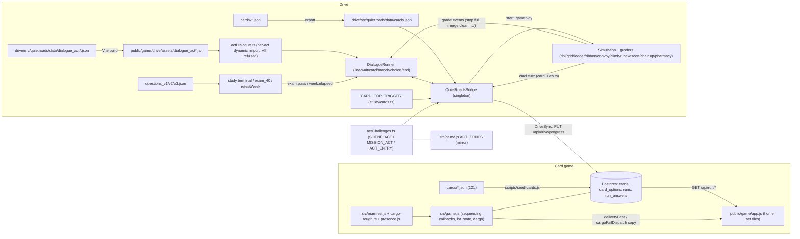

# STORY BIBLE — PINK MENACE: The Quarantine Runs

Full storyline audit (read-only pass; this file is the only artifact written). Every claim
cites `file:line`; **INFERRED** marks reasoning without a citation.

**Two story surfaces:**

1. **The card game (`/`, "PINK MENACE")** — owns the story canon. Cards live in `cards/*.json`
   (121 files), seeded to Postgres by `scripts/seed-cards.js` (`src/schema.sql:49-80`), and
   sequenced by `src/game.js`.
2. **The drive (`/drive`, "Quiet Roads")** — re-enacts the story in 3D. Story lives in
   `drive/src/quietroads/data/dialogue_act*.json` (11 files) + a bundled card copy
   `drive/src/quietroads/data/cards.json` (121 cards — verified parity with `cards/*.json`).
   "The card game owns the story. The drive re-enacts it." (`docs/ACT_DRIVE_ALIGNMENT.md:3-5`,
   `drive/src/quietroads/actChallenges.ts:2-9`).

**Runtime vs. source (duplicates):** card text/options go `cards/*.json` → Postgres
(`seed-cards.js:59-126`; read back by `src/game.js:942-1001`) and → the drive bundle
(`docs/DRIVE.md:39-41`). Drive dialogue JSON is compiled by the Dockerfile's first stage into
`public/game/drive/assets/dialogue_act*.js` (`docs/DRIVE.md:3-4`), loaded per act by
`drive/src/quietroads/dialogue/actDialogue.ts:54-76`. `cards/ACT_II_FOR_AUDIT.json` /
`ACT_III_FOR_AUDIT.json` are unused aggregate audit copies. `cards/*.compile.txt`,
`cards/takes/*.prompt.txt`, `delivery/`, `generations/`, `ceiling/`, `zombie_zones/` are art
pipeline derivatives (image briefs/takes), not runtime story.

**Files scanned:** 13,050 total; 509 text/code files outside `node_modules`, all processed
(large JSON walked field-by-field with source line numbers).

---

## 1. Synopsis

Fourteen months after the Cascadia Quarantine sealed Washington at the Columbia and the
Cascade passes, the grid still runs — so the rules of the road still have teeth
(`pack/01_BIBLE.md:9-15`). Seventeen-year-old **Ali Okonjo** inherits her grandmother's pink,
plow-nosed, cage-windowed VW Beetle — **the Pink Menace** — with a note: "Ali-bug — She's yours
now… Come home slow." (`dialogue_act0-1.json:197`). Her family is 280 miles east in Spokane;
the only road there climbs a pass she can't take on a permit or alone, so "today you do the
small version: you go get the license" (`cards/I-001.json:9`). At the empty licensing office
the plan collapses: Gracie the cat escapes, the recovery's noise draws **the Quiet** (the
infected — never "zombies"), and **Mya** the second cat is lost (`cards/I-006.json`–`I-008.json`;
`dialogue_act0-1.json` scene `1.3`). A rumour board sends her to the Valley warehouse, where
**Deac** — ex-transit operator, keeper of the clipboard and (it turns out) of Mya — trades a
permit path for quiet delivery runs across **the Grid** of Kent: insulin for June, cat food for
Auntie Bea, radio parts for Priya, fuel filters for Tuna, and a four-way showdown with fast
courier **Jonah** (`dialogue_act2.json:109-2126`). She drives Central in Deac's bus **the
Ledger**, then the I-90 convoy where Jonah stalls among dormant Quiet and she must choose the
cargo window or a person (`dialogue_act3.json:749`); passes Deac's 40-question exam (32 to
pass — which stamps the permit and returns Mya, `dialogue_act4.json:580-641`); climbs the
mountain with chains through a summit lot full of Quiet at walking speed
(`dialogue_act5.json:817-833`); says goodbye to Deac at Ellensburg (field notes + the rare
Sori photocard, `dialogue_act6.json:151-241`); survives the night straight, the rest area,
the Vantage Bridge and a moth (`dialogue_act6.json:971-1541`); and escorts grain trucks to
Ritzville with old **Hank** — "you didn't do anything stupid" (`dialogue_act7.json:742`). The
card canon closes Act VI with Deac initialing her log — "You passed it… and the pass is yours
at dawn" (`cards/VI-013.json`; `src/manifest.js:186-195`) — while the drive's written epilogue
(`dialogue_act8.json`, act closed at runtime) has her park a foot from the line on Division
Street, hand the story to Mom and Ray, and a week later sign off the Spokane Relay with
Deac's faint reply — "…Seatbelt." — only if she drove well enough (`respect ≥ 80`,
`dialogue_act8.json:1501-1525`). Act VII (the Dark Hours; the herd on the pass) stays closed
everywhere (`README.md:37`, `actDialogue.ts:49-51`).

## 2. Full chronological story

The playable chronology is the drive's scene chain (0.1 → 7.3; 8.x is written but closed).
Card-canon beats are marked **[card]**. Drive citations give the node-key line in
`drive/src/quietroads/data/dialogue_act*.json` (abbreviated `act0-1`, `act2`, `act2c`, `act3`,
`act4`, `act5`, `act5r`, `act6`, `act6b`, `act7`, `act8`).

### Act 0 — Cold open & the carport

1. **Cold open, dawn.** Ali to Gracie on the couch; Mya will not open her eyes. — scene `0.1`
   (`act0-1.json:122-173`).
2. **Grandma's note hands over the Menace** — "She's heavier than she looks, so she takes
   longer to stop… Come home slow."; Tuna at the Valley warehouse can help. Permit rule: 15
   with driver-ed, 15½ without; a licensed adult rides beside you — "that adult is going to
   have to be someone I earn." — scene `0.2` (`act0-1.json:197-235`).
3. **Tutorial** teaches throttle, stopping shadow, noise meter ("Green, they don't care.
   Yellow, some of them look. Red… we're not doing red"), brake, and an end-of-block objective
   ("Without waking up Mr. Halvorsen… not really Mr. Halvorsen anymore"). — `act0-1.json:242-349`.
4. **Cards I-002 Before the Engine** (walk the car), **I-003 The Belt** ("The belt is yours"),
   **I-004 Roll and Stop** — `act0-1.json:233-368`; `cards/I-002.json`–`I-004.json` (scene L6).
5. **Radio: Spokane relay.** Mom: permits still count, fuel is rationed by license, "Don't
   drive the pass on a permit. Don't drive the pass without chains." Card **I-001 The Pass Is
   Closed**. — scene `0.3` (`act0-1.json:438-521`).

### Act I — The Lot (Mya is lost)

6. **The drive to the DOL** (`mission_dol_drive`): full stops ("Nobody's coming, do it
   anyway"), school zone ("There's a bike still chained to the rack. Twenty."), rail crossing
   ("Trains don't care about your assumptions"). `stop.rolled` sets `rolled_stop_act1`. —
   scene `1.1` (`act0-1.json:547-628`).
7. **The licensing lot:** "They're still in line. Two years." Cards **I-005 Licensing Office,
   Kent** (doors propped, counter empty — "That is the end of the plan") and **I-009 Before
   the Wheels**; `minigame_park_dol` (clean / curb). — scene `1.2` (`act0-1.json:689-800`).
8. **Inside** (`stealth_dol_interior`): emergency power still on; carriers down for "forty
   questions"; Gracie's latch pops; the pamphlet rack crash (92 dB). Card **I-006 Gracie's
   Out** — call her (loud) or cut her off (quiet). — `act0-1.json:809-922`; `cards/I-006.json:6`.
9. **The chase** (`chase_dol_gracie`) → card **I-007 The One You Didn't See** (the fourth
   Quiet, mid-stride between rows; every option `was_correct: true`; "It does not change what
   the lot takes"). She has Gracie — then Mya is gone. — `act0-1.json:929-976`;
   `cards/I-007.json:9`; `pack/30_THE_DOL_LOT.md:7-15`.
10. **The choice (1.3.C, 10 s):** "If I honk they'll all come. If I wait… they might not."
    **wait** → creeping escape, card **I-010 Out of the Stall**, leave without her
    (`mya_lost:true`, `dol_honked:false`). **honk** → 95 dB, the lot wakes ("the whole lot's
    gone": `mya_lost`, `dol_honked`, `dol_lot_lost`). — `act0-1.json:990-1122`.
11. **Card I-008 One of Them Comes Back** — Gracie shaking on her chest, passenger seat empty;
    "calling is what started this." — `cards/I-008.json:6`.
12. **Aftermath (night):** "I'm going back for her. Tomorrow. With a plan." Mom: "Bad night?" —
    Ali doesn't pick up. Card **I-011 The Window**. — scene `1.4` (`act0-1.json:1210-1312`).
13. **Rumor board** (pharmacy safehouse): "Anyone seen a girl in a pink Bug with a plow?
    Couriers at the Valley warehouse asking. Not in trouble. Probably." Card **I-012 The
    Street**. "Fine. Plan B." → `unlock region.kent_valley`, `act1_complete`. — scene `1.4b`
    (`act0-1.json:1336-1374`).

### Act II — The Grid (Deac's deliveries)

14. **Valley warehouse:** Tuna knows the car (filing-cabinet doors) and the cats; "So you
    stayed for the cats." Deac's in the back — "Knock. He hates it when people don't knock."
    — scene `2.1` (`act2.json:117-207`).
15. **Deac has Mya.** "That's a cat I pulled out of a building you left it in." He replays the
    night (branch `dol_honked`: "Then you honked… That lot's gone now"; branch
    `rolled_stop_act1`: "Rolled the one on Titus" vs "Every one… Remember what that felt
    like"). Deal: run deliveries, keep a convoy alive, then the cat. "That's blackmail." /
    "That's a driving test." — scene `2.2` (`act2.json:230-494`).
16. **Delivery 1 — insulin** (`mission_delivery_1_insulin` + `dropoff_pharmacy`): "June's
    clipboard at the pharmacy safehouse on Meeker." In-scene quiz (four-way: first to stop;
    tie: yield right; uncontrolled: slow/look/yield — wrong answers loop "Again."), grandma
    lore (the '09 vision-test argument), smooth-brake-near-Quiet beat, door-slam vs soft-close
    beat. Cards **II-001**, **II-024**. — `act2.json:523-988`.
17. **Delivery 2 — cat food to Auntie Bea** (`mission_delivery_2_catfood`, back-in dock):
    the sanctuary holds eleven cats ("Twelve if you count the one that lives in the ceiling");
    "Silent. Hear the Quiet before you do… It's never no reason." She sells the silent collar
    and the toy — "A busy cat is a quiet cat." — `act2.json:1084-1277`.
18. **Delivery 3 — radio parts to Priya** (`mission_delivery_3_radio`, Central Ave): HUSH —
    "Four idols in the Tacoma Dome bunker… Everything's whisper-level — they had to, it's the
    rule." Photocard trading (Sori is the rare pull). Card **II-004**. — `act2.json:1368-1518`.
19. **Delivery 4 — fuel filters to Tuna** (`mission_delivery_4_filters`, parallel park):
    "Fred Meyer parking lot. Every Sunday. I watched her teach half of Kent in that lot."
    Upgrades: quiet muffler, rubber, lights, chains ("Everybody thinks they don't need
    chains"), plow tune ("Wedge, not wall. Still loud. Still last resort."). — `act2.json:1605-1745`.
20. **Jonah's four-way** (`mission_jonah_intersection`): his van blows the intersection and
    wakes the corner. Branch on `jonah_scene_loud` — quiet: "You drive like my grandma." /
    "My grandma drove this car for forty years and never woke anybody up."; loud: "Oh, you
    woke 'em up too. Nice. We're twins." Deac: "You were fine." vs "You were loud." →
    `act2_complete`, `unlock region.i90`. — `act2.json:1828-2113`.
21. **Shops** (Trade Points): Bea's cats (2.6), Priya's K-pop (2.7), Tuna's upgrades (2.8) —
    buys set `has_gracie_toy`, `has_gracie_collar`, `has_sori_card`, `has_quiet_muffler`,
    `has_chains`, which pay off at beats 36, 40-41, 46-48. — `act2.json:2181-2539`.
22. **[card] Act II's faces for rules:** school lamps **II-002**, portable stop in fog
    **II-003**, Marisol **II-005**/**II-026**, Deac's hand signals **II-006**/**II-016**/
    **II-022**, Bus 12 · Reyna · Tobin **II-007** (amber) & **II-010** (callback, bent arm),
    the Chorus on the radio **II-009**, three-second gap **II-012**, slow-vehicle triangle
    **II-013**, Hollis **II-014**, **II-029 Drive Around the Block**, **II-030** driveway
    turn, **II-031 Into the Dash** (callback of I-003). — `cards/II-*.json`;
    `pack/33_LOT_MEMORY.md:7-13`.

### Act III — Central (the Ledger) & the I-90 convoy

23. **Deac's cargo run** (`mission_central_ledger`, scene `2.5`): "No back window, so the
    mirrors are your whole world back there." Cards **III-002/003/004/006**; grades fire
    `ledger.lanechange.*`, `ledger.crossed_solid`, `ledger.follow.close`, `ledger.wrong_lane`,
    `ledger.merge.*`. — `act2c.json:26-175`.
24. **[card] III-001 "Your Wheel"** — the ride-along: twelve dispatch-cadence lines, one
    deliberate late merge played to consequence ("I spent his margin so I could keep mine…
    That's the merge you do not take"), ends "Your wheel." — `cards/III-001.json`;
    `pack/22_III_001_RIDE_ALONG.md:11-22`.
25. **[card] III-002 "Mya Has the Glass"** — the reveal: Mya is a loaf on the Ledger's dash
    (parked). She is Ali's; Deac read the collar and kept her through two acts. —
    `cards/III-002.json`; `pack/01_BIBLE.md:40,52`.
26. **[card] Deac's act:** the Drift (fatigue III-013/016/020/025), Old Ninety the rogue semi
    (III-011/012), Hollis (III-009), Reyna off-route (III-021), Officer Dunn's siren
    (III-022), and the close: the Core skyline, "the door to Act IV is visible and shut," and
    Yuna's voice on the radio — "a count-in, then a laugh, then static. Yuna, not yet a face"
    (III-030). — `cards/III-*.json`; `pack/20_ACT_III_PLAN.md:45-81`.

### The Ribbon (drive scenes 3.x — mapped to card-Act V)

27. **The on-ramp** (`mission_ribbon_merge`, scene `3.1b`): "The Ribbon. Eyes up, not on the
    bumper." Cards **V-001/003/005/007/010/012** open on ramp/merge beats. —
    `act5r.json:26-152`.
28. **Convoy briefing** (scene `3.1`): Issaquah medical checkpoint, three vehicles — Deac
    leads, Jonah middle, Ali sweeps. Bea gives Gracie treats; "Deac took her carrier out to
    the truck an hour ago. I didn't say that. Go." — `act3.json:118-241`.
29. **I-90 eastbound** (`mission_convoy_issaquah`, scene `3.2`): ramp speed, gap-taking,
    three-second following (cards **V-001/V-003/V-005**, **III-007**), the 70 limit ("That's a
    limit, not a target"), pink-car lore ("{GRANDMA} said nobody expects anything from a pink
    car. So nobody bothers you"), Jonah on grandma — "She's in Spokane. She got on the bus." —
    `act3.json:268-532`.
30. **The Stall — the story's biggest choice** (scene `3.3`, node `3.3.C`): Jonah's van dies on
    the shoulder; the median holds dozens of dormant Quiet; the cargo "has a window. It's
    insulin. It's literally on a clock." **continue** (`stall_continued`, −20 respect): he
    walks six hours; cargo arrives with 11 minutes to spare; Deac: "Cargo made the window…
    Those aren't the same size."; the carrier stays in the truck (`mya_deferred`). **stop**
    (`stall_stopped`, +40): tow-strap QTE, 35 mph creep, cargo 40 minutes late; Deac: "Late." /
    "Both of you." / "…Good." — `act3.json:667-1169`.
31. **Issaquah resolution:** stop → `3.4` "Issaquah: Mya Returns" (Deac sets the carrier on
    the hood and says nothing; Gracie yells once and every Quiet within a hundred yards turns;
    "Loud one stays in the car."). continue → `3.4a` "Issaquah: Empty Hood" (Jonah: "Pass the
    test. He'll give you the cat. He's mean, not cruel."). — `act3.json:1293-1498`.
32. **Radio that night** (scene `3.5`): Mom, Ray, "Is he good?" / "He's terrifying." / "Good."
    Test tomorrow. → `act3_complete`, `unlock terminal.exam_40`. — `act3.json:1518-1735`.

### Act IV — The Core (the exam)

33. **The night before** (scene `4.1`): Deac drops the duffel — blank license forms, the state
    seal stamp. "Forty questions. Thirty-two right… I failed everyone I liked. That's why
    they're alive." Choice: **study** (`study_terminal`; streak lines; wrong-repeat "Out loud.
    To the cat."; cramming cut after 3 sets) or **sleep**. Retest variant reads
    `exam_weak_chapter`. — `act4.json:138-418`.
34. **Forty Questions** (`exam_40`, scene `4.2`): "Phone off. Cats out." Abandon → "Walking out
    is a fail. Sitting down is a question you haven't answered yet." **Pass** → stamped,
    signed, "Alison. Driver's license."; if `mya_deferred` the carrier is set on the signed
    form ("Two things you earned tonight. One of them's asleep"); score tiers (40 → "Don't
    tell anyone. They'll think I went soft."; ≥36 strong; else "A pass is a pass"); Tuna
    mounts chains (branch `has_item:chains`); checkpoint `permit_earned`. **Fail** → Field
    Notes chapters 1-8 read aloud (NOTES voice), "Deliveries at six. Retest in a week." →
    `4.3` local week (`local_loop_week`, Jonah: "I got thirty-one my first time. We're
    basically the same person." / Deac: "He got thirty-one twice.") → back to `4.1`. —
    `act4.json:482-1509`.
35. **[card] Act IV in the card game is The Core (downtown Seattle), Yuna's act:** IV-009
    "When Loud Is Right" (the PA is for a dying block), IV-010 "Eleven Months" (idol trainee,
    border closed), IV-016/017 "The Conversation" (Deac returns Mya — "He gives her back
    because he decided. You take her. You do not say the name."), IV-018 "Two on the Seat",
    IV-030 "The Door to the Pass" (eastbound; the pass is still closed). — `cards/IV-*.json`;
    `pack/34_ACT_V.md:39`.

### Act V — the climb (drive scenes 5.x)

36. **The Climb** (`climb_snoqualmie`, scene `5.1`): snow; half-buried 60 sign — "Sign was
    posted in July. Thirty-five." Skid recovery ("OFF the brake. Steer where you want to go.
    Not where you're going"), Mya waking is a warning ("Bea said it's never no reason"), quiet
    settle. Retry branches on `climb_retry`. — `act5.json:95-380`.
37. **Chain-up area** (`chainup_qte`, scene `5.2`): "Drape, hook, tighten. Don't drop the
    tensioner." No chains → Deac stops her: "Sign says chains. Sign means chains… Go back
    down. Tuna's got a set. Earn it." → she turns around → **NEXT_SCENE 2.8** (Tuna's shop).
    Success → "Now you're the only car on this mountain that's allowed to be here." Summit
    brief: "Lights off past the sign. Walking speed. Don't stop, don't speed up, don't talk."
    — `act5.json:570-763`.
38. **The Summit** (scene `5.3`): "Snow falling on a hundred silent figures standing in the
    ski resort parking lot." Chains ticking, headlights off. Branch `has_gracie_toy` ("She
    had the toy in her mouth the whole time. Bea was right." / "Don't tell her. She'll be
    insufferable."). → `act5_complete`, `unlock region.ellensburg`. — `act5.json:817-933`.
39. **[card] Card-Act V is the relay-kit run to Tower 4** (valley floor): V-002 "Tower 4"
    (kit = repeater, antenna, clamps), V-004 ramp meter ("The meter is a light"), V-006 beside
    the trailer, V-008 cone line, V-009 "Small Hands at Speed", V-011 zipper, V-013 "Flashers
    on the Strip" (get past the curve, all the way right, flashers, stay inside). Yuna is
    radio-only with four locked appearances (`pack/36_YUNA_RADIO_VOICE.md:44-55`). —
    `cards/V-*.json`; `pack/34_ACT_V.md:13-15`.

### Act VI — The Backcountry (Ellensburg → Ritzville)

40. **Goodbye, Deac** (scene `6.1`): Ellensburg fuel depot at dusk. He fills the Beetle, hands
    over the Field Notes ("Everything I ever told anyone who listened. Some of it's about
    driving.") and the Sori photocard ("Priya says that's the rare one. Don't tell Jonah." —
    or "Now you've got two"). "You'll want to go fast now… Fatigue is quiet, too. It'll get
    you before they do." "Thank you for the cat." / "…She was never the point." Jonah reaches
    for the horn — and flashes his headlights twice instead. → `deac_gone`. — `act6.json:138-377`.
41. **The Gravel** (`mission_backcountry_run`, scene `6.1b`): drop-offs ("off the edge you hold
    the line — you don't jerk back"), blind crests, uncontrolled intersections, crossbucks.
    Cards **VI-001/002/004/006/010/012**. — `act6b.json:26-194`.
42. **The Straight, night** (`straight_night_drive`, scene `6.2`): "Nobody out here for fifty
    miles — high beams. The book says five hundred feet." Don't outdrive your headlights
    (stopping shadow inside the lights; LED branch). Fatigue stages; HUSH plays "Hold Still" —
    requested "for a girl in a pink car" by someone in Kent. **Rest choice:** pull in (twenty
    minutes; Mom on the radio; Ray: "Check your tire pressure in the morning") or push through
    → rumble strip ("The book said twenty minutes… The road had to say it") → forced stop.
    Morning tire-check choice (`tire_checked`). Cards **III-016/III-020**. — `act6.json:408-989`.
43. **Vantage Bridge** (`vantage_bridge_crossing`, scene `6.3`): wind ("{GRANDMA} said this
    bridge is where the wind lives"); a sign rips loose (88 dB — "That wasn't me"); then, with
    the toy, Gracie takes the felt mouse silently (`bridge_nonevent`), or without it a moth
    makes her THUMP the window and every head turns: engine off, sixty seconds, "Don't breathe
    loud… They're very good at forgetting." Early restart is punished. → `act6_complete`,
    `unlock region.moses_lake`. — `act6.json:1142-1577`.

### Act VI close / the Ritzville run (drive scenes 7.x)

44. **Moses Lake dawn** (scene `7.1`, `escort_ritzville`): four Authority grain trucks.
    Dispatch: "Pink Bug, you're cleared to escort. Fall in behind Hank." Hank: "Four seconds
    behind me, Bug. Not three. I'm not a Beetle." — `act7.json:150-198`.
45. **The escort** teaches no-zones ("If I can't see you in my mirror, I can't see you"; the
    red around the truck), the wide right turn ("the inside isn't a lane. It's a trap with a
    lane painted on it"), move-over for the patrol truck ("Over or slow. Never nothing."),
    passing beside trailers (card **V-006**), and Hank's lore ("He got that from me. Oh-four.
    Ellensburg truck stop. He wrote it down on a napkin."). Report tiers on `escort_incidents`
    (0 → "Hank said you didn't do anything stupid" + `hank_report_clean`; ≤2 → "one stupid
    thing and didn't do it twice"; else "Hank said you got here"). — `act7.json:228-819`.
46. **Barter at Ritzville** (scene `7.2`; "PRICES ARE WHAT THEY ARE"): tiers on `trade_points`
    (≥400 → discount, "Don't tell Hank, he'll want it too"; ≥180 → one purchase — "Which two
    hours scares you more — the dark ones or the loud ones?"; else short — free terrible
    coffee, plus the "Sori was worth it" beat if she owns merch). — `act7.json:1100-1453`.
47. **Radio, Ritzville** (scene `7.3`): Mom will be at the Division Street checkpoint with Ray
    and "the gray one. The one the cats like." Hank's line relayed if `hank_report_clean`.
    "Drive careful." — a sound "that is either laughing or crying and is both." "Get in the
    car, Alison." → `act7_complete`, `unlock region.spokane`. — `act7.json:1519-1656`.

### The epilogue — Spokane (written; the act is CLOSED at runtime)

48. **The last two hours** (scene `8.1`, `spokane_home`): lights branch (LED vs "Old lights.
    Slower, then. …Sori was worth it."); Sprague Avenue — "everything from Kent, in a
    different order, and none of it new. Nothing new. Just right."; Quiet cluster ignored
    (muffler branch: "They didn't even look. Tuna, I love you."); Mya's wake heeded; checkpoint
    at exactly the posted speed ("Don't rush the last two hours"); final parallel park ("Fred
    Meyer lot. Forty times. One more.") graded by `park_gap_in`. — `act8.json:120-559`.
49. **Division Street** (scene `8.2`): the Beetle stops a foot from the line; Mom walks fast,
    very quiet, and holds on; Ray eyes the plow ("Is that a plow?" / "Filing cabinets." /
    "We're going to need to talk about insurance.") and asks about tire pressure
    (`tire_checked` branch); the stall payoff (stop → "A kid named Jonah says thank you" via
    Ray; continue → "Somebody walked six hours because of me, once… Was it?" / "…No."); then
    Grandma out of the hut with the gray blanket — the run's one on-screen surprise
    (`8.2.gm1`–`8.2.gm6`: "You got on the bus." / "It went east. So did you." / "I told you.
    Come home slow." / "…I did."); she puts the blanket over the roof; Gracie attacks it; Mya
    sleeps through everything. — `act8.json:744-1330`.
50. **Epilogue, one week later** (scene `8.3`): "I got here. Both cats. License is on the
    fridge. Mom put a magnet on it. A cat magnet." Messages for Jonah, Bea, Tuna, Priya, Hank
    (each behind a flag/item branch). "Thank you for the cat. Thank you for the test. Same
    time tomorrow." **Ending gate:** `respect ≥ 80` → Deac answers, very faint: "…Seatbelt."
    (`deac_answered`); else static ("The mountains eat radio"). Both paths land on the chair
    (`8.3.13`) and then on the credits' final card, which toggles on `deac_answered` —
    `8.3.credits_deac` ("The last card is the radio… …Seatbelt.") or `8.3.credits_static`
    ("The last card is the room…"). `game_complete` unlocks `credits` only; the
    `postgame.deacs_route` string it used to carry was never implemented and is gone.
    (`drive/test/ending.test.ts`.) — `act8.json:1263-1590`.

### Card-game-only end beats (no drive scene)

- **Act II close** — "Delivered. 41 minutes to spare." / "Delivered warm. June took it
  anyway." / fail: "The pack warmed on Willis. The pharmacy is telling June it's tomorrow."
  (`src/manifest.js:160-201`; spec `pack/21_THE_MANIFEST.md:48-60`).
- **Act V close** — "Relay kit delivered. Repeater, antenna, clamps. Tower 4."
  (`src/manifest.js:180-185`).
- **Act VI close** — the sheet goes in the glovebox; "the pass is shut tonight. Four feet on
  the ridge in two days, or something standing on the east slope that the plows won't go
  near… But the gate has your name in it now… the word is dawn… Two hundred and eighty miles
  east, your mother is awake and does not know yet." (`src/manifest.js:186-195`).
- **Act VII** — permanently closed: "The herd is on the pass. Act VII stays closed."
  (`actChallenges.ts:132-143`).

## 3. Characters

Call signs / accents locked in `pack/01_BIBLE.md:63-75`; cast portraits also in
`src/game.js:189-207` (CAST / CAST_CARDS).

**Ali Okonjo — "KILO"** (the Menace). Age 17, cranberry coiled hair, wire-rim rounds, flat dry
affect (`pack/01_BIBLE.md:35-39`). Motivation: get licensed, then drive the pass east to her
family in Spokane (280 miles, `cards/I-001.json:9`). Weakness/arc: speed. Relationships:
grandmother's heir (`act0-1.json:197`); Mom & Ray on the relay radio (`act0-1.json:438`);
Deac's student (`act2.json:424`); Jonah's rival-turned-friend (`act2.json:1875`); Gracie & Mya
are hers (`pack/01_BIBLE.md:40`). First: `act0-1.json:122` / `cards/I-001.json`; last:
`act8.json:1551` (closed act) or in live play `cards/VI-013.json`. Files: all dialogue files
and effectively the whole card corpus.

**Desmond Vaile — "DEAC"** (the Ledger). 54, ex-transit operator, 26 years "never a
preventable"; dispatch cadence; "believes the schedule is a moral document"
(`pack/01_BIBLE.md:42-50`). Signature object: the clipboard = the PSDP supervised-driving log
(`pack/01_BIBLE.md:46`). Weakness: fatigue (the Drift). Motivation: keep convoys alive; tests
Ali before trusting her with anything that can't protect itself (`cards/IV-017.json`). Arc:
from examiner ("That's not a judgment. That's a report.", `act2.json:280`) to the man who
returns Mya and signs her log (`cards/VI-013.json`). First: `act2.json:230` / `cards/II-006`;
last live: `act6.json:377` (goodbye) + voice `act8.json:1525` (closed). Files:
`dialogue_act2*.json`, `act3`, `act4`, `act5`, `act6`, `act8`; `cards/II-006`, `III-*`,
`IV-016/017`, `VI-013`; `pack/22_III_001_RIDE_ALONG.md`.

**Yuna Park-Reyes — "ENCORE"** (radio voice). 17, idol trainee — "Eleven months into a trainee
contract… when the border closed" (`cards/IV-010.json`); Encore carries four PA horns; weakness:
distraction/passengers — "her whole kit is built to draw attention in a world where sound and
light draw *them*" (`pack/01_BIBLE.md:54-61`). Arc: learning *when* to be loud (IV-009/IV-029).
Radio-only in Act V, four locked appearances (`pack/36_YUNA_RADIO_VOICE.md:44-55`). First:
teased `cards/III-030.json`; live: `cards/IV-009/010/029` + V-cards; HUSH song in `act6.json:602`.

**Gracie** (orange tabby; "the curious one, and the one who comes back", `pack/01_BIBLE.md:40`).
Story role: the noise lesson (I-006/I-007), the dash bill (II-031), the toy payoff (5.3, 6.3,
8.3), the moth on Vantage Bridge (`act6.json:1361`). First: `act0-1.json:135`; last:
`act8.json:1225` (closed). Files: `act0-1`, `act2`, `act3`, `act5`, `act6`, `act8`,
`cards/I-002…I-012`, `II-018`, `II-031`, `IV-018`, `IV-028`, `VI-001…`.

**Mya** (brown mackerel tabby; "She bolts at the DOL lot. Deac finds her… Neither of them says
whose she is", `pack/01_BIBLE.md:40`). The story engine: lost at the lot (I-008), found by
Deac (2.2), revealed on the dash (III-002), returned on exam night (4.2 / IV-017) or at
Issaquah (3.4). Her waking is a Quiet omen ("It's never no reason", `act2.json:1203`;
`act5.json:357`; `act8.json:339`). First: `act0-1.json:148`; last: `act8.json:1225` (closed).

**Mom & Ray.** The family at the Spokane end of the radio. Mom speaks via `radio_static`; Ray
is the stepdad whose "truck breaks constantly" (`act3.json:983`) and the tire-pressure
conscience (`act6.json:842`, `act8.json:942`). Motivation: keep her on the permit rules and
get her home. First: `act0-1.json:438`; last: `act8.json:1511` (closed). Files: `act0-1`,
`act3`, `act6`, `act7`, `act8`; radio bark variants in `src/manifest.js:115-134`.
Grandma stands behind them at the checkpoint (8.2, `8.2.gm1`).

**Grandma.** On screen once, at the very end: the third figure at Division Street. She was
evacuated east by bus ("She got on the bus", `act2.json:155`; "She's in Spokane", `act3.json:512`),
so the reunion is Mom, Ray — and the woman whose car this is. She comes out of the checkpoint hut
with the same gray blanket (8.2, `8.2.gm1`–`8.2.gm6`), takes it out of Ray's hands and puts it
over the Beetle's roof for Gracie, and closes the note out loud: "I told you. Come home slow." /
"…I did." Legacy presence before that: the note (`act0-1.json:197`), forty years of the pink car
("nobody expects anything from a pink car", `act3.json:476`), the Fred Meyer lot teaching
("I watched her teach half of Kent in that lot", `act2.json:1689`), the '09 vision-test argument
(`act2.json:799`), the bridge lore (`act6.json:1164`). Her legacy voice is the Field Notes
"NOTES" chapters (`act4.json:1179-1228`). Voice: bedless and low, one campaign voice
(`dialogue/voice.ts` `GRANDMA`), entered in the act-8 `characters` table; no portrait art
exists yet (the schema requires only `name`). Files: `act0-1`, `act2`, `act3`, `act4`,
`act5`, `act6`, `act8`; `cards/II-029`; placeholders `{GRANDMA}`/`{GRANDMA_INITIALS}` —
the note signs "— G." (`act0-1.json:14`).

**Tuna.** Valley warehouse mechanic; built the plow and filing-cabinet doors (`act2.json:117`);
sells upgrades; the chains authority ("Everybody thinks they don't need chains",
`act2.json:1698`; mounts them at `act4.json:815`). First: `act2.json:117`; last:
`act8.json:1349` (closed).

**Auntie Bea.** Cat-sanctuary keeper (eleven cats, "Twelve if you count the one that lives in
the ceiling", `act2.json:1185`); the quiet-cat thesis ("A busy cat is a quiet cat",
`act2.json:1239`); gives the toy that saves the bridge (`act6.json:1308`). First:
`act2.json:1144`; last: `act8.json:1316` (closed).

**Priya.** Radio-shack courier; HUSH evangelist ("Four idols in the Tacoma Dome bunker…
whisper-level", `act2.json:1469`); photocard trading (Sori is the rare pull). First:
`act2.json:1407`; last: `act8.json:1389` (closed).

**Jonah.** "I'm the fast one." Fast courier; loud, funny, secretly kind (walks six hours,
`act3.json:1435-1489`; "Everybody home. Cargo's a distant second.", `act3.json:1462`). Arc:
rival → the person she may abandon → the friend who flashes his headlights goodbye
(`act6.json:354`). First: `act2.json:1875`; last: `act8.json:1294` (closed). Files: `act2`,
`act3`, `act4`, `act6`, `act8`.

**Hank.** Grain-truck veteran, Ritzville escort; origin of the mirror rule ("He got that from
me. Oh-four. Ellensburg truck stop.", `act7.json:676`); his verdict is the medal. First/last:
`act7.json:171-819`; referenced `act8.json:1443`. Quiz flavor in `questions_v1.json:2560`.

**Reyna Solis & Bus 12; Tobin.** Last shelter-route bus; the stop-arm lesson (II-007 amber /
II-010 bent arm, `cards/II-007.json`, `cards/II-010.json`); Tobin "the kid who bolts from
behind Bus 12" (`pack/01_BIBLE.md:97-98`); Reyna recurs off-route in `cards/III-021.json`; her
radio bark is the cold-clock pressure ("Pharmacy's checking. June's asking. — R.",
`src/manifest.js:131`).

**Marisol** (courier on a bicycle — door zone & three feet: II-005, II-026, IV-013). **Hollis**
(lifted truck, tailgating: II-014, III-009). **Officer Dunn** (WSP remnant, the siren rule:
III-022). **Old Ninety** (rogue semi, the no-zone: III-011/012). **Grange / farm truck**
(VI-005). **Gravy the plow, The Ferry Line, The Crossing** — bible roster only
(`pack/01_BIBLE.md:104-106`), never carded (Act VII or future).

**June.** Never on screen; the insulin recipient ("June's clipboard at the pharmacy safehouse
on Meeker", `act2.json:523`); the human stake of the cold clock (`pack/21_THE_MANIFEST.md:17`).

**LUMI & SORI (HUSH).** Four idols in the Tacoma Dome bunker; Sori is the rare photocard; they
sing "Hold Still" for a girl in a pink car (`act6.json:602-621`). Files: `act2`, `act6`, `act8`.

**The Quiet.** The infected — "never called zombies in-fiction" (`pack/01_BIBLE.md:17`); three
sensory rules (sound / light / yaw draws); the Herd migrates along road corridors
(`pack/01_BIBLE.md:21-27`). Register: posture and stillness, never gore, never filling the
frame (`pack/01_BIBLE.md:198-215`). In the drive: one herd (`sim/quiet.ts`, spawns in
`sim/kentMap.ts`), woken by missed grades (`sim/pressure.ts:1-17`).

**Mr. Halvorsen.** Neighbour in the tutorial objective — "not really Mr. Halvorsen anymore"
(`act0-1.json:274`). A named Quiet.

**Dispatch & the Ritzville Vendor** — voice of Authority escort (`act7.json:159`) and the last
shop before Spokane ("PRICES ARE WHAT THEY ARE", `act7.json:1100`). **BOARD** (the rumor board,
`act0-1.json:1336`) and **NOTES** (Grandma's field notes, `act4.json:1179`) are non-person
speakers (`act0-1.json:115-119` character table).

## 4. Locations / settings

Location registry (card canon) is `pack/01_BIBLE.md:229-277` (L-001…L-006 + the Act VII
variant L-002-VII). Drive locations are `location` fields on each scene (cited in §2) and map
geometry in `drive/src/quietroads/sim/kentMap.ts` / `corridors.ts`.

| Place | What happens there | How you get there | Source |
|---|---|---|---|
| **The Lot** — dead Fred Meyer lot, Renton (card canon L-002) / the Kent licensing lot (card text) | Act I opener; the DOL lot where Mya is lost; the quiet interior & chase | Act I entry scene 0.1→1.1 | `pack/01_BIBLE.md:262-267`; `cards/I-005.json:9`; drive `act0-1.json:636` (`kent_dol_lot`) |
| **Grandma's carport** (Kent side street) | Tutorial; the note; aftermath after the lot | scene 0.2 / 1.4 | `act0-1.json:181,1076` |
| **Kent residential streets** (L-001 4th Ave S at Willis; L-005 school zone; L-004 Central Ave; L-006 slide cut) | Act II deliveries: stops, school lamps, bus, bike, fog work zone, four-way | scene 1.1, 2.3a-d | `pack/01_BIBLE.md:237-260`; `act2.json:508-1755` |
| **Kent Valley warehouse / Tuna's bay** | Meeting Deac; Mya's return-by-test; upgrades shop | scene 2.1/2.2/2.3d/2.8 | `act2.json:109,218,1528,1751` |
| **Meeker pharmacy safehouse** | Insulin drop for June; the rumor board | scene 2.3a dropoff / 1.4b | `act2.json:870`; `act0-1.json:1320` |
| **Auntie Bea's cat sanctuary** | Cat food drop; collar/toy shop; the quiet-cat thesis | scene 2.3b / 2.6 | `act2.json:1144-1277` |
| **Priya's radio shack** | Radio parts; HUSH pitch; photocard shop | scene 2.3c / 2.7 | `act2.json:1407-1518` |
| **Central Avenue (Kent)** — multi-lane | Deac's Ledger run (stay right, signal, gap, merge) | scene 2.5 | `act2c.json:19` |
| **I-90 / the Ribbon** (on-ramp; Kent→Issaquah; climb; summit) | Highway merge, convoy, the stall, the snow climb, chain-up, the Quiet summit lot | scenes 3.1b–3.3, 5.1–5.3 | `act5r.json:19`; `act3.json:256,538`; `act5.json:80,398,685` |
| **Issaquah checkpoint / safehouse** | Mya returns or stays deferred; the night radio; exam night & the week | scenes 3.4/3.4a/3.5, 4.1–4.3 | `act3.json:1177,902,1401`; `act4.json:126` |
| **Ellensburg fuel depot** | Deac's goodbye; field notes & Sori card | scene 6.1 | `act6.json:125` |
| **Backcountry gravel** (county road → gravel; pass notch readable) | Rural skills run (cards VI-*) | scene 6.1b | `act6b.json:19`; `cards/VI-001.json:6` |
| **The night straight (Ellensburg→Vantage) & rest area** | Headlight shadow rule, fatigue, HUSH "Hold Still", the sleep choice | scene 6.2 | `act6.json:393` |
| **Vantage Bridge over the Columbia** | Wind, the sign, the moth, engine-off wait | scene 6.3 | `act6.json:971` |
| **Moses Lake depot → Ritzville** | The Hank escort (no-zones, wide turns, move-over); grain elevators | scene 7.1 | `act7.json:121,727` |
| **Ritzville trading post** | Barter (LED lights / muffler); the voucher | scene 7.2 | `act7.json:831` |
| **Spokane — Division Street checkpoint; the Relay desk** | Reunion with Mom & Ray; the epilogue call | scenes 8.1–8.3 (closed act) | `act8.json:101,532,1250` |
| **Tacoma Dome bunker** (HUSH) | Off-screen; the whisper broadcast at 9 p.m. on 91.3 | referenced | `act2.json:1469`; `cards/IV-010.json` |
| **Tower 4 (valley floor)** | The relay-kit drop of card Act V | referenced | `cards/V-002.json`; `src/manifest.js:24-28` |
| **The pass (Snoqualmie) / The Dark Hours (Act VII)** | Permanently closed; "the herd lives on the pass" | not reachable | `docs/ACT_DRIVE_ALIGNMENT.md:86`; `actChallenges.ts:132-143` |

The visual-accumulation rule: locations recur across acts and visibly change ("the Fred Meyer
lot in Act I is empty and quiet; when you pass it in Act VII it is not",
`pack/01_BIBLE.md:227`), and registered locations may change across acts as act-scoped
variants (`pack/01_BIBLE.md:235`).

## 5. Factions, lore, and world rules

**The world.** Fourteen months after the Cascadia Quarantine, Washington is sealed at the
Columbia and the Cascade passes; Grand Coulee and Chief Joseph kept the hydro running, so
**the lights still work** — "the rules of the road still apply because the road is the only
thing still working. Etiquette is tactics." (`pack/01_BIBLE.md:9-15`). Convoys move people,
water, insulin and fuel between shelters.

**The Quiet (the infected).** Three sensory rules drive every mechanic
(`pack/01_BIBLE.md:17-27`): **sound draws** (hard braking, horn, over-rev, squeal, PA, door
slam), **light draws** (high beams, hazards left running, brake lights, dome light), **yaw
draws** (sharp steering at speed, panic swerve, skid). The Herd migrates along road corridors.
Radios are monitored and unreliable; convoys talk with signals, brake lights, flashes and hand
signals — "a missed signal is a missed sentence" (`pack/01_BIBLE.md:29`). Naming law: never
"zombies"; no firearms as a driving solution; no punishment for asking or driving slowly
(`pack/01_BIBLE.md:108-115`). Quiet art law: posture/stillness, never fill the frame
(`pack/01_BIBLE.md:198-215`).

**Drive-side Quiet mechanics:** one herd (`sim/quiet.ts`, spawns `sim/kentMap.ts`); awareness
thresholds CURIOUS 25 / ALERT 60 / SWARM 90 (`sim/pressure.ts:22-24`); a missed grade raises
nearby awareness by 30 capped at 75 ("mistakes reinforce, they don't condemn",
`sim/pressure.ts:18-41`); the noise system owns the swarm verdict (noise bands via
`sim/noise.ts`); `mission.fail.swarm` is the cargo-losing fail (`Simulation.ts:490`). Card-game
Quiet: `presence` sums from noise with decay and floors at 3 (`pack/26_THE_QUIET.md:30-38`;
`PLAYTEST.md:9`); tiers T0–T4 paint glass plates / cutouts; T4 is the "Quiet beat", not a fail
(`pack/26_THE_QUIET.md:50-59`); collapse copy is Deac's dispatch cadence
(`pack/16_FEAR_AND_SOUND.md:102-117`).

**The Authority.** The governing remnant: permits still count, fuel rationed by license
(`act0-1.json:438`), fuel "on the Authority now" after the exam (`act4.json:815`), grain
trucks and escorts (`act7.json:150`). Driver education law quoted in-fiction: permit at 15
with driver-ed / 15½ without (`act0-1.json:224`).

**Cargo economy (card game).** The cold-pack clock: `COLD_PACK=130` minutes of cold,
`CARGO_BUDGET=140` (`src/manifest.js:3-6`); each card's `state_delta.time_cost` spends it; at
zero the pack warms ("WARMING N MIN") and the fail copy names where the time went
(`pack/21_THE_MANIFEST.md:25-60`; `src/manifest.js:160-175`). Radio check-ins at 30 and at the
turn come from Reyna (Act II) or Yuna (Act V) (`src/manifest.js:115-134`). `cargo_rough`
bands CLEAN/SCUFFED/THINNED and `daylight_fail` (time_cost ≥ 130) end an Act V run
(`src/cargo-rough.js:8-48`).

**Respect / calm / trade_points (drive).** Hidden `respect` (0-100) grades her driving
reputation and gates the epilogue answer; `calm` tracks composure; `trade_points` is the shop
currency (`act0-1.json:19-37`; gates in §7). Card options also move `noise`, `light`, `yaw`,
`damage`, `passenger_stress`, `time_cost` (state_delta on every option in `cards/*.json`).

**The PSDP log / clipboard.** Deac's hand-ruled sheet is diegetic progress
(`pack/01_BIBLE.md:46`); hours only count when written down (`cards/II-011.json`); the end of
Act VI is his initials on the sheet (`cards/VI-013.json`).

**HUSH.** Four idols broadcasting whisper-level from the Tacoma Dome bunker at 9 p.m. on 91.3,
"because they had to, it's the rule" — the Quiet-sound rule made culture (`act2.json:1469`).
Photocards (Sori rare) are the trade goods; "Hold Still" is their song (`act6.json:611`).

**Curriculum law.** "Every rule stated in a card must be traceable to a cited DOL section or
PSDP skill. No invented traffic law. Ever." (`pack/01_BIBLE.md:115`); citation tables in
`pack/07_DOL_SECTIONS.json`, `pack/08_PSDP_SKILLS.json`; validators in
`scripts/validate-citations.js`, `scripts/validate-act-v.js` (which rejects insulin/June/
cooler words from Act V cards — `scripts/validate-act-v.js:29-30`).

**Tone / retention rules.** Callback consequence (every wrong answer schedules a later ledger
card), face-locked rules, visual accumulation (`pack/01_BIBLE.md:221-227`); no score, no
points on the student dashboard; "Silence is the reward… good driving is the thing that makes
the fear recede" (`pack/16_FEAR_AND_SOUND.md:98`); audio-first cues with a visual fallback and
a "drive by sight" accessibility path (`pack/16_FEAR_AND_SOUND.md:31-39,121-129`).

## 6. Plot threads

| Thread | Setup | Payoff | Status |
|---|---|---|---|
| **The pass / going home** — the story's spine | I-001 "The Pass Is Closed" (`cards/I-001.json:9`); note "Come home slow." (`act0-1.json:197`); Mom's "don't drive the pass on a permit" (`act0-1.json:438`) | VI-013 + end beat "the word is dawn. You are cleared to drive the road home" (`src/manifest.js:186-195`); drive: 8.1–8.2 Spokane arrival (`act8.json:133-1232`) | **RESOLVED** (card) / **RESOLVED but unreachable** (drive 8.x is in the closed act) |
| **Mya is lost / returned** | I-005…I-008 (`cards/I-005.json`–`I-008.json`; drive 1.3 `act0-1.json:948-1122`) | Deac has her (2.2 `act2.json:230`); reveal III-002 (`cards/III-002.json`); return at exam pass (`act4.json:620-641`) or at Issaquah (`act3.json:1293`); "The Conversation" IV-017 (`cards/IV-017.json`) | **RESOLVED** — with two orderings (see §10 problems) |
| **The belt bill** — I-003's miss | I-003 "The Belt" `schedules_callback` (`cards/I-003.json`) | II-031 "Into the Dash" — "You never buckled in at the lot…" (`cards/II-031.json`, `callback_of: I-003`) | **RESOLVED** |
| **Bus 12 / the bent arm** | II-007 amber (Reyna, Tobin; `cards/II-007.json`) | II-010 ledger callback: the arm is bent "from a plow that did not wait" (`cards/II-010.json`, `callback_of: II-007`) | **RESOLVED** |
| **The van in the blind spot** | III-005 (`cards/III-005.json`, `schedules_callback`) | III-010 "The Panel Again" — "same white van… He remembered you" (`cards/III-010.json`, `callback_of: III-005`) | **RESOLVED** |
| **The Drift (Deac's fatigue)** | III-013/016 (`cards/III-016.json`, `schedules_callback`) | III-020 "The Straight Again" (`cards/III-020.json`, `callback_of: III-016`; III-027 maps to the same ledger via `LEDGER_ORIGIN`, `src/game.js:152-154`) | **RESOLVED** (managed, not cured — thematically open) |
| **The same crosswalk (IV debt)** | IV-005 "The Double Threat" (`cards/IV-005.json`, `schedules_callback`) | IV-012 "The Same Crosswalk" — "the person… looking at the place a plow was" (`cards/IV-012.json`, `callback_of: IV-005`) | **RESOLVED** |
| **The culvert (VI debt)** | VI-004 "Off the Edge" (`cards/VI-004.json`, "Arms VI-011") | VI-011 "Same Culvert" — "Nothing happens… the least eventful hundred feet" (`cards/VI-011.json`, `callback_of: VI-004`) | **RESOLVED** |
| **Jonah: cargo vs. person** | 3.3 "It's insulin. It's literally on a clock." (`act3.json:713`) | 3.4 / 3.4a + 8.2 stall payoff ("Was it?" / "…No.", `act8.json:1161-1186`); Jonah's flash-goodbye (`act6.json:354`) | **RESOLVED** (drives 8.2 payoff sits in the closed act) |
| **Deac's trust / the clipboard** | "Run deliveries… That's a driving test." (`act2.json:424`); II-011 "Write the Hours Down" (`cards/II-011.json`) | IV-017 "He gives her back because he decided"; VI-013 initials — "You passed it." (`cards/VI-013.json`); 8.3 "Thank you for the test." (`act8.json:1473`) | **RESOLVED** |
| **Yuna tease → face** | III-030 "Yuna, not yet a face" (`cards/III-030.json`) | Act V radio appearances (`pack/36_YUNA_RADIO_VOICE.md:44-55`); IV-010 "Eleven Months" (`cards/IV-010.json`) | **RESOLVED** |
| **HUSH / Sori** | Priya's pitch (`act2.json:1469`); Sori photocard purchase (`act2.json:2326`) | Deac's gift (`act6.json:190-241`); "Hold Still" sung at the Relay (`act8.json:1389`); "Sori was worth it" (`act7.json:1341`) | **RESOLVED** (flavor thread) |
| **Bea's toy / "it's never no reason"** | Bea's thesis + toy (`act2.json:1203-1239`) | Summit: "She had the toy in her mouth the whole time" (`act5.json:866`); bridge: the mouse instead of the moth (`act6.json:1308`); 8.3 "Tell her she was right about the bridge" (`act8.json:1346`) | **RESOLVED** |
| **Hank's medal** | "Deac said you were quiet. Didn't say you were polite." (`act7.json:244`) | "Hank said you didn't do anything stupid" (`act7.json:742`); relayed by Mom (`act7.json:1584`); 8.3 message (`act8.json:1443`) | **RESOLVED** |
| **Grandma's note / "come home slow"** | `act0-1.json:197` | Echoed across the run ("Don't rush the last two hours.", `act7.json:810`; `act8.json:381`), then said back to her by the woman who wrote it (`8.2.gm5`: "I told you. Come home slow." / `8.2.gm6`: "…I did.") | **RESOLVED** (on screen, 8.2) |
| **The Quiet's nature & the closed pass** — "Four feet on the ridge… or something standing on the east slope that the plows won't go near" | Summit lot (`act5.json:817`); "the herd lives on the pass" (`docs/ACT_DRIVE_ALIGNMENT.md:86`) | none — Act VII is deliberately closed | **UNRESOLVED by design** |
| **Gravy / The Ferry Line / The Crossing / Old Ninety's driver** | bible roster (`pack/01_BIBLE.md:101-106`); Old Ninety carded (III-011/012) | none | **ABANDONED** (never carded; parked for Act VII or dropped) |
| **IV-001 "Encore ride-along"** — why Ali can compare "two pedals" | `cards/IV-001-brake.json` ("Yuna drives. Ali sits the welded rear bench"); IV-002 references it ("Yuna's car had two pedals", `cards/IV-002.json`) | none — IV-001 is unseeded, assets only (`PLAYTHROUGH.md:70`) | **ABANDONED/MISSING** (see §10) |
| **"credits"** | 8.3 `game_complete` via `8.3.credits_gate` | the campaign's final card, toggled by `deac_answered` ("…Seatbelt." vs the room) — `drive/test/ending.test.ts` | **RESOLVED** (the card; `postgame.deacs_route` removed) |

## 7. Branching and conditions

### 7a. Drive dialogue variables & flags (set → read)

Declared per dialogue file (`act0-1.json:19-50`, `act5.json:45-47`, etc.); conditions are
evaluated by `DialogueRunner` (`drive/src/quietroads/dialogue/types.ts:20-26`).

| Var / flag | Set at | Read at | Effect |
|---|---|---|---|
| `respect` (0-100) | grade/choice effects (`act0-1.json:556` +1; `act3.json:749` −20/+40) | `act8.json:1501` (≥80) | Gates Deac's "…Seatbelt." answer vs. static |
| `calm` | QTE/rest payoffs (`act0-1.json:846`; `act6.json:890`) | soft stat | no hard gate found |
| `trade_points` (tp) | correct beats (`act0-1.json:741`; `act2.json:1248`) | `act7.json:1171` (≥400 / ≥180) | Ritzville discount / one-purchase / short tier |
| `tutorial_done` | `0.2.done` (`act0-1.json:308`) | persistence | tutorial complete |
| `mya_lost` | `1.3.end_wait`/`end_honk` (`act0-1.json:1064,1122`); cleared `3.4.end`, `4.2.mya3` | state | Mya's location |
| `dol_honked` | `1.3.end_honk` / cleared by `end_wait` | `act2.json:267` | Deac's report of the night |
| `dol_lot_lost` | `1.3.end_honk` | state | the lot is "gone" |
| `rolled_stop_act1` | `1.1.7` (`act0-1.json:568`) | `act2.json:324` | "Rolled the one on Titus" vs praise |
| `met_deac` / `met_tuna` / `met_jonah` | `2.2.end`, `2.1.end`, `2.4.respect` | progress | — |
| `delivery_1..4_done` | `2.3a-d` done nodes | unlock chain `mission.delivery_*` | act progression |
| `jonah_scene_loud` | `2.4.loud` on `noise.red` (`act2.json:1855`) | `2.4.branch` | which Jonah intro plays |
| `has_gracie_toy` / `has_gracie_collar` | shop 2.6 (`act2.json:2191,2206`) | `5.3`, `6.3`, `8.3` branches | toy saves the bridge; summit/epilogue lines |
| `has_sori_card` | `2.7.buy_sori` (`act2.json:2326`) | `6.1`, `7.2`, `8.3` branches | Deac's duplicate gift; "Sori was worth it" |
| `has_quiet_muffler` / `muffler_from_ritzville` | `2.8` / `7.2` buys | `8.1.cluster`, `8.3.tuna_branch` | Quiet cluster ignored; Tuna message |
| `has_chains` | `2.8.buy_chains` (`act2.json:2467`) | `4.2.chains_branch` | chains mounted vs. "get the chains" |
| `merge_clean` | `3.2.merge_ok_fx`/`bad_fx` (`act3.json:385,393`) | `3.2.merge_branch` | "Textbook." vs "Slow merge." |
| `stall_stopped` / `stall_continued` / `mya_deferred` | `3.3.C` (`act3.json:749`) | `3.5`, `4.2`, `8.2`, `8.3` branches | Mya's return + every callback line |
| `studied_tonight` | `4.1.C` (`act4.json:297`) | study session | — |

| `exam_score`, `exam_missed`, `exam_short`, `exam_weak_chapter`, `exam_attempts`, `study_sets_tonight` | exam engine; `4.3.go` (`act4.json:1463`) | `4.1.entry`/`r1`/`after`, `4.2.score_branch`/`fail_tier`/`chapter_branch`, `4.3.4` | score tiers; retest loops; Field Notes chapter choice |
| `exam_passed` / `permit_held` / `exam_failed_once` | `4.2.pass` / `4.2.fail` (`act4.json:580,850`) | campaign gating | permit earned or retest week |
| `climb_retry` / `chainup_blocked` / `chains_mounted` / `chainup_return` | `5.1.go` clears retry; `5.2` sets blocked/mounted (`act5.json:151,634,739`) | `5.1.entry` (`act5.json:95`) | retry lines; **`chainup_return` read but never set (§10)** |
| `skids_this_climb` (var) | `5.1.skid_fx` +1 | `5.1.skid_branch` (≥2 → shorter line) | skid coaching |
| `straight_retry` / `pushed_through` / `rested` / `tire_checked` | `6.2` (`act6.json:439,642,890,917`) | `6.2.entry`, `8.2.tire_branch` | retry line; "Every morning." vs "Most mornings." |
| `bridge_retry` / `bridge_nonevent` / `bridge_wait_restarts` | `6.3` (`act6.json:1182,1315`) | `6.3.entry`; restart counter | retry line; toy payoff |
| `fatigue_stage` (var) | `6.2.fy_fx/fr_fx` (`act6.json:551,571`) | rest-area prompting | fatigue pressure |
| `nozone_tutorial_done`, `wide_turn_held/inside`, `moveover_lane/slow/none`, `hank_report_clean` | `7.1` (`act7.json:244-752`) | `7.3.hank_branch`, `8.3.hank_branch` | Hank's report tiers & relayed line |
| `escort_incidents` (var) | `7.1` misses +1 | `7.1.report_branch` (0 / ≤2 / else) | clean / learned / rough report |
| `ritzville_discount`, `ritzville_short`, `bought_*` | `7.2` (`act7.json:1246,1225,1396`) | `8.1.lights_branch`, `8.2.lights_branch` | lights/Sori epilogue lines |
| `park_gap_in` (var) | `8.1.go` reset 99; park grade writes gap | `8.1.gap_branch`, `8.2.gap_branch` | foot / close / far stop wording |
| `checkpoint_on_speed` | `8.1.speed_ok` | `8.2.pre_branch` | final-approach wording |
| `deac_answered`, `game_complete` | `8.3.12` sets the first, `8.3.end` the second | `8.3.credits_gate` picks the last card; `game_complete` unlocks `credits` | the ending's final card — `drive/test/ending.test.ts` |

### 7b. Player choices that change the story

| Choice | Where | Outcomes |
|---|---|---|
| Wait vs. honk during the Gracie escape | `1.3.C` (`act0-1.json:999`, 10 s, `default_option: wait`) | wait → `mya_lost` only; honk → + `dol_honked` + `dol_lot_lost`, different I-008 variant and 2.2 branch |
| Continue past Jonah vs. stop and tow | `3.3.C` (`act3.json:749`) | continue → +60 tp but `mya_deferred`, empty hood; stop → late delivery, Mya returns at 3.4 |
| Study vs. sleep before the exam | `4.1.C` (`act4.json:227`) | `studied_tonight`; study streaks give tp |
| Abandon exam: sit back down vs. quit | `4.2.abC` (`act4.json:541`) | resume → `exam_40_resume`; quit → `exam_40_finalize` (fail path) |
| Rest area: pull in vs. drive on | `6.2.rest_C` (`act6.json:642`) | rested (+calm) vs. `pushed_through` + rumble strip + forced stop |
| Check tires vs. skip | `6.2.tire_C` (`act6.json:917`) | `tire_checked` → Ray payoff at 8.2 |
| Shop purchases (chains, muffler, lights, toy, Sori, collar) | 2.6-2.8, 7.2 | item flags in 7a |
| Every card option (card game) | `cards/*.json` `options[]` (`correct`, `result`, `state_delta`) | noise/light/yaw/time_cost/presence; cargo fail; ledger callbacks |

### 7c. Card-game progression gates

- **Act gating:** an act unlocks when the prior act's cards are answered (`actEntryLocked`,
  `src/game.js:71-85`), but **Acts IV & V are force-unlocked for the live playtest** —
  "Act IV and Act V are playable now without replaying I–III" (`scripts/test-act-gate.js:75-76`;
  `PLAYTHROUGH.md:14`).
- **Play order:** `cards.seq` ("Play order is `seq`. Gaps are unsown, not broken.",
  `PLAYTHROUGH.md:21`); Act II canonical order II-001…II-020, II-029, II-030, then II-021…
  II-028 (`pack/01_BIBLE.md:131`).
- **Callback debts:** a wrong answer on a `schedules_callback` card queues its ledger card
  `CALLBACK_GAP = 2` main cards later (`src/game.js:41,160-166`); debts survive restarts
  (`pack/20_ACT_III_PLAN.md:14`).
- **Timeouts:** `timeout_option_id`/`timeout_ms` per card (default 24 s, `src/game.js:989-990`);
  dossier/beat cards are continue-only (`CardDeck.isGraded`, `study/cards.ts:42`).
- **Lot memory:** `runs.lot_state ∈ called|correct|slow` written when I-006 resolves
  (`lotKeyFromOption`, `src/game.js:1003-1007`); re-tones I-008, I-011, II-001, II-009,
  III-001 (`applySequenceTone`, `src/game.js:1037-1054`; `pack/33_LOT_MEMORY.md:11-21`).
- **Cargo:** `cargoDead` / `daylight_fail` end runs (`src/game.js:268`; `src/cargo-rough.js:33-43`);
  recap-and-retry replays correct cards as auto-beats (`pack/20_ACT_III_PLAN.md:7-18`).
- **Drive act boundaries:** `scene_finished` → `gotoScene(next_scene)`; a destination in a
  closed act ends the campaign with a toast (`QuietRoadsBridge.ts:181-193`;
  `sceneRouter.ts:40-45`).

## 8. Story-to-code connection map

| Story Element | Defined In | Triggered / Used By | Depends On | Leads To |
|---|---|---|---|---|
| Campaign scene chain (0.1→8.3) | `drive/src/quietroads/data/dialogue_act*.json` | `DialogueRunner.startScene`; `sceneRouter.gotoScene` on `scene_finished` (`QuietRoadsBridge.ts:182-184`) | act chunks from `actDialogue.ts:54-76` | next scene; or `endCampaign` toast (`QuietRoadsBridge.ts:181-193`) |
| Scene→act / mission→act registry | `actChallenges.ts:152-207` (`SCENE_ACT`, `MISSION_ACT`, `ACT_ENTRY`) | `MainMenu` act select; bridge `currentAct`; tests `bundle.test.ts` | `src/game.js:179-187` `ACT_ZONES` (mirror) | act challenge cards, HUD objectives |
| Driving missions & grade events | `sim/Simulation.ts:242-460` (mission switch), graders `sim/{dol,grid,ledger,ribbon,convoy,climb,rural,escort,chainup,pharmacy,zones}.ts` | `start_gameplay` effects in dialogue (`act0-1.json:235` etc.) via `QuietRoadsBridge.ts:290` | `sim/kentMap.ts` geometry; `vehicleObserver.ts` | dialogue triggers (`stop.full`, `merge.clean`, …), `mission.fail.swarm`, card cues |
| In-scene cards (dialogue `card` nodes) | dialogue files (`1.2.card_I-005`, `2.3a.card_II-001`, `3.2.card_V-001`, …) | `DialogueRunner` card node → `CardOverlay`; resolve via `QuietRoadsBridge.ts:562` | `data/cards.json` text; server grading (`/api/drive/card-answers`, `docs/DRIVE.md:29-31`) | scene `next` node |
| In-world hazard cards | `study/cards.ts:51-62` `CARD_FOR_TRIGGER` (10 triggers) | bridge `QuietRoadsBridge.ts:472` on sim trigger events | deck membership; `cardsSeen` set | card overlay mid-drive |
| Beat-cued cards (no dialogue node) | `sim/cardCues.ts:15-90+` (`onEvent` maps grade events → card ids) | `Simulation.ts:137,547` `emitCues`; bridge `card.cue:<id>` (`QuietRoadsBridge.ts:335`) | real grader events only (`cardCues.ts:4-13`) | card overlay on the practised beat |
| Card text/options canon | `cards/*.json` (121) | `scripts/seed-cards.js` → Postgres; exported to `drive/src/quietroads/data/cards.json` | `pack/04_card.schema.json`; validators `scripts/validate-*.js` | card game runs; drive CardOverlay |
| Card run economy (cold clock, presence, callbacks) | `src/game.js:228-268` (`cargoUsed/cargoFrom/cargoDead`), `src/manifest.js`, `src/cargo-rough.js`, `src/presence.js` | `src/routes-run.js` answer flow; lot/callback state | `state_delta` on card options | `deliveryBeat` / `cargoFailDispatch` end copy |
| Lot memory (`lot_state`) | `pack/33_LOT_MEMORY.md`; `src/game.js:1003-1054` | I-006 resolution writes `runs.lot_state` | run row in Postgres | re-toned I-008/I-011/II-001/II-009/III-001 |
| Quiet swarm (drive) | `sim/quiet.ts`, `sim/pressure.ts:45-69` (`GRADE_MISSES`), spawns `sim/kentMap.ts` | `Simulation` fail events; noise bands `sim/noise.ts` | grade events from graders | `mission.fail.swarm` → swarm retry nodes (`2.3a.swarm`, `5.2.swarm`, …) |
| Quiet presence (card game) | `src/presence.js`; tiers `pack/26_THE_QUIET.md:28-59` | wrong answers (+noise floor `pack/16_FEAR_AND_SOUND.md:43-47`) | `state.noise/light` | T1-T4 overlays; T4 Quiet beat |
| Grade debrief panel | `quietroads/debrief.ts:29-52` (`GRADE_EVENTS`) | bridge `maybeDebrief` on grade events | `study/cards.ts` `Card` for citation | PASS/MISS overlay (no story advance — `debrief.ts:110-118`) |
| Exam & retest week | `study/index.ts` (exam draw/score), `sim/retestWeek.ts` | `start_gameplay: exam_40` / `local_loop_week` (`act4.json:514,1463`) | `questions_v1/v2/v3.json` banks | `exam.pass/fail` triggers → 4.2 branches; `week.elapsed` |
| Question banks | `data/questions_v1.json` (190), `questions_v2_weak.json` (93), `questions_v3_routines.json` (68) | `study/QuestionBank`, `QuizManager` | WA Driver Guide (`docs/wa-driver-guide/INDEX.md`) | study terminal & exam questions (story-framed) |
| Persistence | `drive_progress` etc. (`docs/DRIVE.md:18-24`; `src/schema.sql:87-218`) | `DriveSync.hydrate` (`drive/src/systems/DriveSync.ts`) | session cookie (SMS login, `README.md:12`) | resume point / parent coverage log |
| Act VII closure | `actDialogue.ts:49-51` (`isActPlayable`), `sceneRouter.ts:14-15` | `loadAct` throws for VII | ROADMAP "Act VII stays closed" (`ROADMAP.md:176`) | `7.3 → 8.1` ends campaign |

## 9. Diagrams

### 9a. Story flow (drive scenes → endings; branches in braces)

```mermaid
flowchart TD
  A["0.1 Cold Open"] --> B["0.2 Carport tutorial + I-002/003/004"]
  B --> C["0.3 Radio: Spokane relay + I-001"]
  C --> D["1.1 Drive to DOL (stop/school/rail beats)"]
  D --> E["1.2 Licensing lot + I-005/I-009 + park minigame"]
  E --> F["1.3 Inside: Gracie escape + I-006/I-007"]
  F -->|"1.3.C wait"| G["I-010 → leave without Mya (mya_lost)"]
  F -->|"1.3.C honk"| H["I-008 variant → lot lost (mya_lost+dol_honked+dol_lot_lost)"]
  G --> I["1.4 Aftermath + I-011"]
  H --> I
  I --> J["1.4b Rumor board + I-012 → Plan B"]
  J --> K["2.1 Valley warehouse (Tuna)"]
  K --> L["2.2 Deac has Mya (branches on dol_honked / rolled_stop_act1)"]
  L --> M["2.3a Delivery 1 insulin + II-001/II-024"]
  M --> N["2.3b Delivery 2 Bea + shop 2.6"]
  N --> O["2.3c Delivery 3 Priya + HUSH + shop 2.7"]
  O --> P["2.3d Delivery 4 Tuna + shop 2.8"]
  P --> Q["2.4 Jonah four-way {jonah_scene_loud}"]
  Q --> R["2.5 Central: Deac's cargo (Ledger grades)"]
  R --> S["3.1b Ribbon merge + V-cards"]
  S --> T["3.1 Convoy briefing (Bea: 'the carrier went to the truck')"]
  T --> U["3.2 I-90 convoy + merge/follow grades"]
  U --> V{"3.3 The Stall: Jonah's van"}
  V -->|"continue (stall_continued)"| W["3.4a Empty Hood (mya_deferred)"]
  V -->|"stop (stall_stopped)"| X["3.4 Mya Returns (tow + late cargo)"]
  W --> Y["3.5 Radio that night"]
  X --> Y
  Y --> Z{"4.2 Forty Questions (exam_40)"}
  Z -->|"pass (32+)"| AA["Permit stamped; Mya returned if deferred; chains mounted; → 5.1"]
  Z -->|"fail / quit"| AB["4.3 The Week (local_loop_week) → back to 4.1"]
  AA --> AC["5.1 The Climb (ice, skids)"]
  AC --> AD{"5.2 Chain-up"}
  AD -->|"no chains"| AE["Turn around → 2.8 Tuna shop (chainup_blocked)"]
  AD -->|"chains on"| AF["5.3 Summit lot (walking speed) + toy branch"]
  AF --> AG["6.1 Goodbye Deac (field notes + Sori card)"]
  AG --> AH["6.1b The Gravel (rural grades)"]
  AH --> AI["6.2 Night straight {rest: pull in / drive on} {tire check}"]
  AI --> AJ["6.3 Vantage Bridge {toy: silent / moth: engine-off wait}"]
  AJ --> AK["7.1 Ritzville escort (Hank: report tiers)"]
  AK --> AL["7.2 Barter {trade_points tiers}"]
  AL --> AM["7.3 Radio, Ritzville"]
  AM -->|"7.3 → 8.1 (Act VII closed)"| AN["END CAMPAIGN — toast: the drivable road ends here"]
  AN -.->|"act8 written but unreachable"| AO["8.1 Spokane + 8.2 Division St (Mom, Ray) → 8.3 Epilogue"]
  AO -.->|"respect ≥ 80"| AP["Deac: '…Seatbelt.' (deac_answered)"]
  AO -.->|"respect < 80"| AQ["Static. 'The mountains eat radio.'"]
```



### 9b. Character relationships

```mermaid
graph LR
  Grandma -. "note: 'Come home slow' / the pink car" .-> Ali
  Ali -- "her cats" --> Gracie
  Ali -- "her cat; lost at the lot" --> Mya
  Deac -- "found her; holds her through Acts II-III" --> Mya
  Ali <-->|"student / teacher; 'That's a driving test.'"| Deac
  Deac -- "returns her (exam night / Issaquah)" --> Mya
  Ali <-->|"rival → friend ('You drive like my grandma')"| Jonah
  Jonah -- "convoy middle; stalls at the shoulder" --> Deac
  Ali -- "deliveries + toy/collar" --> Bea
  Ali -- "deliveries + HUSH/photocards" --> Priya
  Ali -- "mechanic; built the plow; chains" --> Tuna
  Ali -- "escort; 'you didn't do anything stupid'"| Hank
  Reyna -- "Bus 12 stop-arm lesson (II-007/II-010)" --> Ali
  Tobin -- "the kid behind the bus" --> Reyna
  Marisol -- "door-zone lesson" --> Ali
  Hollis -- "tailgater" --> Ali
  Ali -- "radio: permit rules, 'Drive careful'" --> Mom
  Mom --- Ray
  Ray -- "tire pressure" --> Ali
  Yuna -- "radio-only voice; 'Hold Still'" --> Ali
  LUMI --- SORI
  SORI -- "the rare photocard" --> Priya
  June -- "insulin recipient (the clock)" -.-> Ali
  Quiet -- "sound / light / yaw draws" --> Ali
  Quiet -. "the herd on the pass (Act VII, closed)" .-> Ali
```

### 9c. Code / data flow (story content into the running game)



## 10. Problems found

### 10a. Contradictions

1. **Cargo contradiction on the I-90 run (insulin vs. relay kit).** The card canon locks Act V
   = "Relay kit — repeater, antenna, clamps" for **Tower 4** and forbids insulin in Act V
   ("No tow, flatbed, drums, sway `load_state`, **insulin**, or cooler fiction.",
   `pack/34_ACT_V.md:15`; `cards/V-001.json`, `cards/V-002.json`; `src/manifest.js:24-28`;
   enforced by `scripts/validate-act-v.js:29-30`). But the drive's I-90 convoy — mapped to Act V
   by `actChallenges.ts:160` — carries insulin: "It's insulin. It's literally on a clock."
   (`act3.json:713`); "eleven minutes to spare" (`act3.json:820`). INFERRED: the drive reuses
   Act II's June/insulin fiction in its Ribbon scenes; one of the two surfaces is wrong.
2. **I-009 is shown before Mya is lost in the drive.** Scene `1.2` plays cards I-005 then
   I-009 (`act0-1.json:776-785`), but I-009 says "The passenger seat beside you is empty"
   (`cards/I-009.json:6`) — written for *after* the lot (order: I-005…I-008 lot, then I-009,
   `pack/30_THE_DOL_LOT.md:3`, `pack/31_ACT_I_FRAME.md:12`). In the drive both cats are still
   aboard at that point ("Mya, you stay in your carrier.", `act0-1.json:619`).
3. **The Lot is Kent in cards, Renton in the bible.** "the Kent licensing lot"
   (`cards/I-005.json:9`) and `kent_dol_lot` (`act0-1.json:636`) vs. locked registry L-002
   "dead Fred Meyer, **Renton**" (`pack/01_BIBLE.md:262-265`); Tuna says "the Fred Meyer lot"
   (`act2.json:1689`; `act8.json:404`).
4. **Bible §7 zone map is stale vs. live cards.** `pack/01_BIBLE.md:124` gives Act IV DOL
   4.1/4.2/4.3/4.6/4.7/4.17 and an 11-12 skill map; `pack/34_ACT_V.md:39` records the
   correction: "Act IV live cards cite **Skill ten: city driving**, not 11–12. The bible's old
   Act IV = 11–12 / Act V = 13–14 map was the generic booklet."
5. **The nav tablet: story prop vs. art ban.** The Menace has "an aftermarket nav tablet"
   (`pack/01_BIBLE.md:37`) and the Chorus works through it (II-009, III-027 "The Tablet
   Wakes"), but the art lock bans it: `ref_cockpit.jpg` is "poisoned (tablet / digital
   112.0-class) — out of the compile pool" (`refs/LOCKS.md:20`) and compiles add "no desert
   GPS / arid nav HUD" (`cards/takes/VI-001.prompt.txt`).
6. **Three act-numbering schemes coexist.** Card acts (I-VII), drive scene numbers (0.x-8.x),
   and dialogue file names disagree: `dialogue_act3.json` holds card-Act V scenes,
   `dialogue_act7.json` holds card-Act VI scenes (`actDialogue.ts:36-38,64-71`), and
   `actChallenges.ts:160` maps scenes 3.1-3.5 to Act V while `docs/ACT_DRIVE_ALIGNMENT.md:29-32`
   calls 3.1 a "deliberate exception". Consistent internally, but easy to misread.

### 10b. Orphaned content

7. **`dialogue_act8.json` — the entire Spokane epilogue — is unreachable at runtime.** Scenes
   8.1–8.3 (1,874 lines) hold the game's true ending, the `respect`-gated "…Seatbelt." payoff
   and `game_complete`, but Act VII is closed: `isActPlayable` returns false
   (`actDialogue.ts:49-51`), `loadAct` throws (`actDialogue.ts:90-92`), and the 7.3 → 8.1
   handoff instead calls `endCampaign` — toast "The drivable road ends here. (8.1 is the closed
   epilogue.)" (`QuietRoadsBridge.ts:181-193`; `sceneRouter.ts:14-15`; corroborated by
   `ROADMAP.md:52`).
8. **`cards/IV-001-brake.json`** ("Cover the brake" — the Encore ride-along) is unseeded
   ("IV-001 — not a live card. Ride stills… exist as assets only.", `PLAYTHROUGH.md:70`) even
   though IV-002 references it ("Yuna's car had two pedals.", `cards/IV-002.json`).
9. **Card seq gaps / plan drift:** IV-014, IV-019–IV-025 don't exist ("Gaps are unsown, not
   broken.", `PLAYTHROUGH.md:21,71`); the plan said III-020 is "Armed by III-014/III-016 miss"
   (`pack/20_ACT_III_PLAN.md:70`) but shipped III-020 is `callback_of: III-016` only
   (`cards/III-020.json`).
10. **`cards/ACT_II_FOR_AUDIT.json` / `ACT_III_FOR_AUDIT.json`** are aggregate duplicates read
    only by audit scripts; runtime reads the DB (`src/game.js:942-1001`) and
    `data/cards.json`.
11. **Never carded:** Gravy the plow, The Ferry Line, The Crossing (`pack/01_BIBLE.md:104-106`);
    Old Ninety is carded (III-011/012) but unresolved; the A1–A7 "bosses"
    (`pack/01_BIBLE.md:81-89`) survive only as card `antagonist` labels (e.g.
    `cards/II-014.json` `antagonist: splitter`).

### 10c. Dead ends

12. **Shop scenes end without a `next_scene`.** `2.6.end`, `2.7.end`, `2.8.end` are `end` nodes
    with only a log effect (`act2.json:2254,2386,2539`) — after a shop closes the runner has
    no continuation. In 2.3b-d the shop is an optional jump beside a scene-ending branch, but
    `5.2.block → NEXT_SCENE 2.8` (`act5.json:739`) sends the player to Tuna's shop with no way
    back to the climb. INFERRED dead end (the handoff tests walk `next_scene` chains only —
    `drive/test/bundle.test.ts` — and never a `jump`-into-shop-then-close path).
13. **`chainup_return` is read but never set.** Declared `act5.json:45-47`, read at
    `5.1.entry` (`act5.json:95`) for the "Chains in the trunk this time?" branch; a repo-wide
    search finds no writer. The intended return after buying chains at 2.8 can never play.

### 10d. Missing pieces

14. **`unlock: ["credits", "postgame.deacs_route"]`** — **FIXED** (Phase 5, 2026-10-29,
    `AUDIT.md` §12): the last card is part of the only ending the campaign has and toggles on
    `deac_answered` (`8.3.credits_deac` / `8.3.credits_static`), both ending paths reach it,
    and the `postgame.deacs_route` unlock — a postgame nothing implements — is removed.
    `drive/test/ending.test.ts` holds all three facts.
15. **Act VI cargo is a TODO.** `src/manifest.js:31` — `cargo: "TODO — Claude: Backcountry
    load"` — placeholder story text in a runtime file; the VI end-beat prose
    (`src/manifest.js:186-195`) never names the load either.
16. **Player identity mismatch.** The dialogue hardcodes `PLAYER: "Ali"`, `PLAYER_FULL:
    "Alison"` (`act0-1.json:10-17`; "Alison. Driver's license." `act4.json:601`; "Get in the
    car, Alison." `act7.json:1644`) while the card game signs the manifest with the account
    name (`src/manifest.js:203-213`). Canon name is "Ali Okonjo" (`pack/01_BIBLE.md:35`).
17. **The lost IV-001 beat leaves an unexplained fact** (Ali's "Yuna's car had two pedals"
    comparison, `cards/IV-002.json`) — see #8.

### 10e. Placeholder / TODO story text

18. `src/manifest.js:31` — **FIXED** (Phase 4, 2026-10-29): the load is "Diesel — four cans
    for the ridge plows", the Act VI end beat names it in the same breath as the chains, and
    `scripts/test-manifest.js` fails if the cargo and the beat ever disagree (#15).
19. **Status docs contradict each other on Act VI.** `PLAYTEST.md:120-132` still says Act VI is
    "card JSON shells only. No art. No stills. No seeding." and `pack/40_ACT_VI.md:39` keeps
    `variation.forced: "Act VI scaffold — no still; do not seed"`, while the cards carry final
    copy and `docs/ACT_DRIVE_ALIGNMENT.md:81-84` marks Act VI shipped (and the drive ships the
    VI missions). Docs drift, not story drift.
20. **Placeholder family names** `{MOM}`/`{RAY}`/`{GRANDMA}` default to literal "Mom"/"Ray"/
    "Grandma" (`act0-1.json:10-17`) — deliberate. The signature was **FIXED** (Phase 4,
    2026-10-29): `{GRANDMA_INITIALS}` defaults to `"— G."` in the dialogue meta and in
    `qrStore.ts`, and the note's own literal em dash was dropped so it renders "Come home
    slow. — G."

## 11. Open questions (only the author can answer)

1. **Which cargo is canonical for the I-90 run** — June's insulin (drive `act3.json:713`) or
   the Tower 4 relay kit (card canon, `pack/34_ACT_V.md:15`)?
2. **Should the Spokane epilogue ever ship?** `dialogue_act8.json` is complete and polished,
   but "Act VII stays closed" is a standing rule (`README.md:37`). Is 8.x meant to be Act VII
   content that waits, or a non-canonical draft?
3. **Is the drive's I-009-before-the-loss ordering acceptable?** Or should scene `1.2` drop
   I-009 (it currently shows an empty-seat line before Mya is lost)?
4. **What happens after Tuna's shop in the chain-up loop?** (shop scenes have no
   `next_scene`; `chainup_return` is never set.) What was the intended path back to 5.1?
5. **Grandma's exact identity/status** — **ANSWERED** (Phase 4, 2026-10-29): she is alive and
   in Spokane ("She's in Spokane", `act3.json:512`), and she is the third figure at Division
   Street (`8.2.gm1`–`8.2.gm6`): gray blanket, "I told you. Come home slow." See §3.
6. **Is "Alison" (dialogue) or the account name (manifest) the intended player name** —
   **ANSWERED for the manifest** (Phase 4, 2026-10-29): `manifestFor()` no longer takes a name
   at all; the clipboard ships `driver: "________"` and is signed in-fiction on the start
   button (`scripts/test-manifest.js`). "Alison" stays the dialogue's full name.
7. **IV-001 (Yuna ride-along):** reseed, rewrite IV-002's reference away, or leave the gap?
8. **`credits` / `postgame.deacs_route`** — **ANSWERED** (Phase 5, 2026-10-29): `credits` is
   the ending's final card, toggled by `deac_answered` (`8.3.credits_deac` /
   `8.3.credits_static`); `postgame.deacs_route` was never implemented and is removed.
9. **Act VI's load** — **ANSWERED** (Phase 4, 2026-10-29): the diesel for the ridge plows, the
   run that opens the pass she has to drive home (`scripts/test-manifest.js`).
10. **Is the nav tablet in or out?** — **ANSWERED: out** (Phase 4, 2026-10-29). The Chorus
    comes through the CB deck the cabin already has (`cards/I-011`); II-009, III-027 ("The
    Chorus Wakes") and III-022 say radio, and the two stills that drew a lit tablet are flagged
    for redraw in `AUDIT.md` §11. `pack/01_BIBLE.md:37` and `ref_cockpit.jpg`'s ban now agree.

---

## Appendix — story-bearing file inventory

**Runtime story data:** `drive/src/quietroads/data/dialogue_act0-1.json`, `dialogue_act2.json`,
`dialogue_act2_central.json`, `dialogue_act3.json`, `dialogue_act4.json`, `dialogue_act5.json`,
`dialogue_act5_ribbon.json`, `dialogue_act6.json`, `dialogue_act6_backcountry.json`,
`dialogue_act7.json`, `dialogue_act8.json` (+ `dialogue.schema.json` — node/condition
grammar), `drive/src/quietroads/data/cards.json` (bundle), `cards/*.json` (121 card sources).

**Card-game engine copy:** `src/game.js` (CAST lines, lot_state copy), `src/manifest.js`
(manifest, radio barks, delivery/fail/end beats), `src/cargo-rough.js`, `src/presence.js`
(Quiet presence).

**Lore / canon docs:** `pack/01_BIBLE.md` (world bible), `pack/16_FEAR_AND_SOUND.md`,
`pack/20_ACT_III_PLAN.md`, `pack/21_THE_MANIFEST.md`, `pack/22_III_001_RIDE_ALONG.md`,
`pack/23_THE_SPOKEN_DICTIONARY.md`, `pack/26_THE_QUIET.md`, `pack/30_THE_DOL_LOT.md`,
`pack/31_ACT_I_FRAME.md`, `pack/33_LOT_MEMORY.md`, `pack/34_ACT_V.md`,
`pack/35_ACT_V_RESEARCH.md`, `pack/36_YUNA_RADIO_VOICE.md`, `pack/40_ACT_VI.md`,
`pack/43_PACK_RULES_CONSOLIDATED.md`, `pack/07_CHARACTER_LOCK_PROMPTS.md`,
`pack/12_IDENTITY_AND_CAMERA_POLICY.md`, `pack/29_QUIET_RENDER_PROBE.md`,
`pack/40_SIX_ACT_AUDIT.md`, `pack/ACT_V_13CARD_MUTED_READ.md`, `pack/ACT_V_FIVE_CARD_SPLIT.md`.

**Story-adjacent (art direction / status):** `cards/takes/*.prompt.txt` (scene image briefs),
`cards/*.compile.txt`, `cards/II-027.inpaint.md`, `delivery/*/DELIVERY.md`,
`refs/LOCKS.md`, `refs/CANDIDATE_MENACE_CABIN.md`, `ceiling/`, `generations/`,
`artifacts/act-vi-wave1-priority/`, `zombie_zones/` (Quiet plates), `pack/02-05,08,09,10,11,
19,24,27,32,37,38,39,41,42,44_*` (pipeline/audit), `pack/DISABLED_TICKETS.md`.

**Status / report docs:** `README.md`, `PLAYTEST.md`, `PLAYTHROUGH.md`, `AGENT_LOG.md`,
`ROADMAP.md`, `AUDIT.md`, `FINAL_REPORT.md`, `docs/DRIVE.md`, `docs/ACT_DRIVE_ALIGNMENT.md`,
`docs/DRIVE_INTEGRATION_QA.md`, `_audit_patch/10_ACT_II_AUDIT.md`,
`_audit_patch/10_ACT_II_CITATION_PATCH.json`, `pack/10_ACT_II_CITATION_PATCH.json`.

**Story-framed curriculum:** `drive/src/quietroads/data/questions_v1.json` (190 questions),
`questions_v2_weak.json` (93), `questions_v3_routines.json` (68) — WA Driver Guide questions
wrapped in HUSH/"Fandom Harbor" flavor (tags `kpop`, in-world triggers like
`workzone.enter`), plus `drive/public/data/questions.json`, `docs/wa-driver-guide/*`.

**Wiring code (triggers/conditions):** `drive/src/quietroads/actChallenges.ts`,
`dialogue/{DialogueRunner,sceneRouter,actDialogue,types,voice}.ts`,
`sim/{Simulation,cardCues,pressure,quiet,beats,zones,ledger,convoy,escort,climb,chainup,
ribbon,rural,dol,grid,pharmacy,retestWeek,noise,vehicleObserver,kentMap,corridors}.ts`,
`study/{cards,index,seat}.ts`, `debrief.ts`, `systems/QuietRoadsBridge.ts`, `stores/qrStore.ts`,
`src/game.js`, `src/routes-run.js`, `scripts/seed-cards.js`.


